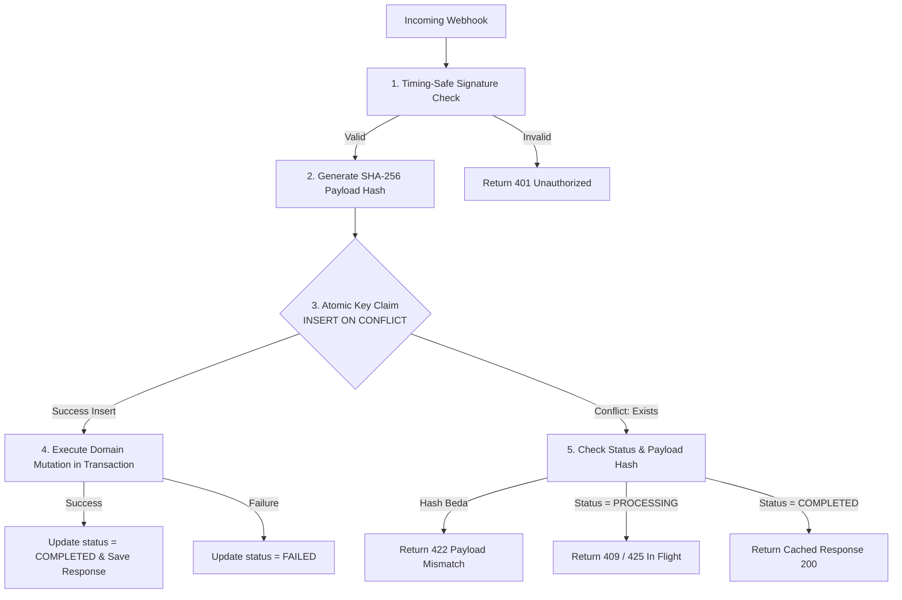

# Webhook Idempotency, Payload Fingerprinting & API Resilience

> **Status:** `CANONICAL REFERENCE`  
> **Parent Skill:** [`api-backend-engineer`](../SKILL.md)  
> **Target Environment:** Node.js / TypeScript, Next.js Route Handlers, Edge Functions  
> **Scope:** Webhook intake, payment processing, retry resilience, and structured error responses.

---

## 1. Two-Phase Distributed Idempotency Engine

Webhook dari payment gateway (Midtrans, Xendit) atau kurir logistik (Biteship, RajaOngkir) dijamin akan mengalami pengiriman berulang (*at-least-once delivery*), pengiriman tertunda, atau tiba tidak berurutan (*out-of-order*).

### 1.1 Skema Tabel Idempotency
```sql
CREATE TABLE IF NOT EXISTS idempotency_keys (
    key VARCHAR(255) PRIMARY KEY,
    payload_hash CHAR(64) NOT NULL, -- SHA-256 fingerprint dari raw body
    status VARCHAR(32) NOT NULL,    -- 'PROCESSING', 'COMPLETED', 'FAILED'
    status_code INTEGER,
    response_body JSONB,
    created_at TIMESTAMPTZ NOT NULL DEFAULT NOW(),
    updated_at TIMESTAMPTZ NOT NULL DEFAULT NOW(),
    expires_at TIMESTAMPTZ NOT NULL DEFAULT (NOW() + INTERVAL '24 hours')
);

CREATE INDEX IF NOT EXISTS idx_idempotency_expires 
ON idempotency_keys (expires_at) 
WHERE status = 'COMPLETED';
```

### 1.2 Pipeline Eksekusi Atomik (Two-Phase Claim)
Setiap mutasi webhook wajib melalui pipeline dua fase berikut:



### 1.3 Verifikasi Kriptografi Timing-Safe
Jangan gunakan perbandingan string biasa (`a === b`) pada verifikasi signature karena rentan *timing attacks*. Gunakan `crypto.timingSafeEqual`:

```typescript
import { createHmac, timingSafeEqual } from "crypto";

export function verifyWebhookSignature(
  rawBody: string | Buffer,
  receivedSignature: string,
  secretKey: string
): boolean {
  const hmac = createHmac("sha256", secretKey);
  hmac.update(rawBody);
  const expectedSignature = hmac.digest("hex");

  const expectedBuffer = Buffer.from(expectedSignature, "utf8");
  const receivedBuffer = Buffer.from(receivedSignature, "utf8");

  if (expectedBuffer.length !== receivedBuffer.length) {
    return false;
  }
  return timingSafeEqual(expectedBuffer, receivedBuffer);
}
```

---

## 2. Monotonic State Machine Invariants

Status pesanan, pembayaran, dan pemenuhan logistik adalah **tiga state machine yang independen**.

```text
PaymentStatus:     [UNPAID] ───────────► [SETTLED] ───────────► [REFUNDED]
OrderStatus:       [DRAFT]  ──► [COMMITTED] ──► [IN_PRODUCTION] ──► [COMPLETED]
FulfillmentStatus: [UNFULFILLED] ──────► [PACKED] ────────► [SHIPPED] ──► [DELIVERED]
```

### Aturan Baku:
1. **Status Pembayaran Bukan Status Produksi:** Menerima event pembayaran `settlement` dari Midtrans/Xendit HANYA memutasi `payment_status = 'SETTLED'`. Transisi ke produksi garmen membutuhkan konfirmasi ketersediaan bahan/blank garment.
2. **Monotonic Progression Guard:** Webhook lama tidak boleh menimpa status yang lebih baru:
   ```sql
   -- Hanya update jika status saat ini masih PENDING
   UPDATE orders 
   SET payment_status = 'SETTLED',
       paid_at = $paid_at,
       updated_at = NOW()
   WHERE id = $order_id 
     AND payment_status = 'PENDING';
   ```

---

## 3. Resiliensi Panggilan Pihak Ketiga & Circuit Breaker

Panggilan keluar ke payment gateway atau kurir wajib dilindungi batas timeout dan circuit breaker agar kegagalan vendor tidak merembet ke sistem internal.

### 3.1 Parameter Default Circuit Breaker
* **Failure Threshold:** 5 kegagalan beruntun dalam jendela 30 detik $\to$ State `OPEN`.
* **Reset Timeout:** 15 detik di state `OPEN` sebelum mencoba 1 probe di state `HALF-OPEN`.
* **Abort Signal:** Setiap panggilan `fetch()` eksternal wajib dipasangi `AbortSignal.timeout(5000)` (5 detik).

---

## 4. Standar Respons Error HTTP: RFC 9457 (Problem Details)

Untuk endpoint REST eksternal dan webhook ingress, gunakan format standar RFC 9457 untuk mempermudah integrasi mesin tanpa membocorkan stack trace internal:

```json
{
  "type": "https://api.bisnishub.com/errors/idempotency-payload-mismatch",
  "title": "Idempotency Key Payload Mismatch",
  "status": 422,
  "detail": "The provided Idempotency-Key was previously used with a different request payload.",
  "instance": "/v1/payments/webhooks/req_8923a1",
  "code": "IDEMPOTENCY_PAYLOAD_MISMATCH",
  "trace_id": "7f8b92c104e8"
}
```
*(Catatan: Untuk Server Actions internal Next.js, tetap gunakan TypeScript discriminated union `{ ok: true, data } | { ok: false, error }`).*
