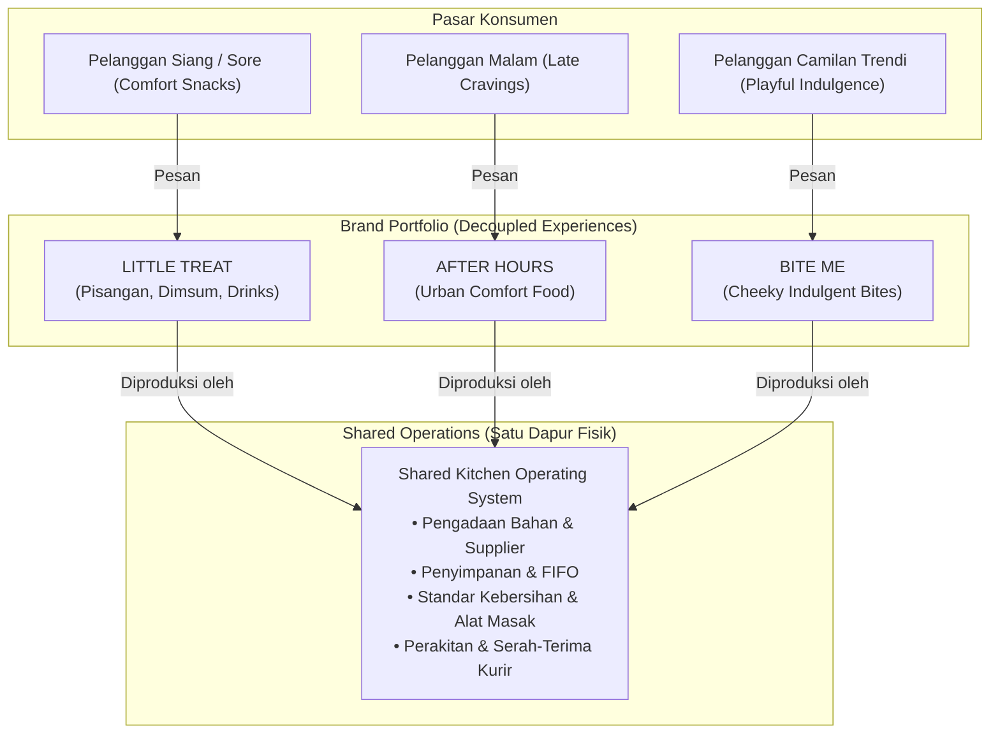

# Food Ventures Master Definition

> [!abstract] **Canonical Definition of the Food Ventures Domain**  
> Dokumen ini merupakan sumber definisi tertinggi untuk domain Food Ventures. Seluruh strategi, perancangan brand, spesifikasi produk, operasional dapur, dan kebijakan finansial dalam domain ini wajib konsisten dengan definisi di bawah ini.

---

## 1. Hakikat dan Tujuan Domain

**Food Ventures** adalah domain pengorganisasian portofolio bisnis kuliner (*Food & Beverage*) di dalam ekosistem BisnisHub yang berfokus pada model **dapur bersama (*shared kitchen*)** dengan pendekatan **pengiriman langsung (*delivery-first*)**.

Tujuan utama dari domain ini adalah:

1. **Menciptakan Efisiensi Modal Tinggi:** Mengoperasikan fasilitas dapur tunggal untuk memproduksi beberapa brand virtual yang memiliki target pasar dan waktu konsumsi berbeda.
2. **Menghilangkan Duplikasi Operasional:** Memusatkan aktivitas non-diferensiasi (pengadaan bahan mentah, penyimpanan bahan, standar kebersihan dapur, penyerahan paket ke kurir) dalam satu payung operasional bersama (*Shared Operations*).
3. **Memaksimalkan Diferensiasi Brand:** Memberikan kebebasan penuh kepada setiap brand untuk membangun persona, gaya visual, rasa produk, kemasan khusus, dan pengalaman pelanggan yang unik tanpa harus menanggung beban fasilitas dapur terpisah.

---

## 2. Invarian Strategis dan Batasan Tegas

Dokumentasi ini menetapkan invarian yang mengikat seluruh aktivitas perencanaan:

```text
BUKAN ENTITAS HUKUM
Food Ventures adalah label domain tata kelola portofolio bisnis internal, bukan nama perseroan terbatas (PT), CV, atau holding company resmi.

BUKAN BRAND KONSUMEN
Nama "Food Ventures" tidak dipublikasikan ke konsumen akhir. Konsumen hanya berinteraksi dengan brand individu (seperti LITTLE TREAT).

STATUS PRE-LAUNCH & PERENCANAAN
Seluruh dokumen dalam domain ini mencerminkan fase eksplorasi dan perancangan awal (PRE-LAUNCH). Belum ada klaim izin usaha resmi, sertifikasi, atau pembukaan gerai yang valid.

KEBIJAKAN PLATFORM BELUM DIVERIFIKASI (NOT VERIFIED)
Pendaftaran beberapa brand virtual pada satu titik lokasi dapur rumahan di platform pesan-antar (GrabFood, GoFood, ShopeeFood) berstatus NOT VERIFIED dan memerlukan validasi regulasi merchant sebelum eksekusi komersial.

BATAS PERANGKAT LUNAK TRANSAKSIONAL
Dokumentasi bisnis ini tidak mendefinisikan ulang skema database, tabel, endpoint API, ataupun mesin transaksi MGBOS.
```

---

## 3. Model Operasional: Shared Kitchen & Decoupled Brands

Food Ventures memisahkan antara **Lapisan Produksi Fisik** dan **Lapisan Pengalaman Konsumen**:



### Prinsip Pemisahan Kepemilikan

- **Resep & Rasa:** Dimiliki secara eksklusif oleh brand. Shared operations bertindak sebagai operator yang mengeksekusi resep sesuai standar toleransi yang disepakati.
- **Kemasan:** Kemasan luar (kantong pengiriman, lakban keamanan) disediakan oleh operasional bersama. Kemasan dalam (stiker, wadah berlogo, kartu ucapan) menjadi tanggung jawab brand.
- **Harga Jual & Margin:** Ditentukan oleh brand berdasarkan biaya bahan baku (HPP) dan target audiensnya.

---

## 4. Portofolio Brand Awal

Portofolio ini memulai perjalanannya melalui brand bertahap:

1. **LITTLE TREAT (Brand Awal / Initial Brand):**
   - **Positioning:** Momen kebahagiaan harian melalui kudapan hangat dan minuman berkualitas (*everyday comfort and small indulgences*).
   - **Kategori Produk:** Pisangan (olahan pisang premium), Dimsum (kukus/goreng gurih), dan Minuman (kopi & non-kopi).
   - **Status:** Brand pertama yang akan divalidasi operasionalnya di dapur bersama.

2. **AFTER HOURS (Brand Tahap Konsep / Future Brand):**
   - **Positioning:** Makanan comfort urban untuk malam hari (*evening cravings & late-night bites*).
   - **Status:** Eksplorasi konsep untuk memanfaatkan kapasitas dapur di luar jam siang.

3. **BITE ME (Brand Tahap Konsep / Future Brand):**
   - **Positioning:** Camilan kekinian yang berani, ekspresif, dan memanjakan (*bold, cheeky, playful, and indulgent*).
   - **Status:** Eksplorasi konsep camilan impulsif dengan daya tarik visual tinggi.

---

## 5. Otoritas Pengambilan Keputusan

Semua keputusan arah strategis portofolio, persetujuan resep yang berdampak pada HPP/margin, identitas visual, dan peluncuran brand berada di bawah otorisasi langsung **Rizky (Owner)**.
