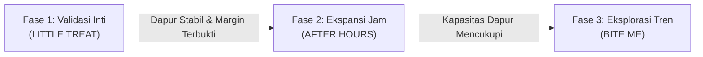

# Food Ventures Multi-Brand Portfolio Architecture

> [!abstract] **Canonical Strategy for Multi-Brand Portfolio Architecture**  
> Dokumen ini memetakan arsitektur portofolio multi-brand kuliner berbasis dapur bersama, rasionalitas sinergi ekonomi antar-brand, dan tahapan peluncuran brand secara berhati-hati (*phased rollout*).

---

## 1. Tesis Strategis: Mengapa Multi-Brand?

Membuka satu gerai kuliner fisik tradisional biasanya membutuhkan modal besar untuk sewa tempat, dekorasi, dan etalase dengan risiko ketergantungan pada satu jenis menu.

**Food Ventures** mengadopsi tesis bisnis alternatif:

```text
1 KITCHEN ASSET
       ↓
MULTIPLE AUDIENCE OCCASIONS
       ↓
OPTIMAL CAPACITY UTILIZATION
       ↓
HIGHER CAPITAL EFFICIENCY
```

Dengan mengoperasikan satu dapur produksi yang efisien, utilitas tetap (listrik, gas, sewa ruang dapur, alat pendingin, deep fryer) dan tenaga kerja produksi dapat diamortisasi ke dalam volume pesanan gabungan dari beberapa brand virtual.

---

## 2. Segmentasi Audiens dan Waktu Konsumsi (Dayparting)

Portofolio dirancang agar brand tidak saling mengkanibalisasi, melainkan mengisi waktu permintaan yang berbeda:

| Brand | Status | Target Occasion | Waktu Operasional Rencana | Karakter Menu |
| :--- | :--- | :--- | :--- | :--- |
| **LITTLE TREAT** | **Initial (Phase 1)** | Camilan sore hingga malam, teman kerja/santai, kudapan keluarga | **Senin–Jumat:** 17:00 – 24:00<br>**Sabtu–Minggu:** 14:00 – 24:00 | Hangat, manis, gurih renyah, minuman pendamping |
| **AFTER HOURS** | **Konsep (Phase 2+)** | Late craving, lembur malam, lapar larut | *PROPOSED / Belum Dikonfirmasi* (Jadwal malam hari belum disahkan) | Urban comfort, gurih pekat, porsi mengenyangkan |
| **BITE ME** | **Konsep (Phase 2+)** | Impulse snacking, tren media sosial, kumpul teman | *PROPOSED / Belum Dikonfirmasi* (Jadwal belum disahkan) | Berani (*bold*), saus variatif, visual kontras |

> [!NOTE]
> Jadwal operasional terencana yang disahkan Owner saat ini hanya berlaku untuk **LITTLE TREAT**. Jam operasional untuk brand masa depan (**AFTER HOURS** dan **BITE ME**) berstatus usulan murni (*PROPOSED / UNCONFIRMED*) dan belum disahkan sebagai keputusan final.

---

## 3. Tahapan Peluncuran Portofolio (Rollout Sequencing)

Untuk memitigasi risiko operasional, pengembangan portofolio mengikuti urutan disiplin:



### Aturan Invarian Penting:
1. **Fokus Tunggal di Fase 1:** Seluruh perhatian dialokasikan untuk menyempurnakan resep, alur penggorengan, ketahanan kemasan pengiriman, dan unit economics **LITTLE TREAT**.
2. **Tidak Ada Dokumentasi Prematur:** Brand AFTER HOURS dan BITE ME dipertahankan sebagai profil konsep ringkas. Dokumentasi rinci (resep, strategi marketing, SOP bahan khusus) baru akan ditulis ketika evaluasi Fase 1 dinyatakan berhasil oleh Owner.
3. **Batas Kapasitas Fisik Dapur:** Jumlah pesanan gabungan per jam tidak boleh melampaui batas keamanan dan kecepatan output alat dapur tunggal.

---

## 4. Kerangka Sinergi Ekonomi Dapur Bersama

Sinergi yang diciptakan oleh model ini mencakup:

- **Pengadaan Bersama (*Consolidated Sourcing*):** Bahan baku netral (minyak goreng berkualitas, tepung dasar, gula, es batu, kemasan luar) dapat dibeli dalam jumlah lebih besar dengan harga grosir lebih murah.
- **Pemanfaatan Tenaga Kerja Efisien:** Operator dapur dapat mempersiapkan bahan setengah jadi (*prep work*) pada pagi hari, melayani pesanan Little Treat pada siang-sore hari, dan beralih ke pesanan malam jika kapasitas memungkinkan.
- **Logistik Pengiriman Terpadu:** Kurir yang menjemput pesanan datang ke satu titik fisik yang jelas dengan standar penyerahan paket yang seragam.

---

## 5. Pertimbangan Kepatuhan Platform (Status: NOT VERIFIED)

> [!WARNING]
> Sebelum mengaktifkan beberapa brand pada alamat dapur yang sama di aplikasi aggregator pihak ketiga, tim wajib memverifikasi:
> - Syarat pendaftaran multi-merchant di satu rekening bank / alamat fisik.
> - Kebijakan verifikasi foto dapur dan papan nama merchant.
> - Ketentuan biaya komisi dan integrasi POS merchant.

Hingga verifikasi resmi diperoleh, portofolio mengasumsikan peluncuran bertahap dimulai dari brand tunggal (LITTLE TREAT).
