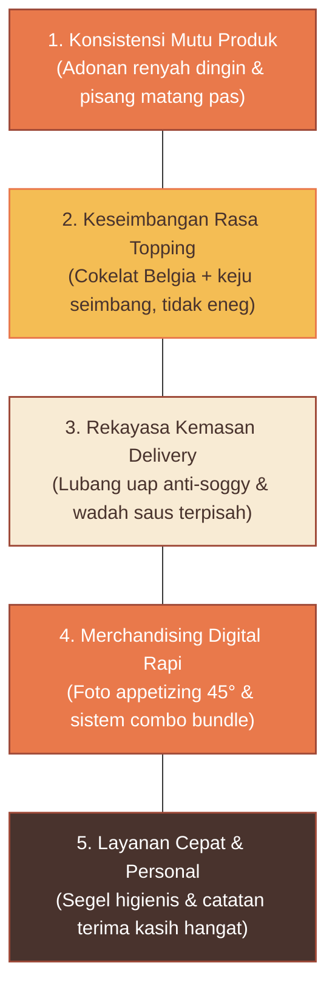

# LITTLE TREAT — Brand Strategy, Positioning & Communication Architecture

> [!abstract] **Strategi Posisioning & Komunikasi Resmi**  
> Dokumen ini mendefinisikan arsitektur posisioning hybrid LITTLE TREAT, rumusan tagline resmi, pemisahan 3 lapisan komunikasi brand, 5 pilar diferensiasi kompetitif, serta batasan strategis (*The Golden Guardrails*).

---

## 1. Arsitektur Posisioning Hybrid (Two-Layer Formula)

Posisioning LITTLE TREAT menggabungkan dua lapisan peran strategis:

```text
┌────────────────────────────────────────────────────────────────────────┐
│                        PRIMARY FOUNDATION                              │
│                   "Everyday Little Indulgence"                         │
│  Fondasi komersial: Aksesibilitas harga, kenyamanan rasa (comfort),     │
│  dan frekuensi pembelian berulang mingguan (mesin cashflow & retensi). │
└──────────────────────────────────┬─────────────────────────────────────┘
                                   │
┌──────────────────────────────────┴─────────────────────────────────────┐
│                       SUPPORTING CHARACTER                             │
│                     "Modern Treat Destination"                         │
│  Sentuhan pembeda: Estetika visual kontemporer, kemasan berventilasi,  │
│  signature treats terkurasi, dan unboxing berkesan (daya saing harga). │
└────────────────────────────────────────────────────────────────────────┘
```

---

## 2. Arsitektur 3 Lapisan Komunikasi Brand

Untuk mencegah tumpang tindih pesan, komunikasi brand dibagi menjadi tiga tingkatan:

| Lapisan Komunikasi | Rumusan Resmi | Target Audiens & Fungsi | Touchpoint Penerapan |
| :--- | :--- | :--- | :--- |
| **1. Brand Tagline** | **`Make Every Day a Little Treat.`** | **Konsumen Luar:** Ajakan emosional singkat pemacu aksi yang mudah diingat. | Kemasan luar, pita segel, bio media sosial, headline iklan. |
| **2. Brand Positioning** | **`Everyday Little Indulgence`** | **Internal & Bisnis:** Menetapkan kuadran pasar, batas harga HPP, dan ritme repeat order. | Dokumen strategi, brief menu baru, evaluasi margin kontribusi. |
| **3. Brand Statement** | **`Your Everyday Destination for Little Moments of Indulgence.`** | **Eksplanatori Lengkap:** Menjelaskan identitas lengkap brand dan perannya di masyarakat. | Profil merchant GoFood/Grab, About Us, proposal kemitraan B2B. |

### Alternatif Pendukung Taktis:
- **Alternatif 02 (`A Little Treat for Every Little Moment.`):** Dialokasikan untuk kartu ucapan, momen hari raya, dan pesan musiman.
- **Alternatif 03 (`Small Moments. Big Smiles.`):** Diadopsi sebagai **Central Design Idea** dan *micro-copy* kemasan.

---

## 3. Lima Pilar Diferensiasi Kompetitif

Menghindari perang harga dan perang topping brutal di pasar lokal (benchmark Ragajaya / Bojonggede):



---

## 4. Batasan Strategis Brand (The Golden Guardrails)

```text
┌────────────────────────────────────────────────────────────────────────┐
│                        THE GOLDEN GUARDRAILS                           │
│                                                                        │
│  • Fun, but not childish: Ceria tanpa terlihat kekanak-kanakan.        │
│  • Stylish, but not pretentious: Menarik tanpa terlihat mahal/angkuh.  │
│  • Affordable, but not cheap: Terjangkau (Rp 16k–20k), bukan murahan.  │
│  • Expressive, but not noisy: Memiliki aksen berani tanpa bising.      │
│  • Modern, but not cold: Bersih kontemporer namun tetap hangat.        │
└────────────────────────────────────────────────────────────────────────┘
```

---

## 5. Pendekatan Segmentasi Pasar (Hipotesis Kebutuhan & Momen)

Pasar sasaran adalah *broad consumer market* berbasis momen konsumsi harian (*need-based & occasion-based*):
1. **Everyday Snacking:** Camilan santai pengganjal lapar sore (15.00–18.00).
2. **Little Reward:** Hadiah kecil penuntas tugas kantor / kuliah (*self-reward*).
3. **Work & Study Companion:** Teman fokus kerja di depan laptop (bersih di tangan).
4. **Sharing Moments:** Porsi sharing keluarga muda dan kumpul teman akhir pekan.
5. **Evening Cravings:** Camilan hangat malam hari (19.00–21.00) bersama kopi/teh.
6. **Casual Treat:** Pembelian spontan saat melihat promo aplikasi delivery.

---
*Dokumen ini merupakan referensi strategi kanonikal LITTLE TREAT.*
