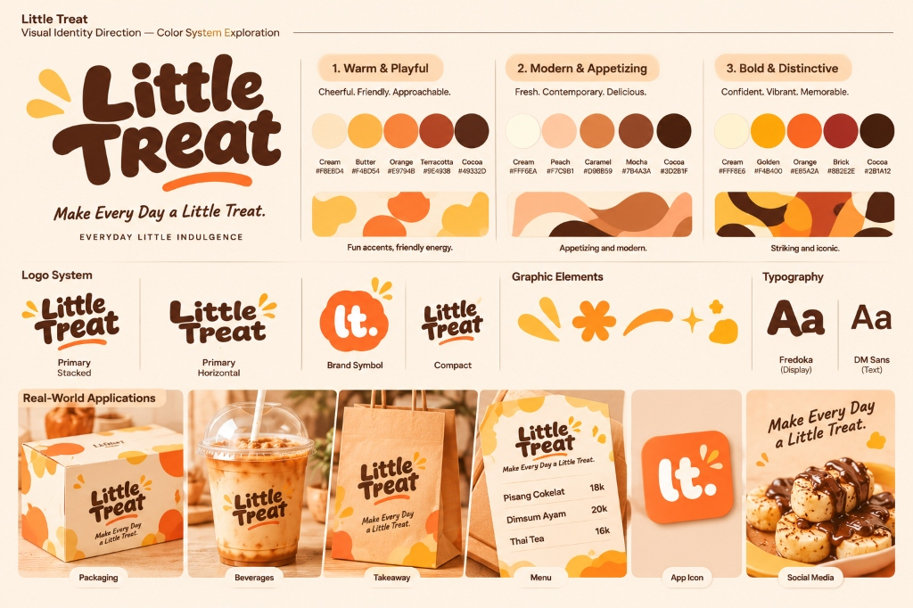
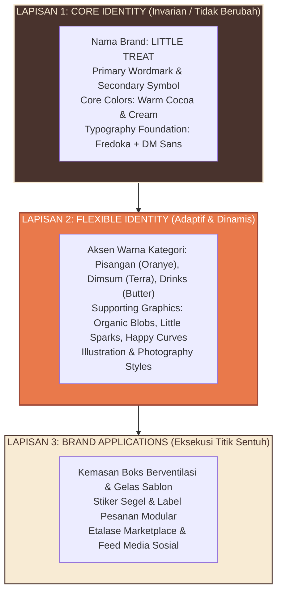

# LITTLE TREAT — Brand Identity System & Design Constitution

> [!abstract] **Konstitusi Desain & Sistem Identitas Visual**  
> Dokumen ini menetapkan arsitektur sistem identitas visual LITTLE TREAT berbasis 3 lapisan (*Core, Flexible, Applications*), 6 prinsip desain mutlak, serta ide desain sentral: **"Small moments. Big smiles."**

---

## Master Brand Identity & Visual System Board



---

## 1. Ide Desain Sentral (Central Design Idea)

```text
┌─────────────────────────────────────────────────────────────┐
│                 SMALL MOMENTS. BIG SMILES.                  │
│                                                             │
│  LITTLE TREAT membuat hal-hal sederhana dalam keseharian    │
│  terasa lebih menyenangkan dan istimewa.                    │
│  Bukan kemewahan palsu. Bukan sekadar makanan murah.        │
│  Tetapi momen kepuasan kecil yang mengundang senyum.        │
└─────────────────────────────────────────────────────────────┘
```

---

## 2. Arsitektur 3 Lapisan Sistem Identitas

Untuk menjamin prinsip *"Consistency without Sameness"* (konsisten tanpa membosankan), identitas dibangun dalam tiga lapis:



---

## 3. Enam Prinsip Desain Mutlak (The 6 Design Principles)

Setiap rancangan kemasan, logo, postingan media sosial, dan materi promosi wajib lolos uji 6 prinsip ini:

1. **Joyful, Not Childish (Ceria Tanpa Kekanak-kanakan):**  
   Hangat dan ramah, namun memiliki proporsi kurva yang matang sehingga tetap diminati orang dewasa dan pekerja kantor.
2. **Appetizing Before Decorative (Menggugah Selera Sebelum Hiasan):**  
   Kelezatan makanan dan keterbacaan menu selalu lebih utama daripada ornamen dekorasi yang ramai.
3. **Distinctive, Not Complicated (Khas Tanpa Rumit):**  
   Bentuk sederhana yang mudah diingat dan tetap tajam saat dicetak satu warna atau ukuran kecil.
4. **Modern, Not Trend-Dependent (Modern Tanpa Bergantung Tren):**  
   Menghindari efek visual musiman internet yang cepat usang dalam 1 tahun.
5. **Accessible, Not Cheap-Looking (Merakyat Tanpa Terkesan Murahan):**  
   Mencerminkan harga bersahabat (Rp 16k–20k) namun dieksekusi dengan standar higienis dan rapi.
6. **Consistent, Not Repetitive (Konsisten Tanpa Monoton):**  
   Memiliki aturan baku warna dan tipografi, namun luwes diterapkan di berbagai media fisik dan digital.

---
*Dokumen ini merupakan konstitusi desain resmi LITTLE TREAT.*
