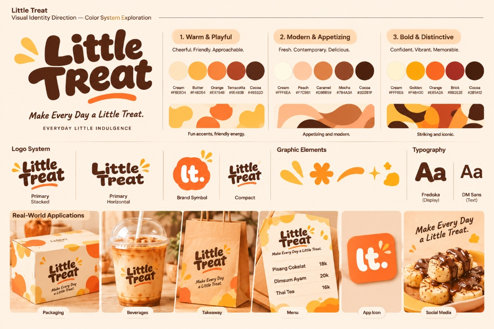

# LITTLE TREAT — Color System & Category Accent Architecture

> [!abstract] **Spesifikasi Palet Warna & Aksentuasi Kategori**  
> Dokumen ini memuat kode warna heksadesimal resmi (*HEX codes*), aturan proporsi 60-30-10, sistem pembeda aksen kategori produk, serta panduan kontras aksesibilitas untuk seluruh materi LITTLE TREAT.

---

## 1. Papan Eksplorasi Sistem Warna Resmi



---

## 2. Palet Warna Resmi (V0.1 Hybrid Formulation)

LITTLE TREAT mengadopsi sintesis palet **Warm & Playful** yang diperkuat sentuhan kedewasaan **Modern & Appetizing**:

### A. Core Brand Palette (Palet Inti)

| Nama Warna | Kode HEX | Swatch | Peran Fungsional & Hierarki |
| :--- | :---: | :---: | :--- |
| **Warm Cocoa** | `#49332D` | 🟫 | **Jangkar Identitas Utama:** Logo utama, tipografi teks, harga menu, garis kontras. Menghilangkan kesan dingin hitam pekat. |
| **Warm Cream** | `#F8EBD4` | 🏻 | **Fondasi Latar Belakang:** Warna dasar karton boks, kertas menu, latar belakang media sosial (*negative space*). |
| **Signature Orange** | `#E9794B` | 🟧 | **Aksen Khas & CTA:** Tombol beli digital, garis lengkung swoosh logo, badge promo utama. |
| **Butter Yellow** | `#F4BD54` | 🟨 | **Energi & Highlight:** Elemen percikan kilau (*sparkles*), stiker pemanis, aksen minuman segar. |
| **Terracotta** | `#9E4938` | 🟫 | **Kedalaman & Variasi:** Elemen bayangan grafis, penyeimbang kehangatan, aksen kudapan gurih (*savory*). |

### B. Supporting Palette (Palet Pendukung Kampanye)
- **Off White (`#FFF9EF`):** Latar belakang bersih untuk layar digital AMOLED / website.
- **Peach (`#F5D5C7`):** Transisi lembut pada ilustrasi ubin kartu menu.
- **Sage Green (`#D9DDAA`):** Aksen musiman untuk varian matcha / ramah lingkungan.
- **Rose Pink (`#E9A5A0`):** Aksen manis edisi terbatas (Valentine, varian stroberi).

---

## 3. Aturan Proporsi Penggunaan Warna (The 60-30-10 Rule)

```text
┌────────────────────────────────────────────────────────────────────────┐
│                      HIERARKI PROPORSI WARNA                           │
│                                                                        │
│   ████████████████████████████████████████    60% Warm Cream / Neutral │
│   (Kanvas utama boks, kertas roti, background)                         │
│                                                                        │
│   ████████████████████                        30% Warm Cocoa           │
│   (Logo, headline, harga, teks deskripsi menu)                         │
│                                                                        │
│   ██████                                      10% Orange, Butter, Terra│
│   (Aksen swoosh, CTA button, sparkles, badge)                          │
└────────────────────────────────────────────────────────────────────────┘
```

> **Anti-Pattern:** Dilarang mewarnai seluruh boks kemasan dengan warna oranye menyala tanpa diimbangi Cream dan Cocoa. Dominasi berlebih menciptakan kelelahan mata (*visual fatigue*) dan menurunkan kesan higienis.

---

## 4. Sistem Aksen Kategori Menu ("One Brand, Multiple Categories")

Untuk menjaga agar LITTLE TREAT tetap terasa sebagai satu brand utuh:
- **Kategori PISANGAN:** Menggunakan aksen **Warm Orange (`#E9794B`)** — merefleksikan kerenyahan emas gorengan dan saus cokelat lumer.
- **Kategori DIMSUM:** Menggunakan aksen **Terracotta (`#9E4938`)** — merefleksikan aroma kukusan bambu hangat dan chili oil gurih.
- **Kategori DRINKS:** Menggunakan aksen **Butter Yellow (`#F4BD54`)** — merefleksikan kesegaran teh susu, kopi dingin, dan pelepas dahaga.

*(Catatan: Aksen hanya diaplikasikan pada label varian dan border kartu menu, bukan mengubah warna master boks kemasan).*

---
*Dokumen ini merupakan spesifikasi warna kanonikal LITTLE TREAT.*
