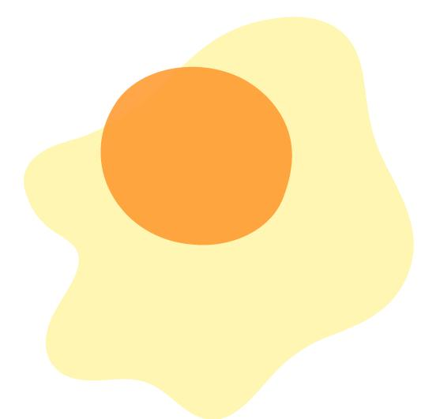
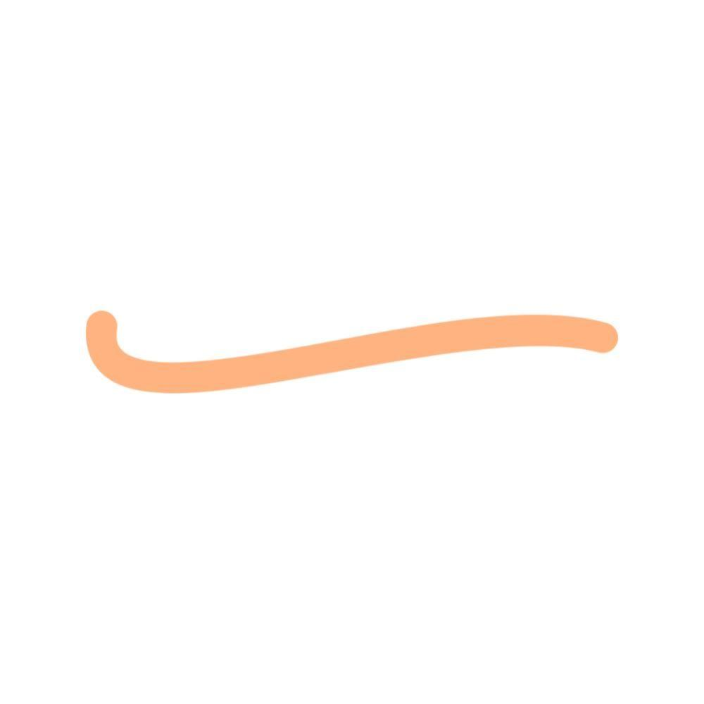
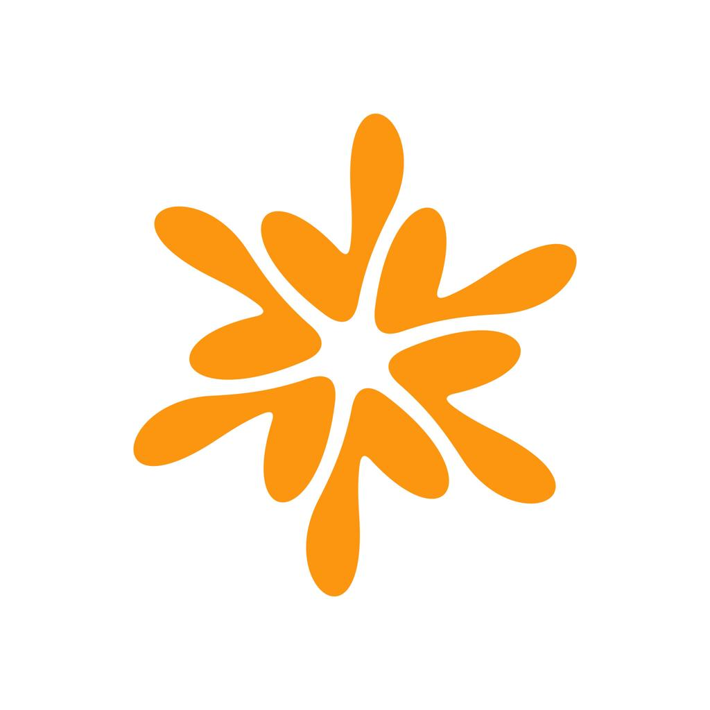
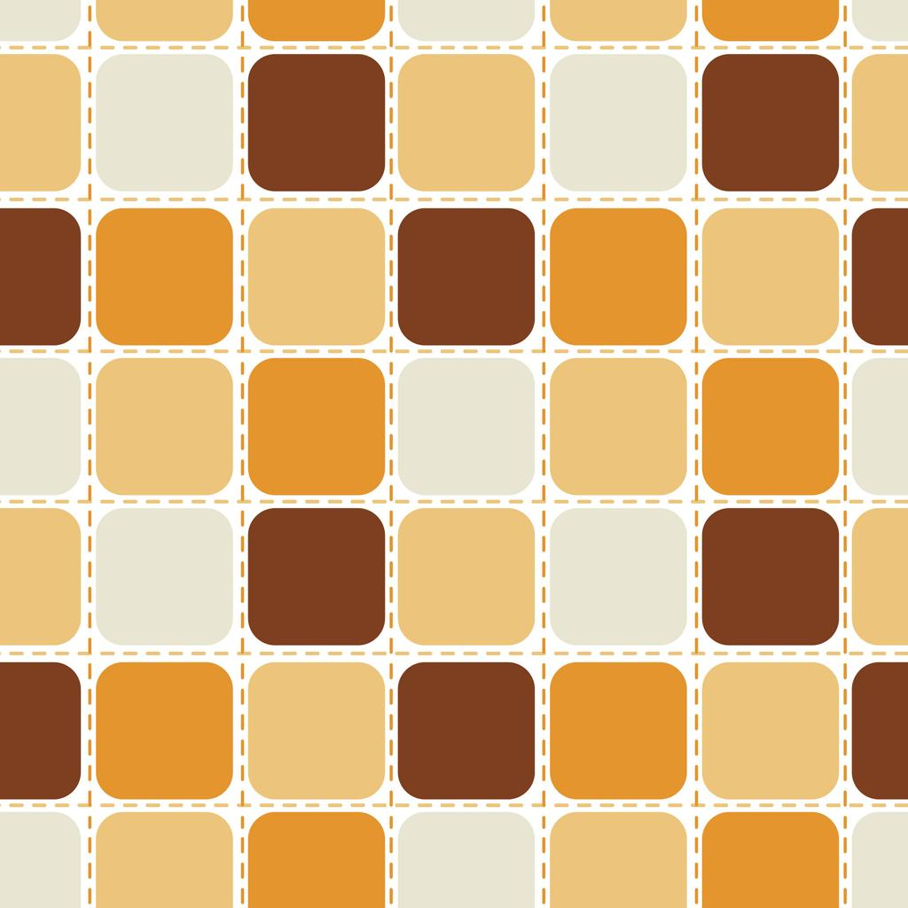
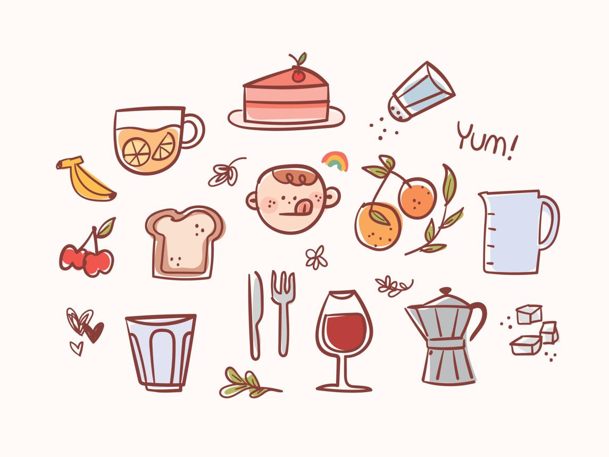
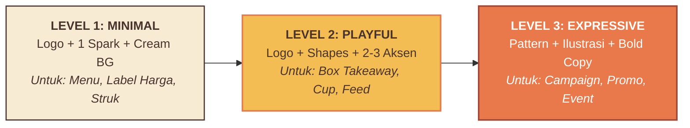

# LITTLE TREAT — Graphic Language & Supporting Elements

> [!abstract] **Kosakata Visual & Elemen Pendukung Brand**  
> Dokumen ini mengatur bentuk-bentuk visual pendukung (*supporting graphics*), pola repetisi kemasan, aset signature eksklusif, serta kerangka kerja 3 tingkat intensitas visual (*3-Level Intensity Framework*) agar LITTLE TREAT dikenali bahkan tanpa logo.

---

## 1. Karakter Utama: Playful Organic

Bahasa grafis LITTLE TREAT dipandu oleh 5 prinsip bentuk:
- **Rounded:** Kurva membulat lembut yang mengundang selera (*appetizing*).
- **Organic:** Bentuk luwes alami adonan kue, pisang matang, dan lelehan cokelat.
- **Playful not Childish:** Ceria dan bersahabat, namun tetap tertata rapi dan modern.
- **Expressive not Cluttered:** Aksen terukur sebagai penunjuk fokus, bukan dekorasi berlebih.
- **Konsisten tapi Fleksibel:** Memiliki aturan baku bentuk dan warna di seluruh touchpoint.

---

## 2. Enam Elemen Grafis Khas (6 Signature Elements)

| No | Elemen Grafis | Fungsi & Aplikasi Utama | Prioritas Penggunaan |
| :-: | :--- | :--- | :---: |
| **01** | **Organic Blobs** | Bentuk cairan/gumpalan bulat tidak beraturan: latar boks, stiker, kontainer teks. | **Tinggi** (Fondasi Harian) |
| **02** | **Little Sparks** | Percikan bintang/sinar kecil 3–4 titik: penanda signature berulang di dekat logo. | **Tinggi** (Fondasi Harian) |
| **03** | **Happy Curves** | Garis lengkung tebal / underline: penunjuk fokus mata & aksen gerakan makanan. | **Menengah** (Penegas Aksen) |
| **04** | **Treat Flowers** | Bunga bulat / asterisk 6 kelopak: aksen dekoratif pemanis kartu menu dan stiker segel. | **Menengah** (Penegas Aksen) |
| **05** | **Pattern System** | Repetisi ritmis bentuk organik ubin: kertas alas roti (*food wrapping*) & paper bag. | **Situasional** (Kemasan Khusus) |
| **06** | **Hand-Drawn Illustrations**| Ilustrasi garis sederhana (*line art*) bersahabat: narasi bahan baku & konten Instagram. | **Situasional** (Storytelling) |

### Visual Showcase Elemen Grafis:
1. **01 — Organic Blobs:**  
   
2. **02 — Little Sparks:**  
   
3. **03 — Happy Curves:**  
   
4. **04 — Treat Flowers:**  
   
5. **05 — Pattern System:**  
   
6. **06 — Hand-Drawn Illustrations:**  
   

> **Aturan Emas:** Logo dan foto makanan adalah **pahlawan utama (*hero*)**. Elemen grafis pendukung bertugas membingkai dan memperkuat nafsu makan, dilarang menenggelamkan produk.

---

## 3. Tiga Aset Grafis Eksklusif Wajib (Proprietary Assets)

1. **The Signature Spark:** Bukan ikon bintang generik Canva. Dirancang kurva vektor kustom dengan proporsi khas Little Treat.
2. **The Organic Box Pattern:** Pola ritmis boks kemasan luar yang estetik, bukan pola repetisi logo murahan (*anti-logo wallpaper*).
3. **Signature Illustration Style:** Ilustrasi berkarakter garis seragam (*fixed stroke*) berwarna Warm Cocoa. Dilarang mencampur 3D render, vektor flat kaku, dan doodle sembarangan.

---

## 4. Kerangka Kerja 3 Tingkat Intensitas Visual (3-Level Intensity)

---
*Dokumen ini merupakan spesifikasi bahasa grafis resmi LITTLE TREAT.*
