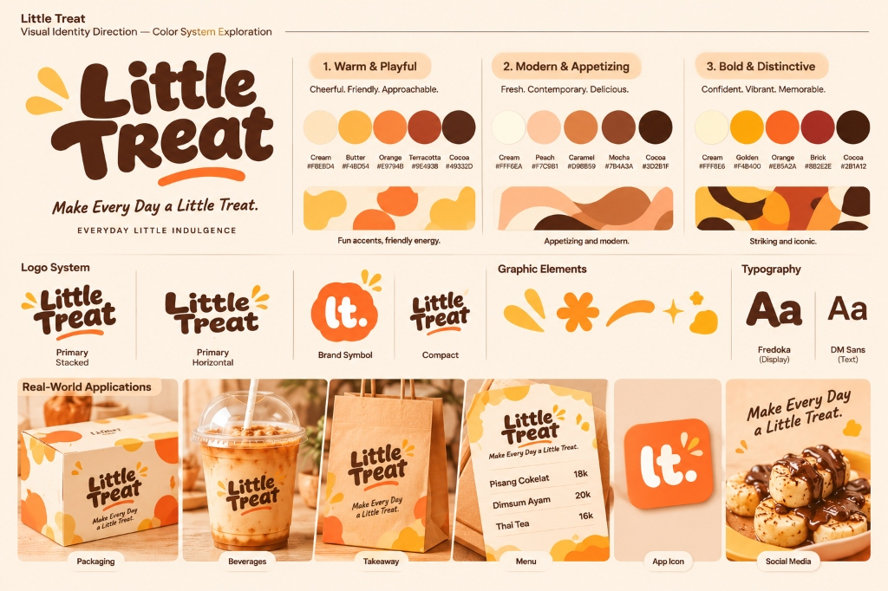
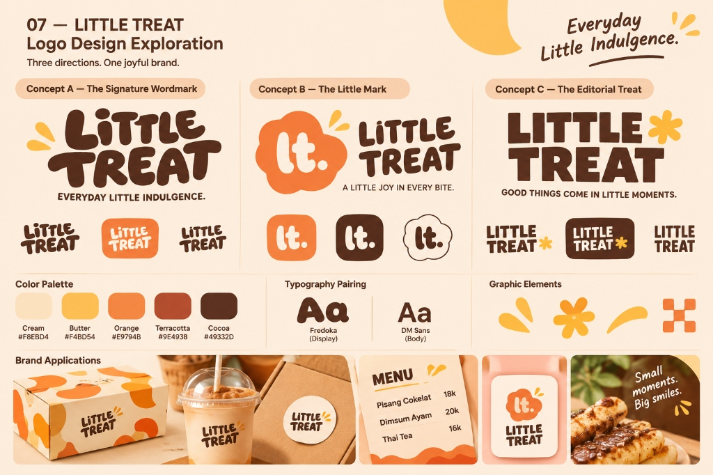
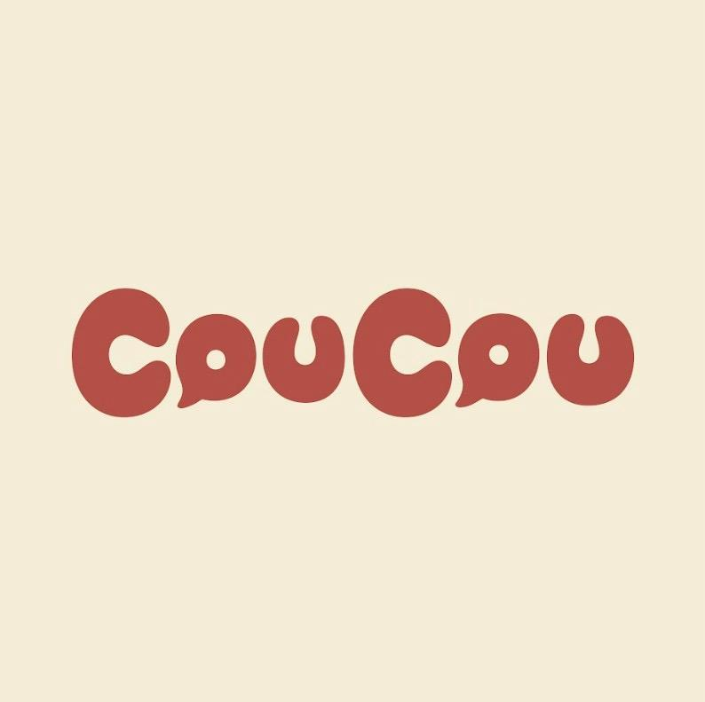
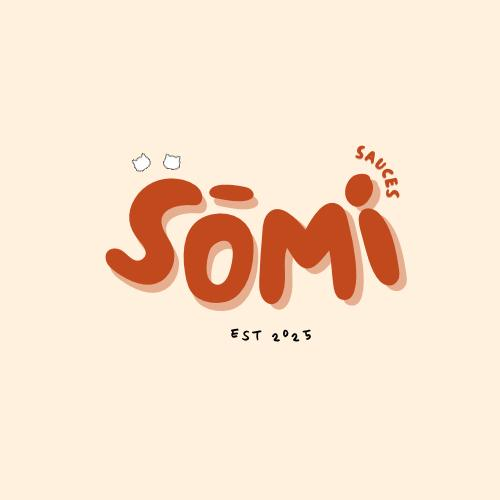
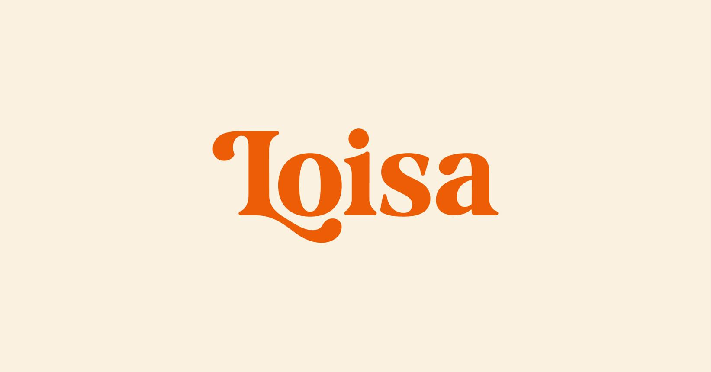

# LITTLE TREAT — Logo System & Construction Guidelines

> [!abstract] **Spesifikasi Teknis Sistem Logo**  
> Dokumen ini mengatur konstruksi vektor, varian penggunaan, hierarki lockup, aturan pemisahan (*decoupling rule*), serta zona aman (*clear space*) untuk sistem logo LITTLE TREAT.

---

## 1. Papan Eksplorasi & Varian Logo Resmi

### A. Master Logo System (Varian Terpilih / Current Candidate)


### B. Eksplorasi Awal Prototype v1 (Status: SUPERSEDED / HISTORICAL BASELINE)


---

## 2. Tiga Komponen Sistem Logo

Sistem logo LITTLE TREAT dirancang modular untuk mengakomodasi berbagai bidang aplikasi fisik dan digital:

### A. Primary Wordmark (Identitas Utama)
- **Konstruksi:** *Custom lettering* membulat (*rounded terminals*), proporsi tebal seimbang, memiliki garis aksen lengkung oranye (*happy swoosh*) di bawah kata "TREAT" dan tiga percikan (*sparks*) di kiri atas.
- **Warna Standar:** Warm Cocoa (`#49332D`) pada latar Warm Cream (`#F8EBD4`).
- **Aplikasi:** Bagian depan boks kemasan takeaway, kop menu kasir, papan nama gerai, dan header website resmi.



### B. Secondary Brand Symbol (Simbol Khas Mandiri)
- **Konstruksi:** Monogram huruf kecil `lt.` dalam siluet awan organik atau kotak membulat (*squircle*) oranye dengan dua percikan kilau kuning mentega.
- **Fungsi:** Bekerja mandiri tanpa teks nama brand.
- **Aplikasi:** Avatar profil GoFood / ShopeeFood (resolusi 32×32 px), stiker segel bulat boks diameter 3 cm, cap stempel kardus, dan bordir celemek crew.



### C. Logo Lockups (Susunan Adaptif)
1. **Vertical / Stacked Lockup:** Wordmark di atas + Tagline *"Make Every Day a Little Treat."* di bawah. (Untuk sisi samping boks delivery dan poster vertikal).
2. **Horizontal Lockup:** Wordmark sejajar berdampingan dengan tagline atau simbol. (Untuk bilah navigasi desktop dan banner horizontal).
3. **Compact Lockup:** Wordmark dipadatkan dalam bingkai badge oval/lingkaran untuk media terbatas.



---

## 3. Aturan Pemisahan Tagline (The Decoupling Rule)

```text
┌────────────────────────────────────────────────────────────────────────┐
│                        THE DECOUPLING RULE                             │
│                                                                        │
│  Tagline "Make Every Day a Little Treat." TIDAK HARUS selalu menempel   │
│  pada logo.                                                            │
│                                                                        │
│  • Gunakan STANDALONE WORDMARK saat:                                   │
│    - Ukuran cetak logo di bawah 40 mm lebar.                           │
│    - Avatar digital dan favicon aplikasi.                              │
│    - Sablon gelas cup bening 16 oz (agar bersih & minimalis).          │
│                                                                        │
│  • Gunakan LOGO LOCKUP saat:                                           │
│    - Media promosi berbidang luas (banner, billboard gerai, boks besar)│
│    - Materi pengenalan brand baru ke audiens yang belum kenal nama kita│
└────────────────────────────────────────────────────────────────────────┘
```

---

## 4. Area Bebas & Ukuran Minimum (Clear Space & Minimum Size)

- **Zona Bebas (Clear Space):** Wajib dikelilingi ruang kosong minimal setinggi huruf "e" pada kata "Little". Tidak boleh ada elemen grafis atau teks lain yang masuk ke zona ini.
- **Ukuran Minimum Cetak (Print Minimum):** Lebar minimal 25 mm untuk Standalone Wordmark; minimal 15 mm diameter untuk Secondary Symbol `lt.`.
- **Ukuran Minimum Digital:** Minimal 120 px lebar untuk Wordmark layar HP; minimal 32×32 px untuk avatar `lt.`.

---
*Dokumen ini merupakan spesifikasi logo resmi LITTLE TREAT.*
