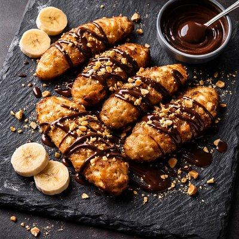
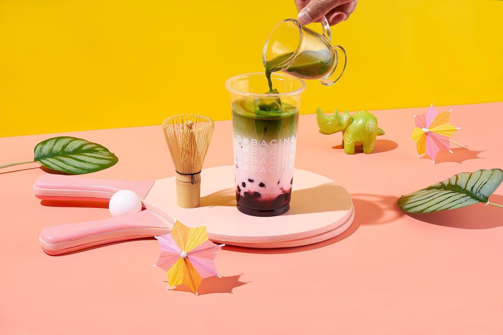
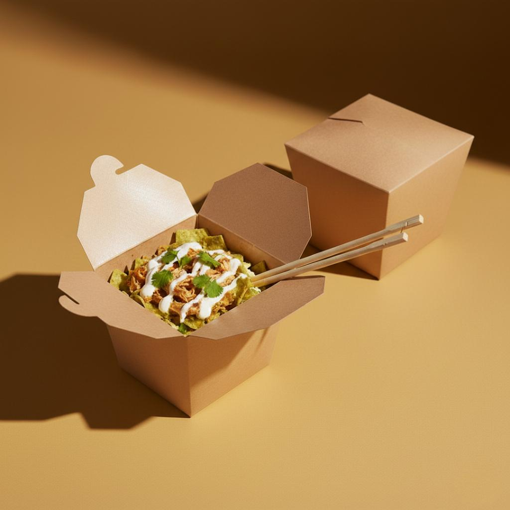
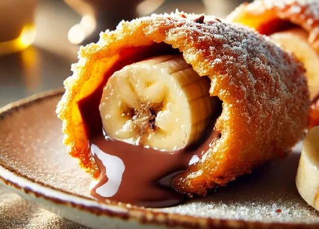
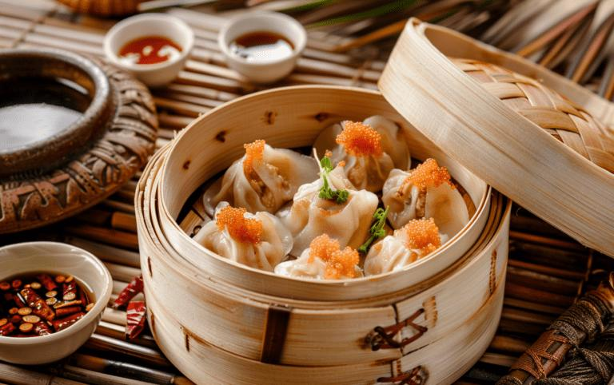
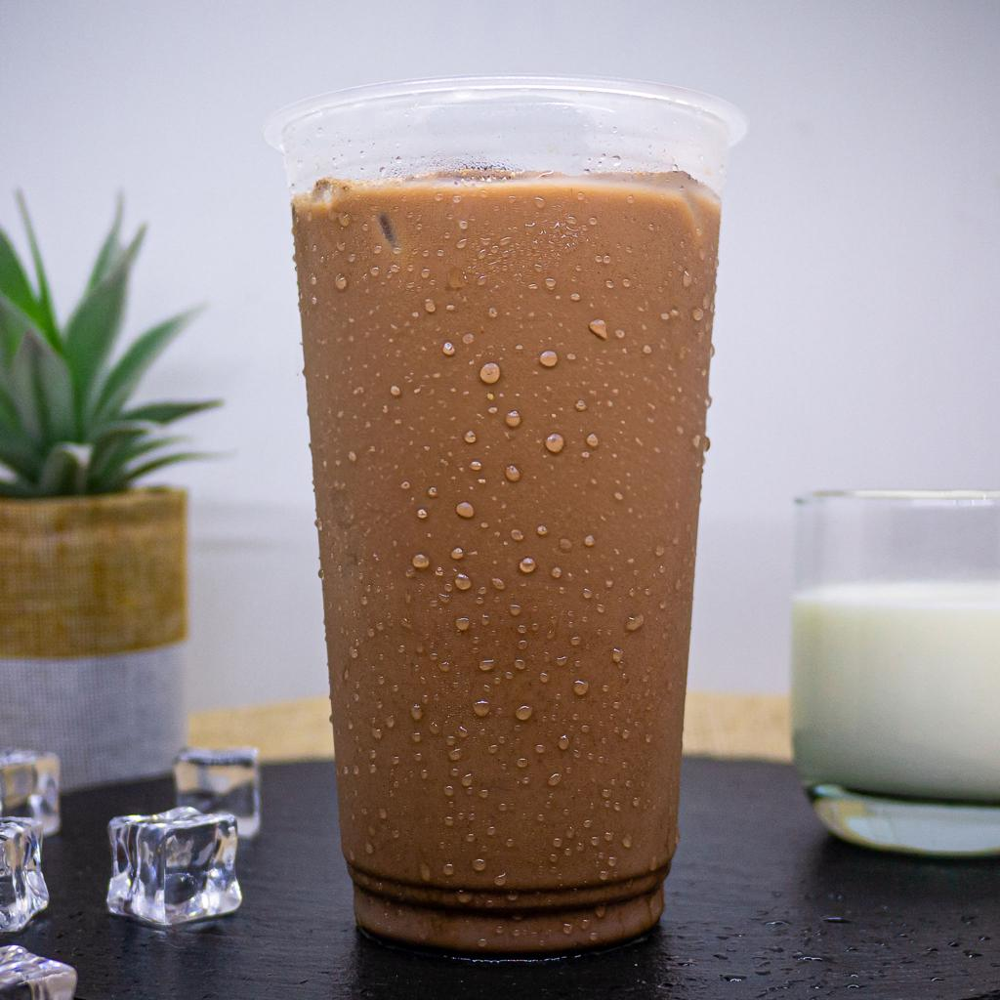

# LITTLE TREAT — Photography Standards & Art Direction Guidelines

> [!abstract] **Panduan Fotografi Produk & Pengarah Seni Visual**  
> Dokumen ini menetapkan standar fotografi produk (*Delicious Little Moments*), matriks 6 jenis shot wajib, panduan pencahayaan dan food styling per kategori menu, sistem studio mini berbiaya rendah (*lean photo setup*), serta aturan integritas visual (*Truth in Advertising*).

---

## 1. Konsep Utama: Delicious Little Moments

> **Mandat:** *"Make It Look Irresistible."*  
> Dalam bisnis food delivery, foto adalah instrumen pemicu nafsu makan (*appetite driver*). Konsumen memutuskan membeli sebelum mencicipi produk secara fisik.

### Tiga Pilar Karakter Visual:
1. **Appetizing:** Makanan terlihat nyata, lezat, berkilau alami, dan memicu keinginan mencicipi seketika.
2. **Playful:** Komposisi memiliki energi ceria dan kepribadian bersahabat.
3. **Contemporary:** Penataan bersih, pencahayaan alami, bernuansa kafe modern, dan terbebas dari katalog jadul.

---

## 2. Tiga Gaya Fotografi Sesuai Saluran

- **A — Product Craving (Fondasi Utama):** Close-up tekstur renyah (*crispy crust*), lelehan cokelat kental (*glossy chocolate drizzle*), keju parut melimpah, dan uap basah dimsum. Dikhususkan untuk menu GoFood, GrabFood, ShopeeFood, dan etalase website.
  

- **B — Playful Lifestyle (Persona & Engagement):** Interaksi tangan manusia mengambil makanan dari boks kemasan dengan warna ceria dinamis untuk Instagram Feed/Reels dan TikTok.
  

- **C — Everyday Editorial (Penyeimbang Elegan):** Background minimalis, pencahayaan samping alami, dan *negative space* luas untuk materi website dan narasi brand.
  

---

## 3. Matriks Standar 6 Shot Fotografi Produk

| Jenis Shot | Sudut Kamera | Fungsi Bisnis | Spesifikasi Komposisi |
| :--- | :---: | :--- | :--- |
| **1. Hero Product** | 45° *(Eye-Level)* | Pemicu nafsu makan utama di aplikasi ojol | Makanan di atas piring/boks terbuka, fokus depan tajam, latar sedikit blur. |
| **2. Product Overview**| 45° atau 90° | Memperlihatkan porsi & kelengkapan isi | Menampilkan porsi utuh (5–6 potong pisang bertabur topping) untuk transparansi pembeli. |
| **3. Texture Detail** | Macro Close-up | Membuktikan kerenyahan & kelezatan bahan | Sorotan makro pada remah tepung garing, lelehan saus, atau serat daging dimsum. |
| **4. Product & Pack** | 30° – 45° | Validasi kualitas kemasan takeaway | Makanan matang bersanding dengan boks Takeaway LITTLE TREAT berstiker segel. |
| **5. Lifestyle** | Dinamis | Membangun resonansi emosional santai | Tangan mencelupkan pisang ke saus atau tangan memegang cup dingin. |
| **6. Bundle / Combo** | 45° Sudut Lebar| Mendorong kenaikan nilai keranjang (AOV) | Paket *Pisangan + Thai Tea* atau *Pisangan + Dimsum* dalam satu bingkai harmonis. |

> [!CAUTION]
> **Aturan Integritas Produk (*Truth in Advertising*):**  
> Foto wajib merefleksikan produk yang **benar-benar diterima konsumen**. Dilarang menggunakan prop kimia palsu atau manipulasi porsi berlebih yang berujung kekecewaan dan ulasan buruk pelanggan.

---

## 4. Art Direction Spesifik Tiap Kategori Menu

- **PISANGAN (Golden & Indulgent):**  
  Menonjolkan lapisan luar kuning keemasan (*golden crust*), remahan tepung garing bergerigi, kilau lelehan cokelat kental, dan taburan keju cheddar parut melimpah di atas latar Warm Cream.
  

- **DIMSUM (Juicy & Savory):**  
  Menonjolkan kulit dimsum tipis transparan berkilau uap lembap (*moist steamed texture* — **dilarang terlihat kering/layu**), daging montok, dan celupan chili oil gurih di wadah kukusan bambu.
  

- **DRINKS (Fresh & Refreshing):**  
  Menonjolkan gradasi warna teh susu dingin, butiran es batu bening, embun air dingin (*condensation droplets*) di dinding luar cup transparan, dan sedotan steril.
  

---

## 5. Sistem Studio Mini Berbiaya Rendah (Lean Photo Setup)

1. **Kamera:** Smartphone kamera Pro (kunci exposure & white balance 5200K–5600K).
2. **Stabilitas:** Tripod meja stabil (Rp 100k) untuk mencegah foto kabur/goyang.
3. **Pencahayaan:** Cahaya jendela alami pagi/sore + tirai tipis putih sebagai diffuser alami.
4. **Reflektor:** Styrofoam putih (Rp 20k) untuk mengisi bayangan gelap di sisi sebaliknya.
5. **Alas Foto:** Vinyl motif semen krem dan kayu hangat (Rp 75k).
6. **Paket Wajib per SKU (Cukup 4 Shot):** Hero (45°), Detail Macro, Overview Top-Down, dan Serving boks.

---
*Dokumen ini merupakan panduan fotografi kanonikal LITTLE TREAT.*
