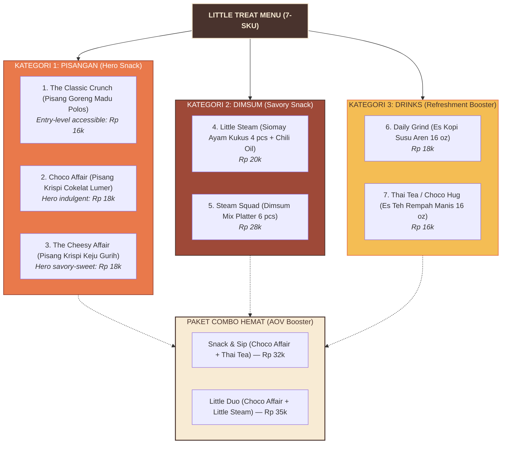

# LITTLE TREAT — Menu Architecture & Lean Launch Portfolio

> [!abstract] **Arsitektur Menu & Portofolio Peluncuran Ramping (7-SKU)**  
> Dokumen ini membakukan struktur hierarki penamaan produk (*Hybrid Naming Format*), batas 3 kategori produk awal (*Pisangan, Dimsum, Drinks*), 7 aturan penamaan menu, serta portofolio peluncuran 7-SKU yang dirancang ramping untuk efisiensi dapur solopreneur.

---

## 1. Format Penamaan Hibrida (The Hybrid Naming Format)

Untuk memadukan daya tarik emosional brand modern dengan kejelasan fungsional di aplikasi ojek online, seluruh menu menggunakan format standar:

```text
┌────────────────────────────────────────────────────────────────────────┐
│                        HYBRID NAMING FORMULA                           │
│                                                                        │
│        [Signature Name]  —  [Clear Product Descriptor]                 │
│                                                                        │
│  Contoh:                                                               │
│  • Choco Affair — Pisang Krispi Cokelat Belgia Lumer                   │
│  • The Cheesy Affair — Pisang Krispi Keju Cheddar Melimpah             │
│  • Little Steam — Siomay Ayam Udang Kukus Lembut                       │
│  • Daily Grind — Es Kopi Susu Gula Aren Spesial                        │
└────────────────────────────────────────────────────────────────────────┘
```

- **Bagian Depan (*Signature Name*):** Membangun ekuitas brand unik yang dapat dipatenkan dan mudah diingat konsumen.
- **Bagian Belakang (*Product Descriptor*):** Membantu algoritma pencarian aplikasi (SEO delivery app) dan memperjelas ekspektasi rasa pembeli.

---

## 2. Portofolio Peluncuran Ramping (7-SKU Lean Launch Assortment)

Mencegah penumpukan bahan baku dan kerumitan persiapan dapur dengan membatasi peluncuran perdana pada 7 SKU terkurasi:



---

## 3. Tujuh Aturan Penamaan Produk (The 7 Naming Rules)

1. **Format Hibrida Wajib:** Nama signature wajib diikuti deskriptor fungsional.
2. **Singkat & Ringkas:** Nama signature maksimal 3 kata agar tidak terpotong di layar HP.
3. **Mencerminkan Janji Rasa:** Menggunakan kata-kata yang membangkitkan selera (*Crunch, Steam, Affair, Daily*).
4. **Bebas Singkatan Alay:** Dilarang menggunakan singkatan membingungkan (misal: *Pisgor Cokju Lum*).
5. **Standarisasi Ukuran:** Porsi diseragamkan (*Personal Box 5–6 pcs, Sharing Box 10–12 pcs*).
6. **Harmoni Lintas Kategori:** Nama kategori wajib menggunakan istilah pendek yang ramah: **Pisangan**, **Dimsum**, **Drinks**.
7. **Perlindungan Hak Cipta:** Nama signature harus unik dan tidak menjiplak nama dagang kompetitor terdaftar.

---
*Dokumen ini merupakan arsitektur menu kanonikal LITTLE TREAT.*
