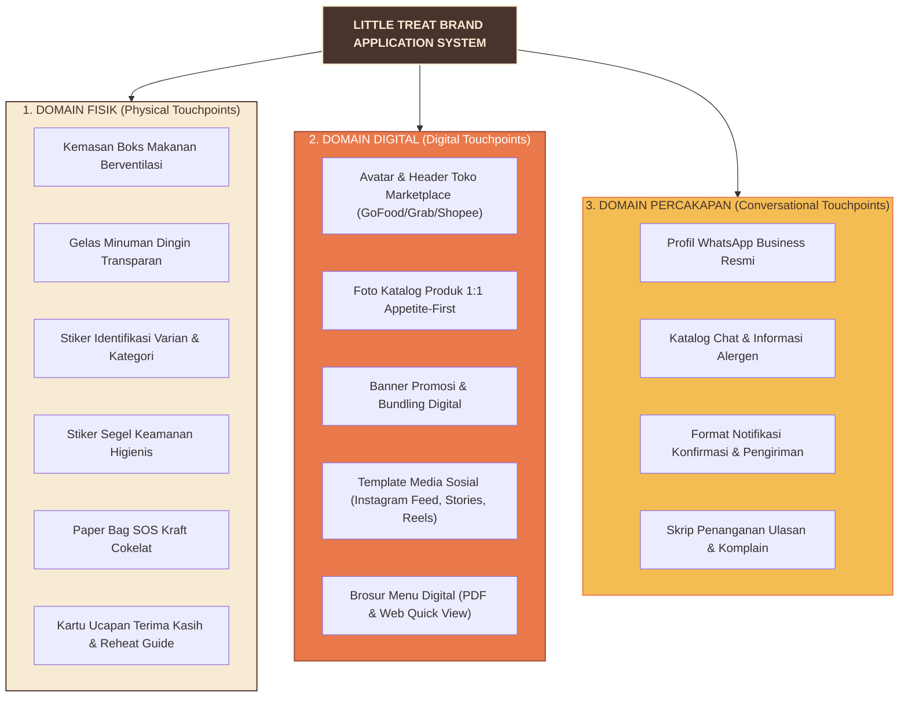

# LITTLE TREAT — Brand Application Architecture & System Touchpoints

> [!abstract] **Arsitektur Aplikasi Merek & Titik Sentuh Sistem**  
> Dokumen ini menetapkan taksonomi seluruh titik sentuh (*touchpoint taxonomy*), hierarki prioritas aplikasi primer versus sekunder, matriks kebutuhan wajib peluncuran versus opsional, serta 4 aturan invarian visual lintas aplikasi guna memastikan konsistensi merek LITTLE TREAT di dunia nyata tanpa membebani modal awal solopreneur.

---

## 1. Taksonomi & Klasifikasi Kategori Aplikasi Merek

Pengalaman konsumen terhadap LITTLE TREAT dirancang melalui tiga domain sentuhan:



---

## 2. Peta Prioritas Titik Sentuh (Primary vs. Secondary)

Tidak semua materi aplikasi memiliki urgensi yang sama pada fase awal. Pembagian prioritas dilakukan secara ketat untuk melindungi fokus dan modal kerja:

| Tingkat Prioritas | Definisi & Karakteristik | Aplikasi yang Termasuk | Rasionalitas Bisnis |
| :--- | :--- | :--- | :--- |
| **Primer (*Primary Touchpoints*)** | **Frekuensi Tinggi & Penentu Konversi:** Dilihat atau dipegang langsung oleh 100% konsumen saat memesan dan menerima makanan. | 1. Boks berventilasi polos + stiker label produk.<br>2. Stiker segel anti-rusak (*tamper seal*).<br>3. Cup dingin + stiker logo bulat.<br>4. Avatar & Banner toko GoFood/ShopeeFood.<br>5. Foto katalog hero produk 45°.<br>6. Profil & format pesan WhatsApp. | Kegagalan pada titik primer langsung merusak kepercayaan, kesegaran makanan, atau konversi checkout. |
| **Sekunder (*Secondary Touchpoints*)** | **Frekuensi Kondisional & Penguat Loyalitas:** Hadir pada pesanan tertentu (misal: pesanan kombo banyak atau pesanan berulang). | 1. Paper bag kraft cokelat berstempel brand.<br>2. Kartu ucapan terima kasih A6 & panduan reheat.<br>3. Template postingan edukasi Instagram.<br>4. Menu meja lipat (*table tent*) untuk gerai offline. | Mempercantik pengalaman unboxing dan mendorong pesanan ulang, namun tidak membatalkan kelayakan operasional hari pertama. |

---

## 3. Matriks Kebutuhan Peluncuran: Wajib vs. Opsional

```text
┌────────────────────────────────────────────────────────────────────────┐
│                   LAUNCH READINESS MATRIX (MVP GATE)                   │
├──────────────────────────────────┬─────────────────────────────────────┤
│   APLIKASI WAJIB (DAY-1 GATE)    │     APLIKASI OPSIONAL (FASE 2)      │
├──────────────────────────────────┼─────────────────────────────────────┤
│ • Boks kraft ventilasi uap       │ • Paper bag kraft berlogo sablon    │
│ • Stiker label produk & kategori │ • Boks custom cetak pabrik (offset) │
│ • Stiker segel higienis          │ • Roll film sealer cup custom       │
│ • Cup bening 16 oz + stiker lt.  │ • Kartu loyalitas cetak             │
│ • Foto menu 7-SKU aplikasi delivery│ • Seragam celemek bordir crew     │
│ • Avatar & Cover GoFood/Shopee   │ • Papan nama toko akrilik neon box  │
│ • Profil WhatsApp Business       │ • Merchandise stiker pack & enamel  │
└──────────────────────────────────┴─────────────────────────────────────┘
```

---

## 4. Empat Aturan Invarian Visual Lintas Aplikasi

Setiap materi yang diproduksi wajib mematuhi 4 aturan invarian berikut tanpa pengecualian:

### Invarian 1: Payung Merek Tunggal (*Single Master Brand Invariant*)
```text
LITTLE TREAT adalah satu-satunya entitas merek yang dikenal publik.
Dilarang menciptakan logo, identitas terpisah, atau nama sub-brand mandiri
untuk "Pisangan", "Dimsum", atau "Drinks". Seluruh produk adalah lini menu
dari LITTLE TREAT.
```

### Invarian 2: Proporsi Warna 60-30-10 (*Color Balance Invariant*)
- **60% Latar Netral / Warm Cream (`#F8EBD4`) atau Kraft Cokelat Alami:** Memberikan kesan bersih, lapang, higienis, dan hangat.
- **30% Jangkar Warm Cocoa (`#49332D`):** Menjamin keterbacaan tajam pada teks nama produk, angka harga, dan logo utama.
- **10% Aksen Energi (Orange `#E9794B`, Butter `#F4BD54`, Terra `#9E4938`):** Hanya sebagai aksen penunjuk fokus (CTA tombol, swoosh logo, badge promo, dan aksen pembeda kategori).
- *Pantangan:* Dilarang mewarnai seluruh boks kemasan dengan warna oranye menyala tanpa peredam warna krem/cokelat.

### Invarian 3: Tipografi Ganda (*Dual-Engine Typography Invariant*)
- **Fredoka:** Khusus display headline singkat, nama kategori, dan nama produk signature.
- **DM Sans:** Khusus angka harga tebal (*Bold*), deskripsi rasa, instruksi penyajian, dan komunikasi microcopy.
- *Pantangan:* Maksimal 2 keluarga font. Dilarang menggunakan Fredoka untuk paragraf lebih dari 2 baris.

### Invarian 4: Kelezatan Makanan Sebagai Pahlawan (*Product-First Appetite Invariant*)
- Foto produk makanan asli yang menggugah selera (*craveable*) selalu menjadi elemen dominan pada media promosi dan kemasan.
- Elemen grafis (blobs, sparks, curves) berfungsi sebagai pembingkai (*framing*), dilarang menutupi atau mengalihkan perhatian dari makanan utama.

---

## 5. Mekanisme Identitas Kategori Tanpa Memecah Merek

Untuk membedakan jenis makanan dengan cepat di dapur dan di mata konsumen, diterapkan sistem pembeda aksen kategori:

| Kategori Menu | Peran Menu | Warna Aksen Kategori | Kode HEX | Aplikasi Fisik & Digital |
| :--- | :--- | :--- | :---: | :--- |
| **PISANGAN** | Hero Snack (Kudapan Manis Hangat) | **Signature Orange** | `#E9794B` | Baris warna pada stiker boks, border kartu menu digital, tombol CTA. |
| **DIMSUM** | Savory Anchor (Kudapan Gurih Lembap) | **Terracotta** | `#9E4938` | Baris warna pada boks lunch box, label cup saus klip chili oil. |
| **DRINKS** | Transaction Booster (Pelepas Dahaga Dingin) | **Butter Yellow** | `#F4BD54` | Aksen stiker cup minuman, label sedotan, badge promo bundling. |

> [!IMPORTANT]
> **Aturan Penerapan Aksen:**  
> Aksen warna kategori hanya disematkan pada elemen penanda (misal: pita warna setinggi 6 mm pada stiker label atau badge nama menu di aplikasi). Master logo LITTLE TREAT tetap mempertahankan warna standarnya: **Warm Cocoa (`#49332D`)** pada latar Warm Cream atau oranye.

---

*Dokumen ini merupakan arsitektur aplikasi kanonikal LITTLE TREAT.*
