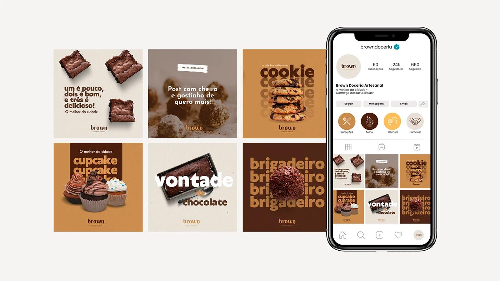

# LITTLE TREAT — Marketplace Storefront & Digital Listing System

> [!abstract] **Sistem Etalase Marketplace & Penataan Katalog Digital**  
> Dokumen ini membakukan standar visual dan arsitektur etalase online LITTLE TREAT pada platform pesan-antar makanan digital (*GoFood, GrabFood, ShopeeFood*). Mengatur avatar profil toko, banner cover etalase, spesifikasi foto listing produk 1:1, format judul ramah algoritma (*search-optimized title*), tata urutan konversi menu, serta struktur add-on pendorong margin.

---

## 1. Identitas Visual Profil Toko (Store Profile Assets)



### A. Avatar Toko (*Store Profile Icon*)
- **Rasio & Resolusi:** 1:1 Square / Circle (Rekomendasi platform: 500 × 500 px, minimum terbaca di 32 × 32 px pada layar ponsel).
- **Elemen Grafis:** Siluet kotak membulat (*squircle*) oranye hangat (`#E9794B`) dengan monogram huruf kecil `lt.` warna Warm Cream (`#F8EBD4`) dan dua percikan kilau mentega (`#F4BD54`).
- **Alasan Desain:** Monogram `lt.` jauh lebih mudah dikenali dalam ukuran lingkaran mikro di daftar merchant aplikasi ojol dibandingkan memaksakan teks panjang "LITTLE TREAT".

### B. Banner Sampul Toko (*Store Header / Cover Banner*)
- **Rasio & Resolusi:** 16:9 atau 2:1 (Sesuai ketentuan platform: 1080 × 540 px atau 1200 × 675 px).
- **Komposisi:**  
  - Sisi Kiri: Master Wordmark *LITTLE TREAT* + Tagline *"Make Every Day a Little Treat."*.
  - Sisi Kanan: Foto komposisi hangat boks takeaway terbuka (pisang cokelat lumer) bersanding dengan segelas Thai tea dingin.
  - Latar Belakang: Warm Cream (`#F8EBD4`) dengan aksen kurva lengkung oranye lembut.

---

## 2. Struktur Urutan Konversi Etalase (Menu Sequence Architecture)

Mata pengguna aplikasi delivery bergerak cepat. Menu diatur berdasarkan hierarki konversi belanja:

```text
┌────────────────────────────────────────────────────────────────────────┐
│               HIERARKI URUTAN ETALASE MARKETPLACE                      │
├────────────────────────────────────────────────────────────────────────┤
│  1. 🔥 REKOMENDASI TERLARIS (BESTSELLERS)                              │
│     Menampilkan 2 pahlawan utama: Choco Affair & Little Steam Dimsum   │
│                                                                        │
│  2. ⚡ PAKET COMBO HEMAT (AOV BOOSTER)                                 │
│     Snack & Sip (Pisang + Es Thai Tea), Little Duo (Pisang + Dimsum)   │
│                                                                        │
│  3. 🍌 PISANGAN SIGNATURE (KUDAPAN MANIS KRISPI)                       │
│     The Classic Crunch, Choco Affair, The Cheesy Affair                │
│                                                                        │
│  4. 🥟 DIMSUM HANGAT (KUDAPAN GURIH & SAUS)                            │
│     Little Steam (4 pcs), Steam Squad (6 pcs Sharing)                  │
│                                                                        │
│  5. 🥤 DRINKS & REFRESHERS (MINUMAN SEGAR DINGIN)                      │
│     Daily Grind Es Kopi Aren, Thai Tea Dingin, Choco Hug               │
│                                                                        │
│  6. ➕ EKSTRA TOPPING & SAUS TAMBAHAN                                  │
│     Ekstra Dipping Cokelat Belgia (+4k), Ekstra Chili Oil (+3k)        │
└────────────────────────────────────────────────────────────────────────┘
```

---

## 3. Spesifikasi Foto Listing Produk (Product Image Framework)

Foto produk adalah faktor nomor 1 yang menentukan apakah konsumen mengklik tombol beli atau keluar mencari merchant lain:

| Parameter | Spesifikasi Standar | Aturan Khusus Platform |
| :--- | :--- | :--- |
| **Format Rasio** | 1:1 Square (1080 × 1080 px) | Format JPG/PNG berlatar bersih dengan kontras tinggi. |
| **Proporsi Makanan** | Minimal 80% area bingkai terisi makanan | Menghindari ruang kosong berlebih yang membuat porsi terlihat pelit. |
| **Sudut Kamera** | 45° Hero Angle dengan fokus tajam | Tekstur lelehan saus, parutan keju, dan kerapian kulit gorengan terlihat jelas. |
| **Konteks Merek** | Stiker segel atau boks kemasan terlihat sedikit di sudut | Memberikan bukti bahwa makanan disajikan secara higienis dan rapi. |
| **Larangan Teks Berlebih (*No Heavy Text Clutter*)** | **Dilarang memasang teks promosi besar menutupi foto** | Algoritma GrabFood dan GoFood menurunkan peringkat foto yang dipenuhi teks banner diskon (*ad penalty*). |

---

## 4. Formula Judul & Template Deskripsi Produk (Listing Templates)

### A. Rumus Penulisan Judul Produk (Search-Optimized Title Formula):
```text
[Nama Signature] - [Deskriptor Bahan/Rasa] ([Jumlah/Porsi])
```
- *Contoh 1:* **Choco Affair - Pisang Krispi Cokelat Lumer (5-6 pcs)**
- *Contoh 2:* **Little Steam - Dimsum Siomay Ayam Kukus + Chili Oil (4 pcs)**
- *Contoh 3:* **Snack & Sip - Choco Affair + Es Thai Tea Dingin**

### B. Template Deskripsi Menu (Listing Description):
```text
[Hook Emosional Singkat - 1 Baris]
Pisang krispi renyah berlapis saus cokelat kental hangat yang lumer di mulut.

[Detail Porsi & Penyajian]
• Isi: 5–6 potong pisang matang pilihan (porsi personal).
• Topping: Saus cokelat rich blend melimpah.
• Disajikan hangat dalam boks food-grade berventilasi anti-lembek.
• Sudah termasuk stiker segel higienis.

[Saran Pairing]
Pas banget dinikmati bareng Es Thai Tea atau Kopi Susu Aren kita!
```

---

## 5. Tata Kelola Varian & Add-On Pendorong Margin

Untuk memaksimalkan margin kontribusi (*upsell*):

1. **Pilihan Wajib (*Mandatory Options*):**
   - Tingkat Kemantapan Saus: *Saus Disiram Langsung (Ready to Eat)* ATAU *Saus Dipisah di Cup Mini (Untuk Disimpan/Perjalanan Jauh)*.
2. **Pilihan Tambahan Berbayar (*Paid Add-ons*):**
   - *Extra Dipping Sauce Chocolate (Cup 25 ml):* +Rp 4.000
   - *Extra Shredded Cheddar Cheese:* +Rp 4.000
   - *Extra Spicy Chili Oil (Cup 25 ml):* +Rp 3.000
   - *Upsize Drink ke 20 oz:* +Rp 3.000

---

*Dokumen ini merupakan spesifikasi etalase marketplace kanonikal LITTLE TREAT.*
