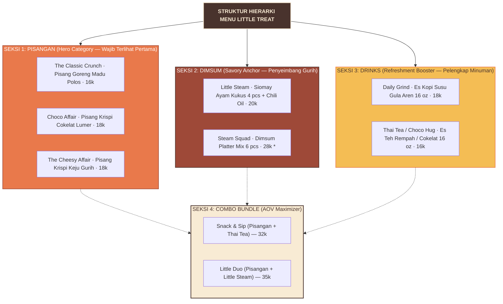
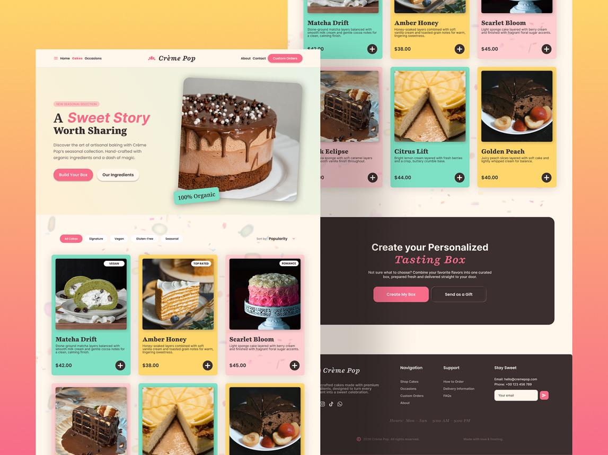
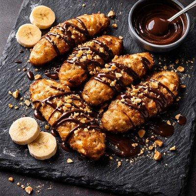

# LITTLE TREAT — Menu System & Product Presentation Guidelines

> [!abstract] **Pedoman Sistem Menu & Presentasi Produk**  
> Dokumen ini mengatur tata letak presentasi menu fisik dan digital LITTLE TREAT, standarisasi format penamaan hibrida (*Hybrid Naming Format*), hierarki tipografi harga, penempatan foto produk heroik 45°, serta penanganan keputusan tertunda terkait ketegangan harga produk personal versus porsi sharing (*Reserved Decision: Pricing Policy*).

---

## 1. Arsitektur Menu Cetak & Digital

Menu LITTLE TREAT dirancang menggunakan pendekatan **3 Blok Kategori Terpadu** yang memandu mata konsumen secara alami:





---

## 2. Format Penamaan Hibrida & Struktur Deskripsi

Setiap produk wajib disajikan dengan **Rumus Penamaan Hibrida**:

```text
┌────────────────────────────────────────────────────────────────────────┐
│                        HYBRID NAMING FORMULA                           │
│                                                                        │
│   [Signature Name]   —   [Clear Functional Descriptor]  ([Portion])    │
│                                                                        │
│   Contoh:                                                              │
│   Choco Affair — Pisang Krispi Cokelat Lumer (Porsi 5–6 pcs)           │
└────────────────────────────────────────────────────────────────────────┘
```

### Komponen Deskripsi Menu (Format Standar 2 Baris):
1. **Baris 1 (Janji Rasa & Tekstur):** *"Pisang matang berlapis adonan garing keemasan dengan siraman saus cokelat kental hangat."*
2. **Baris 2 (Kelengkapan & Porsi):** *"Isi 5–6 potong renyah + topping melimpah. Disajikan hangat."*

---

## 3. Tata Kelola & Presentasi Harga (Pricing Presentation)

Harga disajikan secara transparan dan tegas tanpa jebakan tipografi:

- **Font Harga:** Wajib menggunakan **DM Sans Bold** dengan kontras tinggi (Warna Warm Cocoa `#49332D`).
- **Format Penulisan:** Ditulis sederhana (misal: **18k** atau **Rp 18.000**), dilarang menggunakan format mata uang asing atau format koma membingungkan.

> [!WARNING]
> **RESERVED DECISION: Ketegangan Harga Janji Merek vs. SKU Porsi Sharing**  
> - **Janji Merek Awal (*Price Anchor*):** Dokumen strategi memposisikan LITTLE TREAT pada rentang harga kudapan terjangkau **Rp 16.000 – Rp 20.000** per porsi personal.  
> - **Kandidat Outlier:** Menu **Steam Squad (Dimsum Mix 6 pcs)** dipatok pada harga **Rp 28.000**.  
> - **Status Tata Kelola:** Menu Rp 28k ini secara eksplisit berstatus **`Proposed Sharing Tier — Pending Owner Price Confirmation`**.  
> - **Panduan Penyajian Menu:** Pada kartu menu, item ini wajib ditempatkan di sub-seksi terpisah berlabel *"Porsi Sharing / Rame-Rame"*, bukan disandingkan langsung dengan camilan personal tunggal agar persepsi harga bersahabat brand tetap terjaga.

---

## 4. Portofolio 7-SKU Peluncuran Ramping (Status: Proposed / Unvalidated)

Seluruh 7 posisi SKU produk berikut berstatus **usulan kurasi awal (*Proposed Lean Assortment*)** dan menunggu uji coba sensorik serta validasi minat nyata konsumen:

| No | Kategori | Nama Menu Signature | Deskriptor Fungsional | Porsi Standar | Estimasi Harga | Status Keputusan |
| :-: | :--- | :--- | :--- | :---: | :---: | :---: |
| **1** | **Pisangan** | The Classic Crunch | Pisang Goreng Madu Polos Krispi | 5–6 potong | Rp 16.000 | `PROPOSED HYPOTHESIS` |
| **2** | **Pisangan** | Choco Affair | Pisang Krispi Cokelat Belgia Lumer | 5–6 potong | Rp 18.000 | `PROPOSED HYPOTHESIS` |
| **3** | **Pisangan** | The Cheesy Affair | Pisang Krispi Keju Cheddar Melimpah | 5–6 potong | Rp 18.000 | `PROPOSED HYPOTHESIS` |
| **4** | **Dimsum** | Little Steam | Siomay Ayam Kukus Lembut + Chili Oil | 4 butir | Rp 20.000 | `PROPOSED HYPOTHESIS` |
| **5** | **Dimsum** | Steam Squad | Dimsum Platter Mix Gurih (Ayam & Udang) | 6 butir | Rp 28.000 | `PENDING OWNER DECISION` |
| **6** | **Drinks** | Daily Grind | Es Kopi Susu Gula Aren Spesial | 16 oz cup | Rp 18.000 | `PROPOSED HYPOTHESIS` |
| **7** | **Drinks** | Thai Tea / Choco Hug | Es Teh Rempah Manis / Cokelat Dingin | 16 oz cup | Rp 16.000 | `PROPOSED HYPOTHESIS` |

---

## 5. Integrasi Fotografi Produk pada Menu

Foto makanan pada menu harus berfungsi sebagai pemicu air liur (*salivation trigger*):



1. **Sudut Pengambilan Gambar (*Camera Angle*):** Sudut 45° setara pandangan mata konsumen saat duduk di meja.
2. **Pencahayaan Alami (*Natural Lighting*):** Menonjolkan kilau minyak bersih keemasan dan lelehan cokelat kental tanpa bayangan hitam pekat buatan.
3. **Keteraturan Visual (*Grid System*):**  
   - Pada aplikasi delivery (GoFood/ShopeeFood): Rasio foto 1:1 square.
   - Pada brosur menu cetak A5: Foto produk ditempatkan di sisi kiri atau atas judul menu dengan batas kurva organik lembut (*organic blob masking*).

---

## 6. Penyajian Paket Kombo & Promosi (Bundle Merchandising)

Paket kombo dirancang untuk mendongkrak Nilai Rata-rata Keranjang (*Average Order Value / AOV*):

- **Paket "Snack & Sip":**  
  *1x Choco Affair (18k) + 1x Thai Tea Dingin (16k)*  
  Harga Normal: Rp 34.000 → **Harga Paket Kombo: Rp 32.000** *(Hemat Rp 2.000)*.
- **Paket "Little Duo":**  
  *1x Choco Affair (18k) + 1x Little Steam Dimsum 4 pcs (20k)*  
  Harga Normal: Rp 38.000 → **Harga Paket Kombo: Rp 35.000** *(Hemat Rp 3.000)*.
- **Visual Badge:** Badge lingkaran oranye atau mentega di pojok foto menu bertuliskan *"HEMAT RP 3.000"* menggunakan font Fredoka SemiBold.

---

*Dokumen ini merupakan pedoman presentasi menu kanonikal LITTLE TREAT.*
