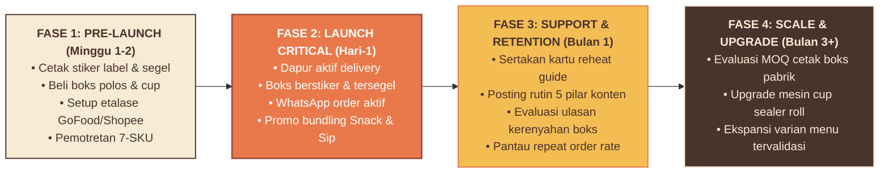

# LITTLE TREAT — Application Priority & Low-Capital MVP Rollout Roadmap

> [!abstract] **Prioritas Aplikasi & Peta Jalan Peluncuran MVP Berbiaya Rendah**  
> Dokumen ini menyusun kerangka kerja bertahap (*phased rollout roadmap*) untuk mengimplementasikan seluruh aplikasi merek LITTLE TREAT dengan modal awal sangat efisien (*lean capital*). Mengelompokkan seluruh aset ke dalam 3 tingkatan prioritas (*Launch Critical, Launch Support, Future Enhancement*) serta menetapkan anggaran belanja cetak dan kemasan awal di bawah Rp 2.000.000.

---

## 1. Kerangka Tiga Tingkat Prioritas Aplikasi (3-Tier Framework)

```text
┌────────────────────────────────────────────────────────────────────────┐
│                   3-TIER APPLICATION PRIORITY MATRIX                   │
├────────────────────────────────────────────────────────────────────────┤
│  🔴 TIER 1: LAUNCH CRITICAL (HARI-1 / WAJIB MUTLAK)                     │
│     Tanpa elemen ini, gerai delivery tidak dapat beroperasi secara     │
│     kredibel, higienis, dan aman bagi konsumen.                        │
│                                                                        │
│  🟡 TIER 2: LAUNCH SUPPORT (BULAN-1 / PENGUAT RETENSI)                 │
│     Aplikasi yang meningkatkan nilai persepsi (*perceived value*),     │
│     pengalaman unboxing, dan pengulangan pesanan (*repeat order*).     │
│                                                                        │
│  🟢 TIER 3: FUTURE ENHANCEMENT (FASE SKALA / VOLUME TERBUKTI)          │
│     Investasi skala besar yang baru dibenarkan secara finansial        │
│     setelah volume penjualan harian mencapai batas kelayakan.          │
└────────────────────────────────────────────────────────────────────────┘
```

---

## 2. Matriks Rincian Aplikasi per Tingkat Prioritas

| Tingkat Prioritas | Item Aplikasi | Spesifikasi Teknis | Status Kesiapan | Estimasi Biaya Awal |
| :--- | :--- | :--- | :---: | :---: |
| **TIER 1 (Launch Critical)** | Boks Makanan Kraft Polos (Lubang Uap) | Kraft 290 gsm laminasi PE + lubang ventilasi (Isi 200 pcs) | **Wajib Day 1** | Rp 160.000 |
| **TIER 1 (Launch Critical)** | Kertas Roti Alas (*Greaseproof*) | Kertas 40 gsm anti-minyak (Isi 500 lbr) | **Wajib Day 1** | Rp 65.000 |
| **TIER 1 (Launch Critical)** | Stiker Label Muka Produk & Kategori | Stiker Chromo A3+ potong kiss-cut (300 pcs) | **Wajib Day 1** | Rp 90.000 |
| **TIER 1 (Launch Critical)** | Stiker Segel Keamanan Higienis | Stiker panjang 30 × 75 mm anti-rusak (300 pcs) | **Wajib Day 1** | Rp 60.000 |
| **TIER 1 (Launch Critical)** | Wadah Saus Klip Mini Terpisah | Cup plastik klip 25–35 ml (Isi 100 pcs) | **Wajib Day 1** | Rp 35.000 |
| **TIER 1 (Launch Critical)** | Gelas Plastik PP 16 oz + Tutup Lid | Gelas PP tebal + flat lid + sedotan (100 pcs) | **Wajib Day 1** | Rp 85.000 |
| **TIER 1 (Launch Critical)** | Stiker Bulat Cup Minuman `lt.` | Stiker transparan vynil anti-air (200 pcs) | **Wajib Day 1** | Rp 50.000 |
| **TIER 1 (Launch Critical)** | Aset Etalase Delivery 7-SKU | Avatar squircle, banner cover, foto katalog 1:1 | **Wajib Day 1** | Rp 0 (Aset Digital) |
| **TIER 1 (Launch Critical)** | Profil WhatsApp Business & Katalog | Bio resmi, link katalog, template quick-replies | **Wajib Day 1** | Rp 0 (Setup Mandiri) |
| **Subtotal Belanja Wajib Tier 1** | — | — | — | **Rp 545.000** |
| | | | | |
| **TIER 2 (Launch Support)** | Paper Bag Kraft Cokelat SOS (Size M) | Kantong kraft polos 80 gsm (Isi 100 pcs) | Bulan 1 | Rp 75.000 |
| **TIER 2 (Launch Support)** | Stempel Karet (*Rubber Stamp*) Logo | Gagang kayu + bak tinta cokelat tahan air | Bulan 1 | Rp 65.000 |
| **TIER 2 (Launch Support)** | Kartu Terima Kasih & Reheat Guide A6 | Cetak Art Carton 260 gsm (Isi 200 lbr) | Bulan 1 | Rp 90.000 |
| **TIER 2 (Launch Support)** | Brosur Menu Lipat Digital / Cetak A5 | Flyer pengenalan lingkungan sekitar (200 lbr) | Bulan 1 | Rp 80.000 |
| **TIER 2 (Launch Support)** | 6 Template Desain Media Sosial | Template feed & stories siap edit di smartphone | Bulan 1 | Rp 0 (Aset Digital) |
| **Subtotal Belanja Support Tier 2** | — | — | — | **Rp 310.000** |
| | | | | |
| **TIER 3 (Future Enhancement)**| Boks Custom Offset Full Color | Cetak pabrik minimal 3.000 pcs bermotif master | Ditunda (Omzet > 50 order/hari)| Rp 6.000.000+ |
| **TIER 3 (Future Enhancement)**| Roll Sealer Cup Plastik Custom | Cetak plastik lid sealer kontinu 1.200 cup | Ditunda (Volume stabil) | Rp 450.000 |
| **TIER 3 (Future Enhancement)**| Neon Box Akrilik Gerai Fisik | Signage gerai offline menyala LED | Ditunda (Buka Dine-in) | Rp 1.500.000 |
| **TIER 3 (Future Enhancement)**| Seragam Celemek Bordir Crew | Apron kanvas cokelat + topi bordir `lt.` | Ditunda (Tambah Staff Dapur) | Rp 300.000 |

---

## 3. Alokasi Anggaran Belanja Modal Merek Awal (Initial Branding Capex)

Dengan memfokuskan pengadaan hanya pada **Tier 1 (Wajib Peluncuran)** ditambah kebutuhan awal **Tier 2 (Kantong & Stempel)**:

```text
┌────────────────────────────────────────────────────────────────────────┐
│             ESTIMASI BELANJA MODAL APLIKASI MEREK (MVP LAUNCH)         │
├────────────────────────────────────────────────┬───────────────────────┤
│ Komponen Pengadaan                             │ Alokasi Biaya (IDR)   │
├────────────────────────────────────────────────┼───────────────────────┤
│ 1. Stok Kemasan Boks & Kertas Roti (200 porsi) │ Rp 225.000            │
│ 2. Stok Gelas Dingin & Sedotan (100 porsi)     │ Rp 85.000             │
│ 3. Paket Cetak Stiker Label & Segel (A3+ Vynil)│ Rp 200.000            │
│ 4. Stok Paper Bag SOS + Stempel Brand          │ Rp 140.000            │
│ 5. Kartu Sisipan Unboxing & Reheat Guide       │ Rp 90.000             │
│ 6. Dana Cadangan Pengadaan Kemasan Darurat     │ Rp 150.000            │
├────────────────────────────────────────────────┼───────────────────────┤
│ TOTAL ANGGARAN BELANJA MODAL APLIKASI (CAPEX)  │ Rp 890.000            │
└────────────────────────────────────────────────┴───────────────────────┘
```

> **Efisiensi Finansial:** Seluruh kesiapan fisik dan visual merek profesional berhasil diwujudkan dengan modal di bawah **Rp 1.000.000**, menyisakan likuiditas terbesar untuk bahan baku makanan segar dan promosi awal.

---

## 4. Garis Waktu Peluncuran Bertahap (Phased Milestones)



---

*Dokumen ini merupakan peta jalan peluncuran MVP kanonikal LITTLE TREAT.*
