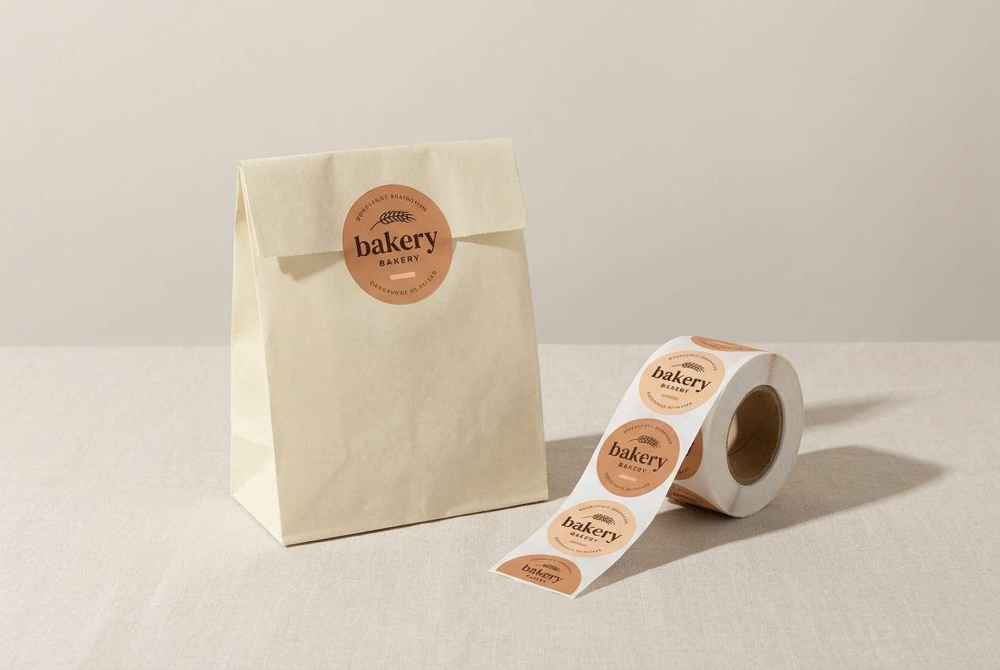
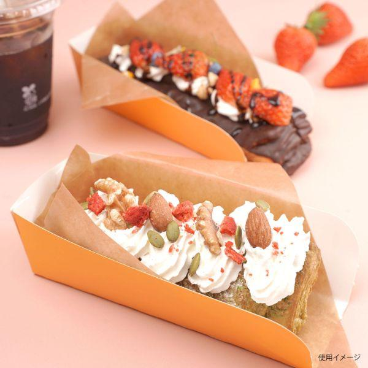
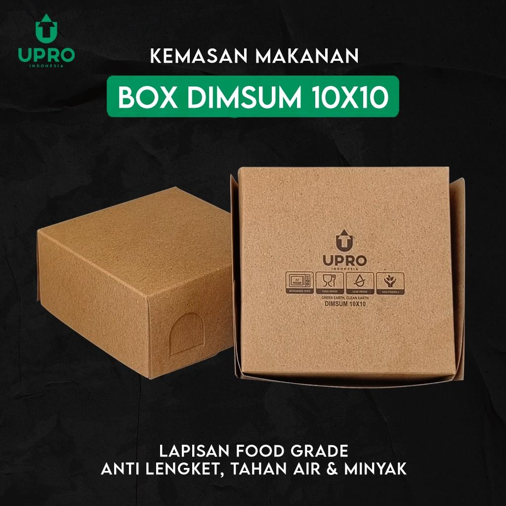
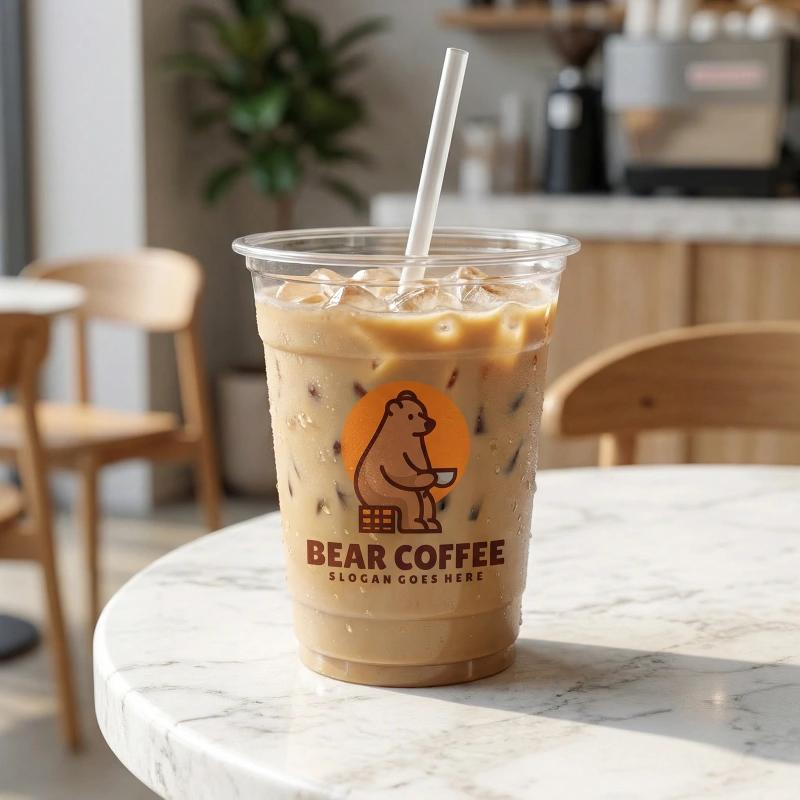
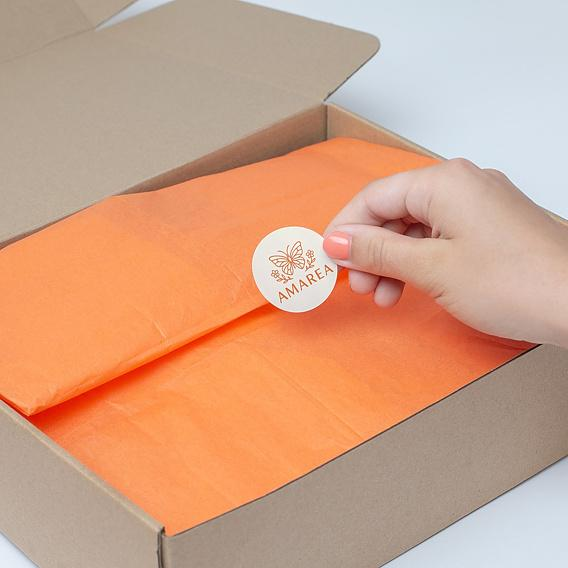
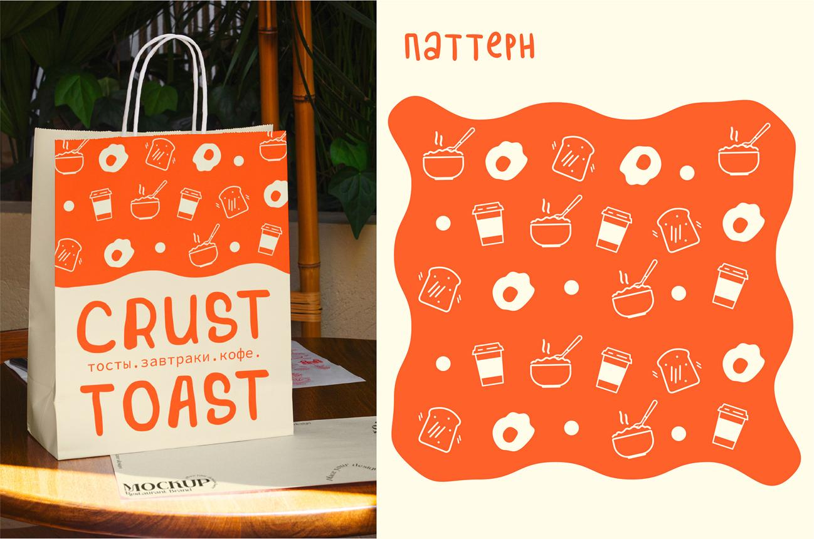

# LITTLE TREAT — Packaging Applications & Physical Production Specifications

> [!abstract] **Spesifikasi Teknis Rekayasa & Aplikasi Kemasan Fisik**  
> Dokumen ini memuat spesifikasi rekayasa kemasan fisik LITTLE TREAT (*Little Joy, Beautifully Packed*). Mengutamakan pendekatan hemat modal (*Asset-Light Packaging Strategy*) menggunakan kemasan standar *food-grade* berkualitas tinggi yang dipadukan dengan sistem label stiker presisi, rekayasa lubang ventilasi uap anti-lembek (*steam vent physics*), pemisahan wadah saus higienis, serta spesifikasi bahan baku dan panduan pengadaan lokal.

---

## 1. Filosofi & Strategi Kemasan Hemat Modal (Asset-Light Strategy)

```text
┌────────────────────────────────────────────────────────────────────────┐
│                   ASSET-LIGHT PACKAGING PRINCIPLE                      │
│                                                                        │
│  "Kemasan yang hebat tidak harus mahal; kemasan yang hebat harus       │
│   dirancang dengan penuh kesengajaan (intentional)."                   │
│                                                                        │
│  • PANTANGAN MVP: Jangan memesan boks custom cetak offset berkuota     │
│    minimum tinggi (MOQ 3.000–5.000 pcs) yang membekukan modal kerja   │
│    sebesar Rp 8.000.000 – Rp 15.000.000 di awal usaha.                 │
│                                                                        │
│  • SOLUSI REKOMENDASI: Gunakan wadah polos standar food-grade          │
│    (kraft/ivory) berkualitas tinggi, lalu personalisasikan dengan      │
│    stiker label kustom berperekat kuat dan stiker segel higienis.      │
└────────────────────────────────────────────────────────────────────────┘
```



---

## 2. Spesifikasi Teknis Tiap Jenis Kemasan Produk

### A. Kemasan PISANGAN (Kudapan Goreng Krispi Hangat)

Pisang krispi memerlukan penanganan khusus terhadap kelembapan uap minyak panas agar tekstur tetap renyah saat tiba di tangan konsumen.



| Parameter | Spesifikasi Teknis | Rasionalitas Rekayasa |
| :--- | :--- | :--- |
| **Bentuk Wadah** | Paper Lunch Box / Food Pail Lipat (Ukuran M: 16 × 10 × 5 cm) | Porsi pas untuk 5–6 potong pisang lumer (*personal serving*). |
| **Material Kertas** | Kraft Cokelat / Ivory Food-Grade 290 – 325 gsm | Tebal, kokoh menahan tumpukan saat dibawa kurir motor. |
| **Lapisan Dalam** | Laminasi PE *Oil-Resistant* (Anti-Minyak) 15–18 gsm | Mencegah minyak menembus ke dinding luar boks. |
| **Rekayasa Ventilasi Uap (*Steam Vents*)** | **2–4 Lubang Ventilasi Samping (Diameter 6–8 mm)** | **Wajib Mutlak:** Uap panas yang terperangkap akan mengembun menjadi tetesan air dan membuat adonan renyah menjadi basah, liat, dan lembek (*soggy*) dalam 15–20 menit perjalanan kurir. |
| **Kertas Alas (*Greaseproof Liner*)** | Kertas roti anti-minyak 40 gsm (Ukuran 20 × 20 cm) bermotif Warm Cocoa | Mencegah saus cokelat lumer menempel langsung pada lipatan karton bawah. |
| **Sistem Label Muka** | Stiker Chromo/Vynil 80 × 50 mm di bagian atas tutup boks | Memuat logo LITTLE TREAT, nama varian menu, dan pita aksen Oranye. |

---

### B. Kemasan DIMSUM (Kudapan Kukus Lembap & Saus)

Dimsum menuntut kelembapan terjaga (*juicy*) tanpa membuat saus sambal atau chili oil tumpah mengotori kemasan luar.



| Parameter | Spesifikasi Teknis | Rasionalitas Rekayasa |
| :--- | :--- | :--- |
| **Bentuk Wadah** | Kraft Lunch Box Persegi (Ukuran S/M: 12 × 12 × 5 cm) | Menjaga 4–6 butir siomay tetap rapat tanpa berhamburan. |
| **Material Kertas** | Brown Kraft 290 gsm + Full PE Coating (Tahan Panas & Air) | Tahan uap lembap kukusan bambu tanpa membuat kertas melengkung. |
| **Wadah Saus Terpisah (*Sauce Isolation*)** | Mangkuk klip plastik mini transparan PP (25–35 ml) berpenutup rapat (*snap-on leakproof*) | **Dilarang keras menyiram saus/chili oil langsung ke atas dimsum** di dalam boks; saus wajib terisolasi agar kulit dimsum tidak lodoh/rusak. |
| **Ventilasi Udara** | Tanpa lubang ventilasi besar (cukup celah mikro lipatan boks) | Menahan kehangatan dan kelembapan juicy dimsum selama perjalanan. |
| **Sistem Label Muka** | Stiker 70 × 40 mm dengan pita aksen **Terracotta (`#9E4938`)** | Membedakan kategori dimsum secara instan dari boks pisangan. |

---

### C. Kemasan DRINKS (Minuman Dingin & Es Segar)

Minuman dingin menghasilkan kondensasi air di dinding luar dan rawan tumpah saat motor kurir berguncang.



| Parameter | Spesifikasi Teknis | Rasionalitas Rekayasa |
| :--- | :--- | :--- |
| **Wadah Minuman** | Gelas Plastik Transparan Polypropylene (PP) 16 oz / 20 oz (Gramatur 7–8 gram tebal) | Warna alami teh susu, kopi aren, dan es batu terlihat menggoda (*transparent appeal*). |
| **Penutup Gelas (*Sealing*)** | Pilihan A (MVP): *Dome Lid / Flat Lid* kencang + stiker segel silang.<br>Pilihan B (Operasional Lanjutan): Mesin Cup Sealer Roll. | Mencegah tumpahan es dan cairan saat dibawa kurir motor. |
| **Branding Gelas** | Stiker Transparan / Vynil Bulat Diameter 40 mm di badan gelas | Memuat monogram `lt.` oranye atau Wordmark Warm Cocoa. |
| **Aksesoris Pelengkap** | Sedotan steril terbungkus kertas + *cup holder paper tray* (untuk pesanan ≥ 2 cup). | Menjaga higienitas mulut sedotan dari debu jalanan. |

---

## 3. Sistem Stiker & Segel Keamanan Higienis (Sealing & Labeling System)



### A. Stiker Segel Higienis (*Tamper-Evident Hygiene Seal*)
- **Fungsi:** Menjamin kepada konsumen bahwa makanan belum pernah dibuka sejak keluar dari dapur LITTLE TREAT.
- **Ukuran & Bentuk:** Stiker persegi panjang 30 × 75 mm atau bentuk pita tulang anjing (*dog-bone shape*).
- **Penempatan:** Menjembatani bibir penutup boks dan badan bawah boks. Jika boks dibuka, stiker akan sobek (*tamper-evident*).
- **Tipografi & Teks:**  
  - Baris 1 (DM Sans Bold 10 pt): *"SEALED FOR FRESHNESS & JOY"*  
  - Baris 2 (DM Sans Regular 8 pt): *"Jangan terima jika segel ini rusak atau sobek."*

### B. Stiker Identifikasi Produk & Kategori (*Product Variant Label*)
- **Ukuran:** 80 × 50 mm persegi panjang sudut membulat (*rounded 4 mm*).
- **Tata Letak Informasi (Layout Hierarchy):**
  1. *Top Bar (Tinggi 6 mm):* Warna aksen kategori (Oranye untuk Pisangan, Terra untuk Dimsum, Butter untuk Drinks).
  2. *Header:* Logo LITTLE TREAT (Warm Cocoa).
  3. *Nama Varian (Fredoka Medium 14 pt):* Contoh: **Choco Affair**.
  4. *Deskriptor (DM Sans Regular 9 pt):* Pisang Krispi Cokelat Lumer.
  5. *Metadata Operasional:* Tanggal & jam produksi, inisial packer, kotak checklist topping ekstra.

---

## 4. Kantong Pembawa (*Carrier Bags*) & Kartu Terima Kasih



### A. Paper Bag Kraft Cokelat (*Carry Bag*)
- **Jenis:** SOS Paper Bag tanpa tali (Ukuran S: 18 × 11 × 23 cm untuk 1–2 boks; Ukuran M: 22 × 12 × 30 cm untuk paket combo + minuman).
- **Material:** Kertas Brown Kraft 80–100 gsm ramah lingkungan dan dapat didaur ulang.
- **Branding Sederhana:** Stempel tinta karet (*rubber stamp*) logo LITTLE TREAT warna cokelat tua atau stiker bulat segel kantong di lipatan atas.
- **Keunggulan Biaya:** Biaya per kantong hanya Rp 600 – Rp 900 (jauh lebih hemat dibanding kantong custom sablon pabrik).

### B. Kartu Sisipan Terima Kasih (*Thank-You & Reheat Guide Card*)
- **Format:** Kartu pos mini 90 × 90 mm, bahan Kraft/Art Carton 260 gsm.
- **Muka Depan:**  
  Headline (Fredoka 16 pt): *"Made fresh to bring a little treat to your day!"*  
  Ilustrasi doodle kopi/pisang + senyum hangat.
- **Muka Belakang (Panduan Menikmati & Reheat):**
  - *Pisangan:* Panaskan di Airfryer 160°C selama 3 menit atau teflon tanpa minyak 2 menit untuk kerenyahan maksimal. (Hindari microwave basah).
  - *Dimsum:* Kukus kembali 3 menit jika ingin disajikan panas mengepul.
  - *Social Proof:* *"Suka camilannya? Tag @littletreat.id dan bagikan momen manismu!"*
  - *Customer Care:* WhatsApp Hotline 08xx-xxxx-xxxx.

---

## 5. Ringkasan Estimasi Biaya Kemasan per Porsi (Unit Packaging Cost)

```text
┌────────────────────────────────────────────────────────────────────────┐
│               TARGET HPP KEMASAN PER PORSI (MVP ASSET-LIGHT)           │
├────────────────────────────────────────────────┬───────────────────────┤
│ Komponen Kemasan                               │ Estimasi Biaya (IDR)  │
├────────────────────────────────────────────────┼───────────────────────┤
│ • 1x Boks Kraft Food Grade 290 gsm (Laminasi)  │ Rp 650 – Rp 850       │
│ • 1x Kertas Roti Greaseproof Liner             │ Rp 100 – Rp 150       │
│ • 1x Stiker Label Produk (Chromo Print)        │ Rp 150 – Rp 250       │
│ • 1x Stiker Segel Keamanan Higienis            │ Rp 100 – Rp 150       │
│ • Proporsi Paper Bag Kraft (sharing per order) │ Rp 250 – Rp 400       │
├────────────────────────────────────────────────┼───────────────────────┤
│ TOTAL BIAYA KEMASAN PER PESANAN                │ Rp 1.250 – Rp 1.800   │
└────────────────────────────────────────────────┴───────────────────────┘
```

> **Target Kontrol:** Biaya kemasan berhasil ditekan di bawah **8% – 10% dari harga jual produk** (Rp 16.000 – Rp 20.000), menjaga margin kontribusi makanan tetap sehat dan kompetitif.

---

*Dokumen ini merupakan spesifikasi teknis kemasan kanonikal LITTLE TREAT.*
