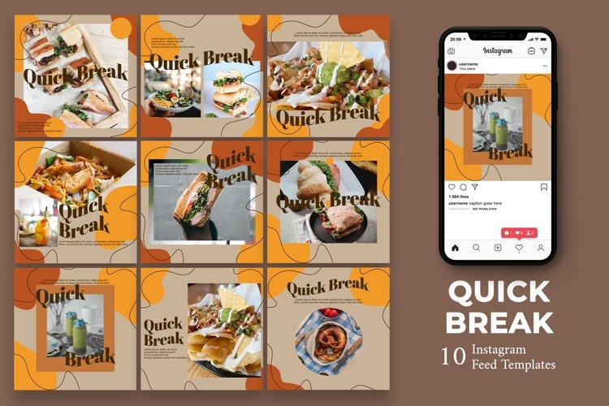
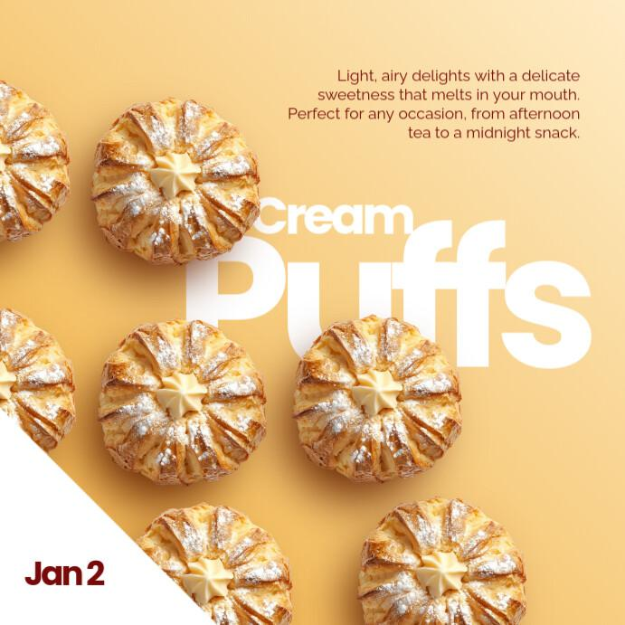
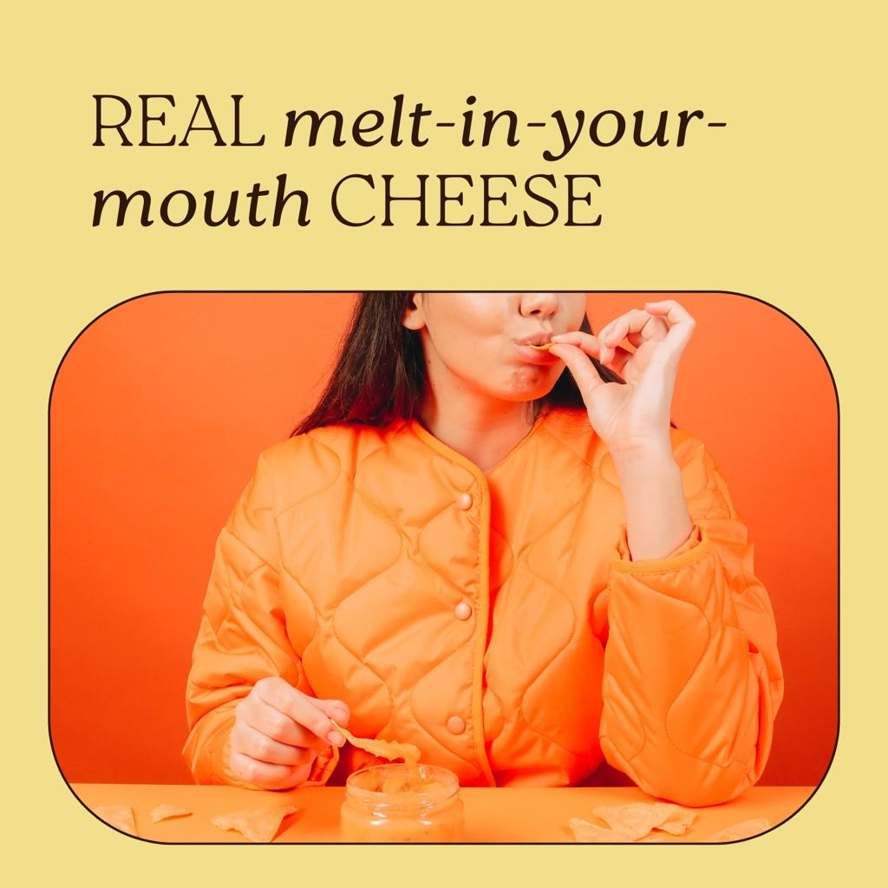
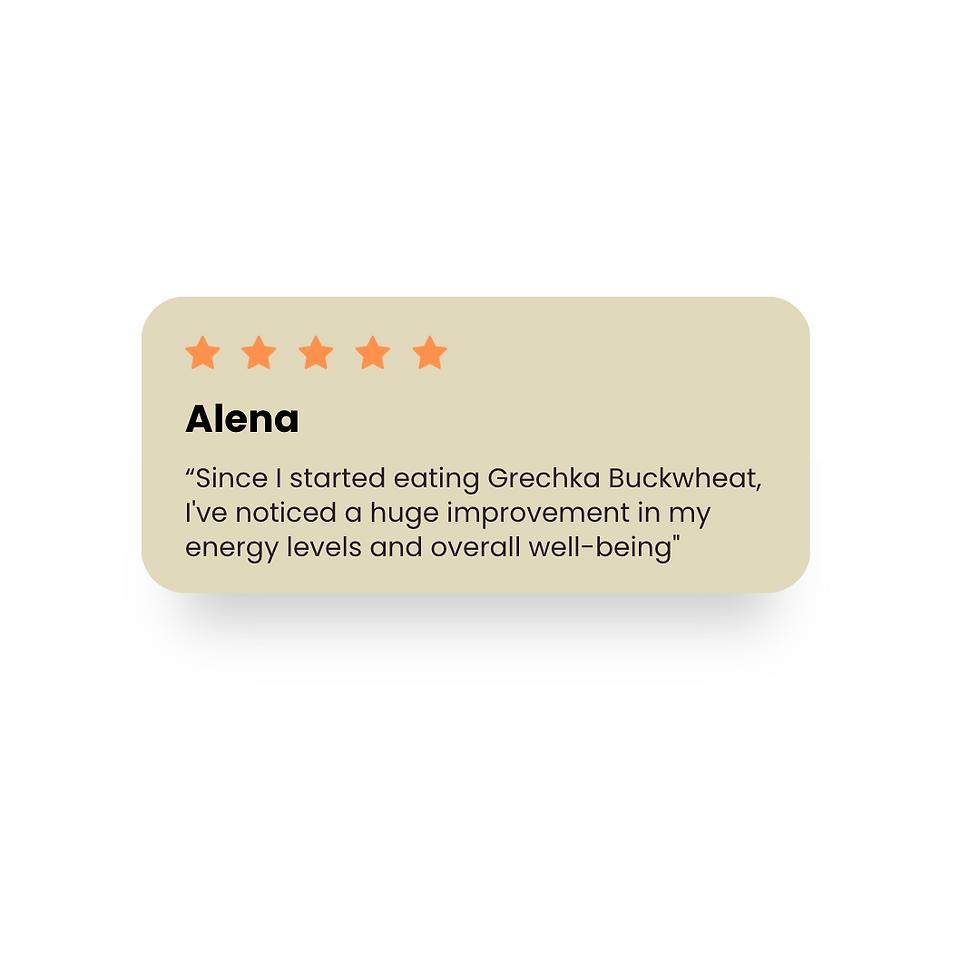

# LITTLE TREAT — Social Media Application Templates & Visual Playbook

> [!abstract] **Pedoman Aplikasi Media Sosial & Buku Panduan Konten Visual**  
> Dokumen ini memuat panduan operasional produksi konten visual media sosial (*Instagram Feed, Stories, Reels, TikTok*) untuk LITTLE TREAT. Merinci arsitektur 5 pilar konten, 6 template tata letak modular yang dapat digunakan kembali (*reusable templates*) tanpa memerlukan desainer grafis penuh waktu, serta aturan rasio teks, tata warna, dan tipografi selaras merek.

---

## 1. Arsitektur Komposisi Feed & Keseimbangan Pilar Konten

Visual Instagram LITTLE TREAT dirancang mengalir (*seamless feed aesthetic*) dengan memadukan kehangatan makanan dan keceriaan personal:

### Matriks Distribusi 5 Pilar Konten Mingguan:
- **35% Product Craving (Pemicu Lapar):** Foto/video makro lelehan cokelat, keju parut, remahan tepung garing, dan uap kukusan dimsum.
- **20% Promotions & Bundling (Penggerak Transaksi):** Info paket kombo *Snack & Sip*, diskon ongkir aplikasi delivery, promo akhir pekan.
- **20% Brand Personality & Joy (Pembangun Kedekatan):** Kutipan motivasi santai *"Make Every Day a Little Treat."*, grafis doodle bersenyum, cerita di balik layar dapur.
- **15% Product Education (Edukasi Nilai):** Panduan memanaskan ulang di rumah (*reheating guide*), asal bahan pisang lokal pilihan, saran padu-padan camilan + minuman.
- **10% Customer Moments & Social Proof (Bukti Nyata):** Repost story unboxing konsumen, tangkapan layar ulasan bintang 5 aplikasi ojol.

---

## 2. Enam Template Konten Siap Pakai (The 6 Reusable Templates)

Untuk menekan biaya operasional kreatif solopreneur, seluruh postingan wajib mengacu pada salah satu dari 6 template modular berikut:

### Template 1: Product Spotlight (Sorotan Menu Hero)

- **Fungsi:** Memperkenalkan atau menonjolkan satu menu unggulan secara detail.
- **Tata Letak:** 70% foto makanan close-up pada latar Warm Cream + 30% area teks bawah (Nama menu Fredoka Bold + deskripsi rasa DM Sans 1 baris + tombol CTA oranye).
- **Elemen Grafis:** 1 aksen *Little Spark* di sudut judul dan kurva organik halus di latar belakang.

### Template 2: New Drop / Menu Baru (Pengumuman Produk)
- **Fungsi:** Mengumumkan varian rasa atau menu musiman baru.
- **Tata Letak:** Latar belakang Warm Cocoa tebal dengan bingkai boks bergelombang + teks judul Fredoka warna Warm Cream: *"INTRODUCING OUR NEWEST TREAT!"*.
- **Aksen:** Stiker badge bulat mentega kuning bertuliskan *"LIMITED DROP"*.

### Template 3: Promotion & Combo Deal (Penawaran Hemat)
- **Fungsi:** Mempromosikan paket bundling *Snack & Sip* atau *Little Duo*.
- **Tata Letak:** Foto berdampingan 2 produk (Pisangan + Thai Tea) di atas latar Warm Cream + Pita oranye melintang dengan teks harga: *"COMBO SNACK & SIP CUMA 32K"*.
- **Hierarki Harga:** Angka harga ditulis besar dan tebal dengan font DM Sans Bold.

### Template 4: Brand Message & Joyful Quote (Kutipan Penyemangat)

- **Fungsi:** Membangun resonansi emosional dan interaksi santai di sela-sela postingan jualan.
- **Tata Letak:** Latar kanvas polos Warm Cream (`#F8EBD4`) luas (*negative space*) + kutipan Fredoka warna Warm Cocoa di tengah bingkai: *"Hari ini terasa berat? You deserve a little treat."*.
- **Elemen Grafis:** 2–3 doodle bintang atau bunga organik kecil di sudut teks.

### Template 5: Customer Love & Social Proof (Ulasan Pembeli)

- **Fungsi:** Memperlihatkan kepuasan pelanggan nyata dari ulasan aplikasi delivery.
- **Tata Letak:** Foto produk di bagian belakang dengan efek blur halus + kartu awan putih/krem di depan memuat kutipan ulasan pembeli + deretan 5 bintang kuning mentega.
- **Teks Pendukung:** *"Terima kasih sudah bikin hari ini lebih manis! — Kak Siska, Citayam"*.

### Template 6: Educational Pairing & Reheating (Panduan Praktis)
- **Fungsi:** Mengedukasi cara terbaik menikmati produk di rumah (Carousel 2–3 slide).
- **Slide 1:** Judul Fredoka: *"Rahasia Pisang Tetap Renyah Sampai Malam!"*.
- **Slide 2:** 3 langkah mudah memanaskan di airfryer (160°C, 3 menit).
- **Slide 3:** Rekomendasi minuman pendamping untuk sore hari.

---

## 3. Aturan Desain Bebas Ribet (The Low-Overhead Design Rules)

1. **Rasio Teks Maksimal 25%:** Jangan penuhi gambar dengan tulisan panjang. Biarkan visual makanan menjadi daya tarik utama. Penjelasan panjang ditempatkan di *caption*.
2. **Kepatuhan Format Rasio Layar:**
   - *Instagram Feed:* 1:1 Square (1080 × 1080 px) atau 4:5 Portrait (1080 × 1350 px — *sangat disarankan untuk dominasi layar ponsel*).
   - *Stories & Reels:* 9:16 Vertical (1080 × 1920 px) dengan zona aman 250 px di atas dan bawah agar tidak tertutup antarmuka aplikasi.
3. **Standar Penulisan Caption yang Ramah:**
   - Selalu awali dengan hook yang relevan dengan rutinitas harian (misal: *"Jam rawan ngantuk sore-sore gini enaknya ngemil apa ya?"*).
   - Selipkan info pemesanan yang jelas di akhir: *"Tersedia di GoFood, GrabFood, & ShopeeFood (klik link di bio) atau WhatsApp kita langsung!"*.

---

*Dokumen ini merupakan panduan media sosial kanonikal LITTLE TREAT.*
