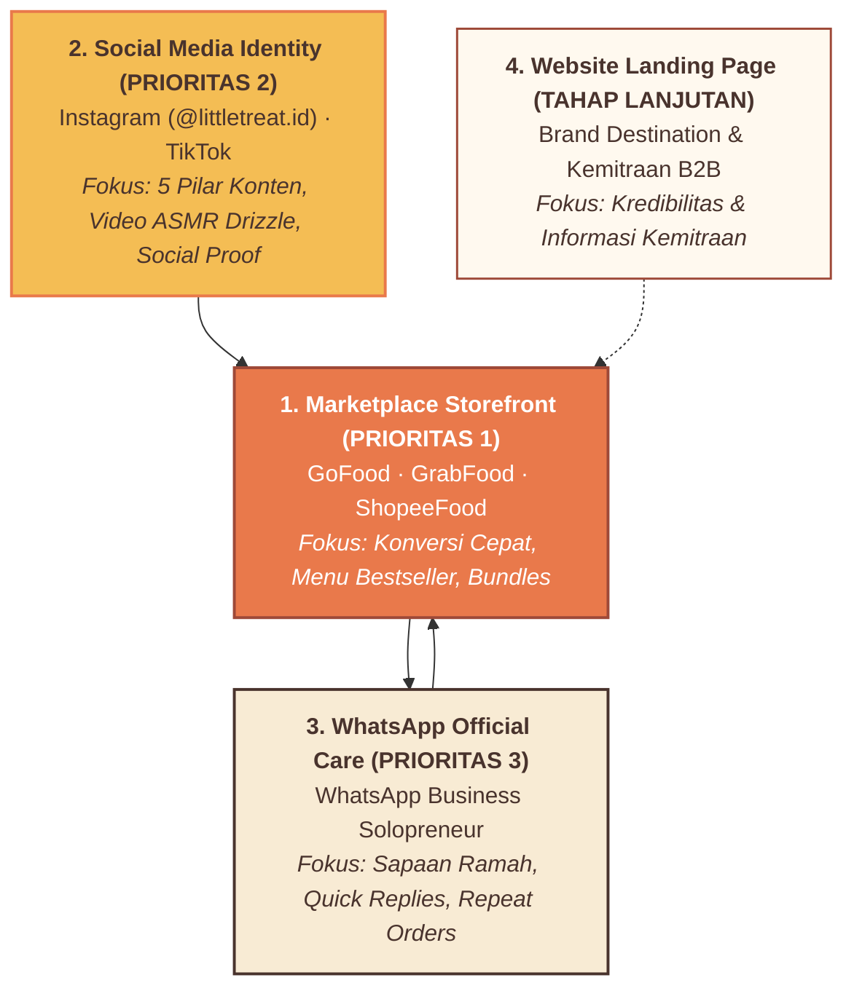
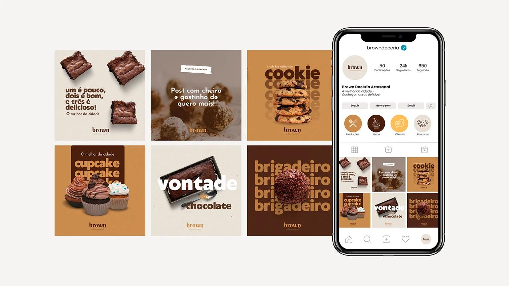
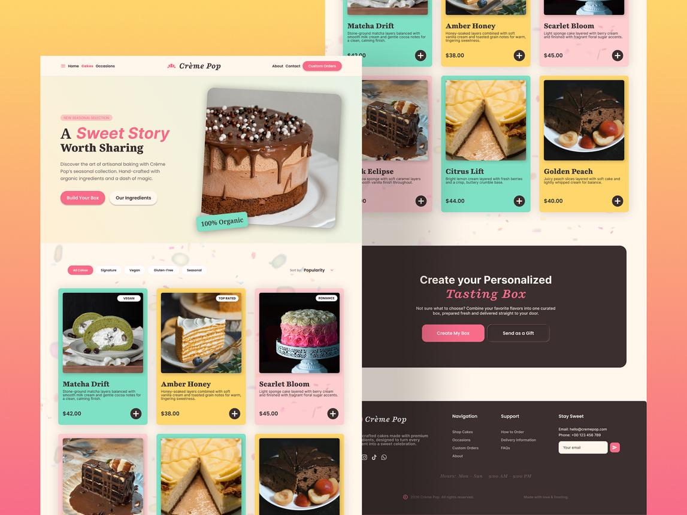
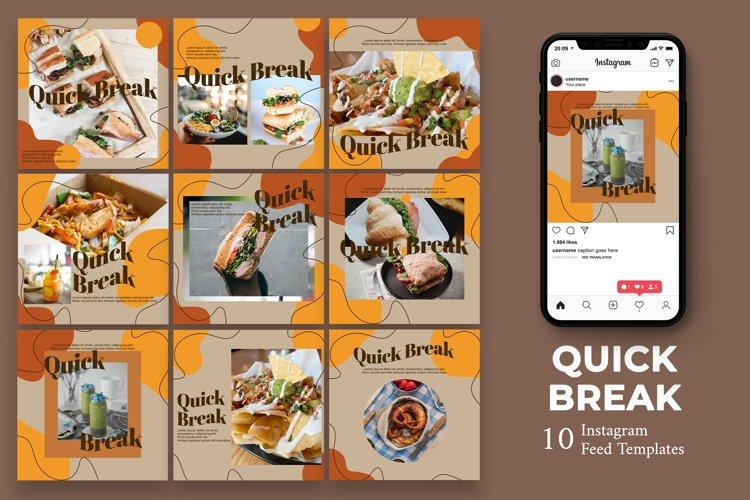
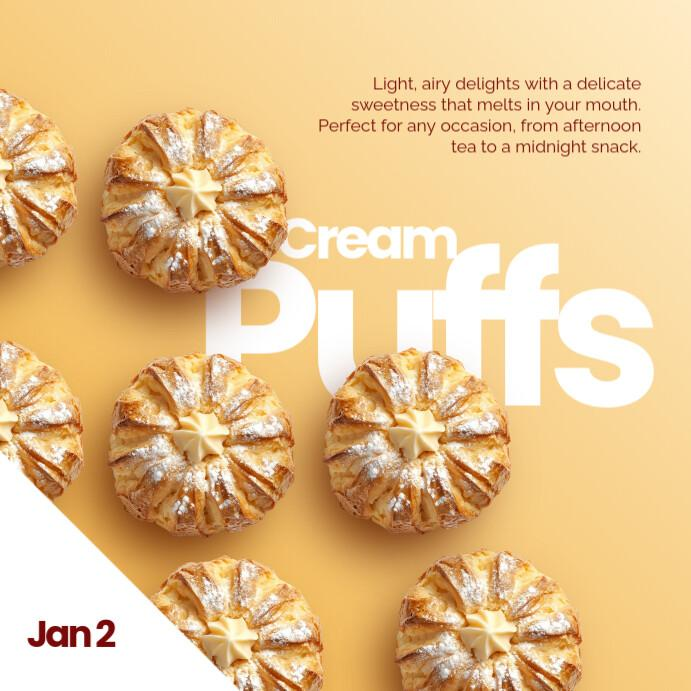
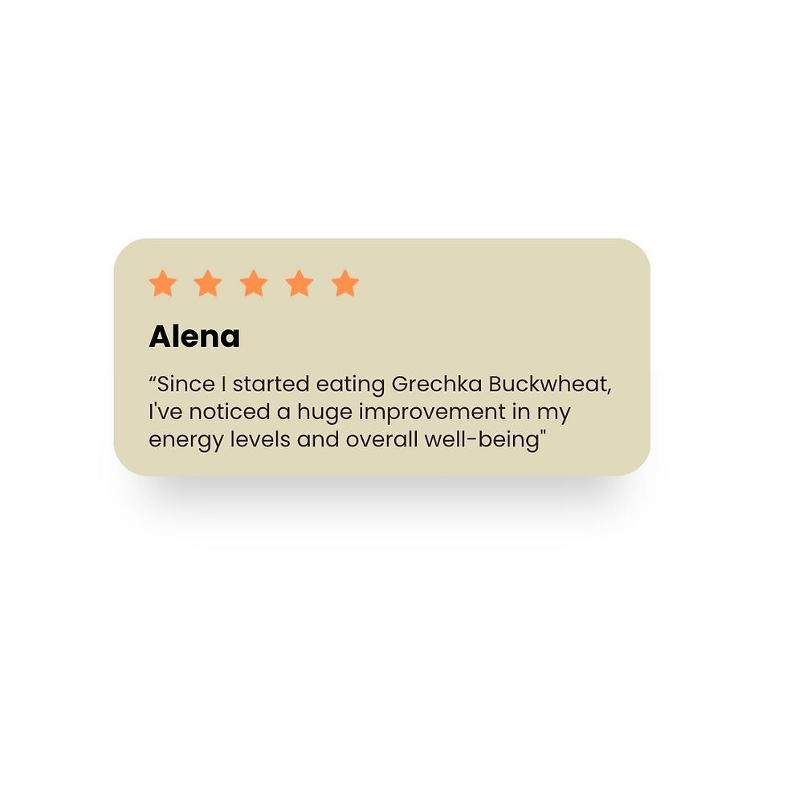

# LITTLE TREAT — Digital Brand Identity & Channel Architecture

> [!abstract] **Sistem Identitas Digital & Arsitektur Saluran Konversi**  
> Dokumen ini membakukan kehadiran digital LITTLE TREAT (*A Little Joy, Everywhere*), tata kelola etalase marketplace delivery (*GoFood, GrabFood, ShopeeFood*), sistem 5 pilar konten media sosial, template reusable, serta standar komunikasi WhatsApp pelanggan.

---

## 1. Konsep Utama: A Little Joy, Everywhere.

Digital presence LITTLE TREAT dirancang untuk **mengubah kunjungan online menjadi pesanan nyata (*high-conversion storefront*)** dengan memadukan empat karakter:
- **Playful but Refined:** Ceria dan ramah, namun tertata rapi seperti brand F&B modern.
- **Warm & Approachable:** Nada visual hangat yang akrab di layar ponsel.
- **Appetizing & Expressive:** Foto produk menggoda selera menjadi pusat perhatian utama.
- **Modern & Easy to Navigate:** Navigasi harga, varian, dan porsi yang transparan tanpa friksi.

---

## 2. Arsitektur 4 Kanal Digital Berdasarkan Prioritas

### Acuan Benchmark Tampilan Visual Digital:
- **Brand Confeitaria Benchmark:**  
  
- **Menu UI Cards Benchmark:**  
  
- **Instagram Feed Flow Benchmark:**  
  

---

## 3. Marketplace Storefront System (Hierarki Konversi Etalase)

1. **Avatar Toko (Logo):** Siluet squircle oranye dengan monogram `lt.` krem dan aksen kilau butter (terbaca tajam di ukuran 32×32 px).
2. **Cover Banner:** Foto boks takeaway terbuka bersanding Thai tea dingin dengan headline *"Make Every Day a Little Treat."*.
3. **Struktur Urutan Menu (Conversion Order):**
   - *Urutan 1:* Hero Products / Bestseller (*Choco Affair, The Classic Crunch*).
   - *Urutan 2:* Craving Triggers (visual saus leleh paling menggoda).
   - *Urutan 3:* Bundle & Combo Section (paket hemat pendorong AOV).
   - *Urutan 4:* Menu Satuan (Pisangan, Dimsum, Drinks).
   - *Urutan 5:* Ekstra Add-on cocolan saus cokelat dan chili oil.
4. **Deskripsi Menu Anti-Ragu:** Format 2 baris (rasa/tekstur + jaminan porsi).

---

## 4. Sistem Konten Media Sosial (5 Content Pillars)

- **35% Product Craving:** Video makro lelehan cokelat hangat (*ASMR drizzle*), remahan tepung garing, dan keju parut melimpah (*fokus bikin lapar*).
- **20% Promotions & Bundles:** Promo gajian, diskon bundling akhir pekan (*dorong transaksi*).
- **20% Brand Personality:** Pesan santai harian *"Make Every Day a Little Treat."*, ilustrasi gembira (*bangun kedekatan*).
- **15% Product Education:** Panduan pairing camilan + minuman, cerita pisang lokal berkualitas (*edukasi nilai*).
- **10% Customer Moments:** Ulasan pembeli ojol bintang 5 dan unboxing story (*social proof*).

---

## 5. Sistem 4 Template Reusable (Lean Design System)

1. **Product Spotlight:** Foto makanan hero + nama Fredoka + tombol CTA DM Sans.  
   
2. **Promotion & Offer:** Latar Oranye hangat + label diskon tebal + foto combo + periode promo.
3. **Customer Love:** Tangkapan layar review pembeli dalam bingkai kurva awan krem.  
   
4. **Brand Message:** Kutipan motivasi santai harian berlatar Warm Cream.  
   

---

## 6. Brand Voice & Nada Komunikasi Percakapan

- **Karakter:** *Playful, Warm, Friendly, Lighthearted* (Ramah, santai, sopan, tanpa nada menggurui).
- **Batasan:** Bersih dari slang musiman alay atau lelucon garing yang dipaksakan.
- **Contoh Komunikasi:**
  - *Rekomendasi:* *"Hari ini terasa panjang dan padat? We've got a little treat for you. Cobain Choco Affair hangat plus Thai tea dingin kita!"*
  - *Terima kasih:* *"Thanks for making us part of your day! Semoga camilan ini bawa senyum kecil di sela aktivitasmu."*
  - *Repeat:* *"Ready for another little treat? Pesanan favoritmu siap disiapin hangat-hangat lagi hari ini!"*

---
*Dokumen ini merupakan standar identitas digital kanonikal LITTLE TREAT.*
