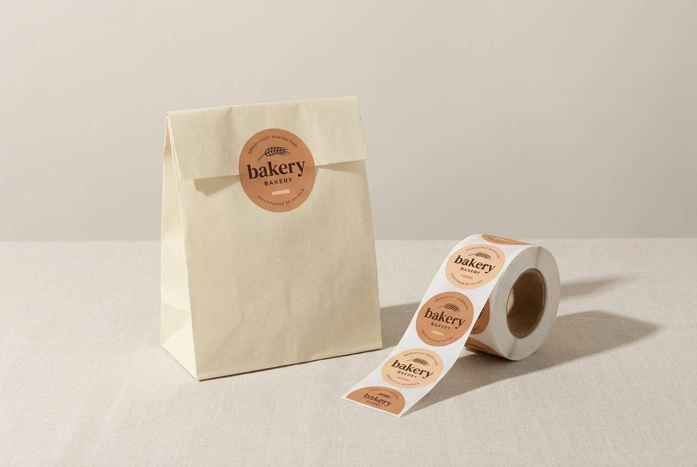
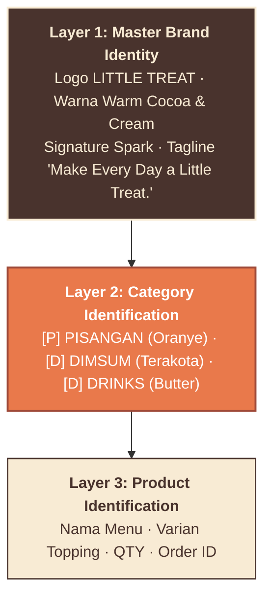
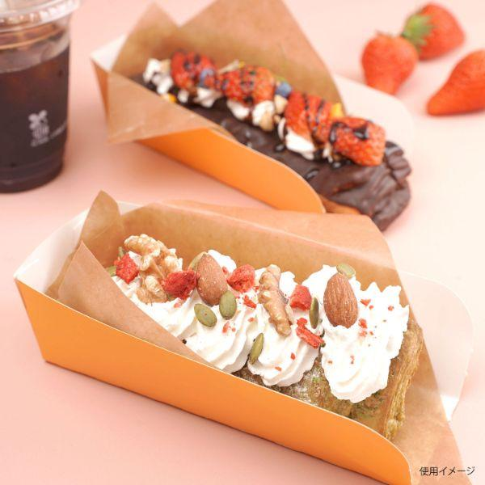
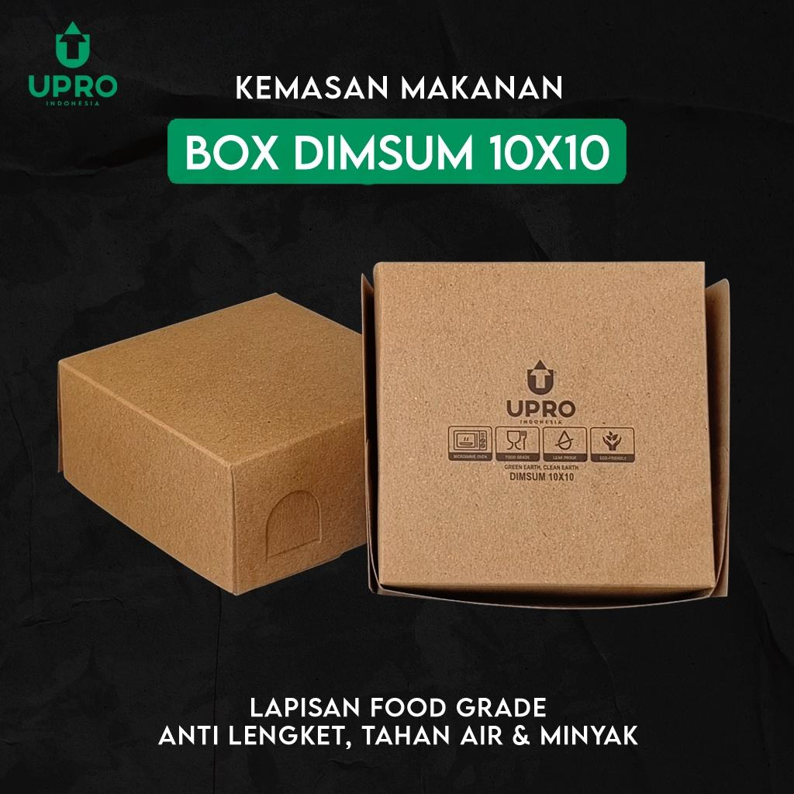
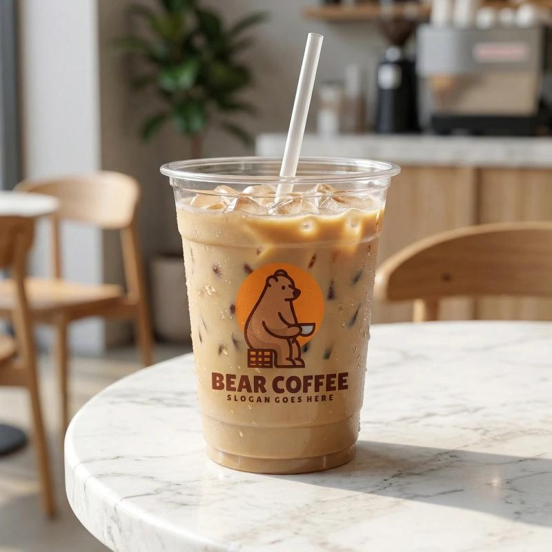
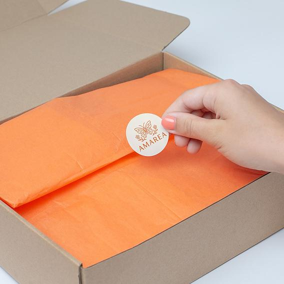
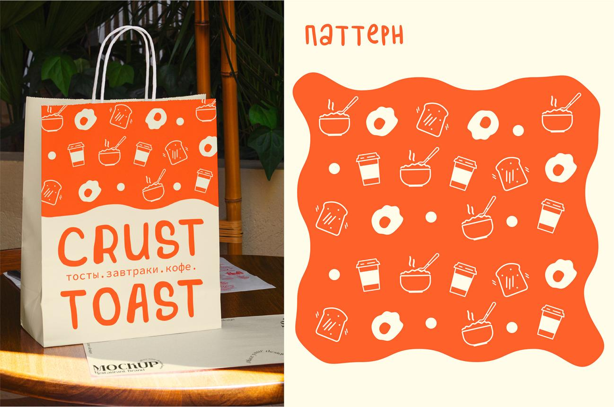

# LITTLE TREAT — Packaging Identity & Physical Engineering System

> [!abstract] **Spesifikasi Rekayasa Kemasan Fisik & Standar Unboxing**  
> Dokumen ini mengatur rekayasa fisik kemasan makanan (*Little Joy, Beautifully Packed*), penanganan ventilasi uap minyak, pemisahan saus, 5 elemen kemasan khas, strategi investasi ringan modal (*Asset-Light Packaging*), serta 7 protokol keamanan pangan (*food safety*).

---

## 1. Konsep Utama: Little Joy, Beautifully Packed

Kemasan adalah titik sentuh fisik pertama konsumen dalam bisnis pesan-antar makanan.



> **Prinsip Utama:** *"Good packaging doesn't need to be expensive. It needs to be intentional."*  
> Kemasan dirancang memenuhi dua tuntutan seimbang:
> 1. **Brand Experience:** Pengalaman membuka kemasan (*unboxing*) yang bersih, higienis, hangat, dan mengundang senyum.
> 2. **Operational Efficiency:** Cepat dirakit, hemat tempat, aman bersentuhan dengan makanan, dan tidak membebani HPP.

---

## 2. Arsitektur Kemasan 3 Lapisan (The 3-Layer System)

Mencegah penumpukan stok boks berbeda dengan menerapkan sistem seragam:



---

## 3. Rekayasa Fisik Kemasan per Kategori Produk

### A. PISANGAN (Golden & Crispy)
- **Wadah:** Food-grade paper box / tray laminasi anti-minyak + kertas roti alas (*greaseproof liner*).
- **Rekayasa Ventilasi Uap (Steam Vents):** Wajib memiliki 2–4 lubang ventilasi uap terukur.  
  > [!CRITICAL]
  > **Pantangan Fisika:** Uap panas minyak yang terperangkap dalam boks tertutup rapat akan mengembun dan menetes kembali ke makanan, membuat kulit pisang renyah menjadi basah, liat, dan lembek (*soggy*) dalam 15 menit perjalanan kurir.



### B. DIMSUM (Juicy & Moist)
- **Wadah:** Kraft lunch box 290–325 gsm laminasi PE tebal anti-bocor (*heat & moisture resistant*).
- **Wadah Saus Terpisah:** Saus chili oil/sambal wajib berada dalam mangkuk klip mini tertutup rapat (25–35 ml), **dilarang menyiram langsung saus ke atas dimsum** agar kulit dimsum tidak hancur selama pengiriman.



### C. DRINKS (Fresh & Chilled)
- **Wadah:** Gelas plastik transparan PP/PET 16–20 oz (warna alami minuman dipamerkan) + lid anti-bocor / cup sealer roll + sedotan ramah lingkungan steril terbungkus.



---

## 4. Lima Elemen Kemasan Khas (5 Signature Elements)

1. **Brand Sticker:** Stiker bulat/awan logo *Little TREAT* + signature spark pada boks polos.
2. **Product Label:** Informasi nama menu (*Choco Affair*), topping, dan jumlah pesanan (QTY).
3. **Sealing System:** Stiker segel anti-rusak (*tamper-evident hygiene seal*) sebagai bukti boks belum dibuka kurir.  
   
4. **Thank You Message:** Pesan personal hangat di boks: *"Made fresh to bring a little treat to your day. Enjoy every bite!"*.
5. **Carry Bag:** Paper bag kraft cokelat ramah lingkungan dengan stiker brand untuk pesanan combo.  
   

---

## 5. Strategi Investasi Kemasan: Asset-Light Bootstrapped Launch

```text
┌─────────────────────────────────────────────────────────────┐
│  TAHAP 1: ASSET-LIGHT LAUNCH (SEKARANG)                     │
│  • Beli boks polos food-grade standar dari distributor lokal│
│  • Kustomisasi via stiker segel & label kustom berkualitas  │
│  • Investasi modal ringan, fleksibilitas ganti desain tinggi │
├─────────────────────────────────────────────────────────────┤
│  TAHAP 2: FULL CUSTOM PRINTING (SETELAH VALIDASI)           │
│  • Cetak offset pabrik ribuan pcs baru dieksekusi setelah   │
│    volume penjualan stabil > 40–50 pesanan per hari.        │
└─────────────────────────────────────────────────────────────┘
```

---

## 6. Tujuh Protokol Kualitas & Keamanan Pangan (Food Safety)

1. Bersertifikasi aman kontak pangan (*food-grade certified*).
2. Tahan rembesan minyak minimal 2 jam (*greaseproof*).
3. Tahan panas uap makanan 70°C–80°C tanpa melengkung.
4. Mangkuk saus chili oil anti-bocor saat terguncang di motor.
5. Struktur boks kuat menahan beban tumpukan 3 lapis di tas kurir (*stacking rigidity*).
6. Ketahanan kerenyahan tervalidasi pada simulasi perjalanan motor 30–45 menit.
7. **Semua stiker, segel, dan tinta label wajib ditempatkan di luar kemasan** (nol kontak bahan kimia perekat/tinta dengan makanan).

---
*Dokumen ini merupakan spesifikasi kemasan fisik kanonikal LITTLE TREAT.*
