# TeeStock Drop 01 — Curated Design Commercial Pilot & Product Specification v1.0

> [!abstract] **Canonical Commercial Pilot & Merchandising Specification**  
> Dokumen ini adalah spesifikasi produk fisik, unit economics, alur transaksi terbimbing (*assisted commerce*), dan standar operasional untuk peluncuran **Drop 01 (Batch Perdana — November 2026)**. Dokumen ini menjadi jembatan operasional nyata antara visi strategis *Curated-Design-First* (`DEC-TS-2026-012`) dan kemampuan pemenuhan pesanan secara mandiri (*asset-light*).
>
> [!info] **Dependencies & Precedence (SSOT)**  
> [[bisnis/teestock/00-foundation/teestock-master-definition|TS-FND-001: Master Definition v2.0]] • [[bisnis/teestock/00-foundation/decision-register|TS-FND-004: Decision Register (DEC-012)]] • [[bisnis/teestock/02-brand/brand-architecture|TS-BRD-002: Brand Architecture]] • [[bisnis/teestock/03-commerce/catalog-merchandising-system|TS-COM-004: Catalog & Merchandising]] • [[bisnis/teestock/03-commerce/product-taxonomy|TS-COM-005: Product Taxonomy]]

---

## 1. Executive Pilot Mandate: Smallest Viable Commercial Test (SVCT)

TeeStock Drop 01 dirancang sebagai **eksperimen komersial berisiko rendah (*asset-light*)** untuk membuktikan permintaan nyata pasar terhadap kurasi desain apparel TeeStock tanpa membebani kas *founder* atau terjebak dalam pembuatan perangkat lunak transaksi yang prematur.

```text
PRINSIP UTAMA DROP 01:
Demand Validation > Heavy Software Planning
Assisted WhatsApp Commerce > Premature Automated Gateway
Guaranteed Margin (>50%) > Vanity Volume
Strict Zero Dead Stock > Speculative Bulk Inventory
```

### Hipotesis Kunci yang Diuji
1. **Willingness to Pay:** Konsumen bersedia membayar Rp149.000–Rp169.000 untuk kaos grafis terkurasi dengan bahan *heavyweight cotton* berkualitas dan *unboxing experience* premium.
2. **Konversi Assisted Commerce:** Tombol pemesanan langsung ke WhatsApp dengan teks terstruktur (*pre-filled inquiry*) mampu menghasilkan konversi penjualan tanpa friksi *login/account creation*.
3. **Repeatability & Margin:** Model produksi *Just-in-Time / Micro-Batch* menggunakan transfer DTF MultiGraph mampu menghasilkan kontribusi margin kotor > 50% dengan waktu pemenuhan (*dispatch SLA*) maksimal 48 jam.

### Metrik Keberhasilan (Target 14 Hari Peluncuran)
* **Volume Penjualan:** 30 s/d 50 potong kaos terjual dalam 14 hari pertama.
* **Margin Kontribusi Kotor:** Minimal Rp75.000 per potong kaos (Gross Margin ≥ 50%).
* **Dispute & Cacat Cetak:** 0% insiden luntur/rusak pada pencucian pertama; retur cacat < 2%.
* **Beban Waktu Founder:** < 30 menit per hari untuk penanganan chat & konfirmasi resi.

---

## 2. Kurasi Koleksi Drop 01: "Contemporary Graphic Series #01"

Koleksi perdana mengusung tema **Contemporary Graphic Series #01**, memadukan tipografi modern, estetika brutalist minimalis, dan pesan motivasi kontemplatif. Koleksi ini memamerkan 3 artikel *TeeStock Selects* dan 1 artikel rintisan *TeeStock Originals*.

| Kode SKU | Nama Artikel | Lini | Warna Kanvas | Penempatan Cetak | Konsep Visual & Pesan |
| :--- | :--- | :---: | :---: | :---: | :--- |
| `TS-D01-SEL-01` | **Midnight Typo Core** | *Selects* | Pitch Black | Dada Depan (Small) + Punggung (A3 Large) | Tipografi monokrom Swiss modern dengan *negative space* tajam dan aksen koordinat kota. |
| `TS-D01-SEL-02` | **Acid Botanical** | *Selects* | Vintage Cream | Dada Depan (A4 Medium Center) | Ilustrasi flora kontemporer dengan sentuhan distorsi digital halus dan palet warna bumi (*earth tone*). |
| `TS-D01-SEL-03` | **Industrial Wave** | *Selects* | Pitch Black | Punggung Atas (A3 Landscape) | Grafis teknikal geometris terinspirasi cetak saring analog dan arsip manufaktur tekstil. |
| `TS-D01-ORG-01` | **Do Your Best. (Vol. 01)** | *Originals* | Vintage Cream | Dada Kiri (Micro) + Belakang Leher (Typo) | Label rintisan berfilosofi personal; tipografi minimalis "Do Your Best." sebagai pengingat harian yang elegan. |

> [!IMPORTANT]
> **Pemisahan Hak Cipta (IP Hygiene):**
> * Artikel `SEL-01` s/d `SEL-03` (*Selects*) menggunakan desain yang telah memiliki hak lisensi komersial bebas royalti atau komisi kreator mandiri dengan dokumentasi tertulis.
> * Artikel `ORG-01` (*Originals*) merupakan merek dagang dan konsep orisinal yang sepenuhnya dimiliki oleh TeeStock.

---

## 3. Spesifikasi Garment Platform (Bahan & Pola)

Untuk menjamin kepuasan pembeli dan diferensiasi dari kaos suvenir murah, Drop 01 menggunakan platform garmen kelas atas (*premium streetwear canvas*):

### A. Material & Kain
* **Komposisi:** 100% Ring Spun Combed Cotton (Bahan adem, lembut, tidak berbulu).
* **Gramasi / Ketebalan:** **24s Heavyweight (185–195 GSM)** untuk iklim tropis, atau **16s Ultra-Heavyweight (220–235 GSM)** sebagai opsi koleksi berat.
* **Rib Leher:** 2.5 cm ribbed collar tebal (anti-melar / *no-bacon collar* dengan jahitan rantai ganda).
* **Finishing:** *Preshrunk & Bio-washed* (penyusutan setelah cuci < 3%).

### B. Pola Potongan: Indonesian Relaxed Oversized Fit
Pola potongan dirancang santai dengan pundak turun (*drop shoulder*) dan badan sedikit melebar tanpa terlihat gombrong:

| Ukuran | Lebar Dada (Chest Width) | Panjang Badan (Body Length) | Panjang Lengan (Sleeve) | Estimasi Berat Badan Rekomendasi |
| :---: | :---: | :---: | :---: | :---: |
| **M** | 54 cm | 70 cm | 23 cm | 50 – 65 kg |
| **L** | 57 cm | 73 cm | 24 cm | 65 – 78 kg |
| **XL** | 60 cm | 76 cm | 25 cm | 78 – 90 kg |
| **XXL** | 63 cm | 79 cm | 26 cm | 90 – 105 kg |

---

## 4. Spesifikasi Teknik Cetak DTF (MultiGraph Direct-to-Film)

Produksi cetak sepenuhnya dieksekusi melalui kapabilitas DTF internal/partner MultiGraph Group dengan parameter terstandar:

* **Tinta & Film:** Tinta pigmen tekstil elastis ramah lingkungan, bubuk perekat *high-grade polyurethane* elastis, dan film *matte release*.
* **Resolusi Cetak:** 1440 x 1440 DPI, densitas tinta putih (*white underbase*) 85% untuk warna tajam di atas kaos gelap tanpa kaku (*soft-hand feel*).
* **Profil Heat-Press:**
  1. *Press 1:* Suhu 160°C, durasi 15 detik, tekanan medium-tinggi (4–5 bar).
  2. *Peeling:* *Cold peel* (dibiarkan dingin total sebelum film dilepas untuk ketajaman mikro).
  3. *Press 2 (Finishing):* Suhu 160°C, durasi 5 detik dengan lembaran *teflon sheet* untuk membenamkan tinta ke serat kain dan memberi efek *doff/matte* premium.
* **Standar Ketahanan Cuci:** Minimal 35 siklus pencucian mesin tanpa retak (*cracking*) atau mengelupas (*peeling*).

---

## 5. Arsitektur Unit Economics & Struktur Harga

Perhitungan harga pokok penjualan (HPP) dibuat transparan dan konservatif agar bisnis memberikan arus kas bersih yang sehat sejak pesanan pertama:

### A. Rincian HPP per Unit (Bahan Baku + Cetak + Kemasan)

| Komponen Biaya | Rincian / Spesifikasi | Biaya (IDR) |
| :--- | :--- | :---: |
| **Kaos Polos Heavyweight** | Cotton Combed 24s/16s Oversized (Vendor Bandung/Jkt) | Rp44.000 |
| **Cetak DTF High-Res** | Kombinasi Dada Depan (Small) + Punggung (A3) via MultiGraph | Rp20.000 |
| **Label Leher & Woven Tag** | Heat-transfer label leher size + care instructions | Rp2.500 |
| **Kemasan (Packaging)** | Kraft Box E-flute die-cut / Frosted Ziplock Bag 30x40 cm | Rp4.500 |
| **Aksesoris Unboxing** | Kartu ucapan kurasi (*Care Card*) + Paket Stiker (3 pcs) | Rp2.000 |
| **Buffer Biaya & Packing** | Lakban kraft, silica gel, dan plastik luar pengiriman | Rp1.500 |
| **TOTAL HPP PRODUKSI** | **Biaya Modal Bersih per Kaos Siap Kirim** | **Rp74.500** |

### B. Penetapan Harga Jual (Pricing Architecture)

```text
Harga Ritel Normal (Full Price):       Rp169.000
Harga Rilis Perdana (Early Drop):     Rp149.000
-------------------------------------------------
Margin Kotor per Kaos (Early Drop):   Rp149.000 - Rp74.500 = Rp74.500
Persentase Margin Kotor (Gross %):    50.0%
-------------------------------------------------
Margin Kotor per Kaos (Normal Price): Rp169.000 - Rp74.500 = Rp94.500
Persentase Margin Kotor (Gross %):    55.9%
```

### C. Simulasi Proyeksi Kas (Target 50 Kaos Batch #1)
* **Total Modal Kerja yang Dibutuhkan:** 50 pcs x Rp74.500 = **Rp3.725.000**.
* **Total Omzet Penjualan (Early Drop):** 50 pcs x Rp149.000 = **Rp7.450.000**.
* **Laba Kotor yang Masuk Kas Founder:** **Rp3.725.000 bersih**.
* **Titik Impas (Break-even Point):** Cukup menjual **25 potong kaos** untuk mengembalikan 100% modal kerja; sisa 25 kaos adalah laba bersih murni.

---

## 6. Alur Transaksi: Assisted WhatsApp Commerce Flow

Menyelesaikan keputusan produk **`CX-DP-02` (Public Intake)** dan **`CX-DP-03` (Sellable Offer)** tanpa friksi teknologi rumit.

```mermaid
flowchart LR
    A["Katalog Web Storefront<br>(/shop/[slug])"] --> B["Klik Tombol<br>'Pesan via WhatsApp'"]
    B --> C["WhatsApp CS Otomatis<br>(Teks Order Terstruktur)"]
    C --> D["Konfirmasi Ketersediaan &<br>Hitung Ongkir Manual"]
    D --> E["Kirim Invoice & QRIS Statis<br>Kode Unik 3 Digit"]
    E --> F["Pembeli Transfer &<br>Kirim Bukti Bayar"]
    F --> G["Cetak DTF & Packing<br>(SLA 24-48 Jam)"]
    G --> H["Kirim Paket via Ekspedisi<br>+ Input Resi"]
```



### A. Template Format Pemesanan Otomatis (Deep-Link WhatsApp)
Saat calon pembeli menekan tombol *"Pesan via WhatsApp"* pada halaman detail produk di website, aplikasi WhatsApp akan langsung terbuka dengan teks pesan terisi otomatis:

```text
Halo TeeStock! Gue mau pesan kaos dari Drop 01:

- Artikel: [NAMA ARTIKEL, misal: Midnight Typo Core]
- Warna: [Pitch Black / Vintage Cream]
- Ukuran: [M / L / XL / XXL]
- Jumlah: [1 pcs]

Data Pengiriman:
- Nama Penerima: 
- Nomor HP/WA: 
- Alamat Lengkap: 
- Kecamatan & Kota: 
- Kode Pos: 

Mohon info total biaya dan nomor rekening pembayarannya ya!
```

### B. SOP Penanganan & Pembayaran Manual Terverifikasi
1. **Perhitungan Ongkos Kirim:** *Founder* memeriksa ongkir menggunakan aplikasi logistik (misal: Biteship/JNE/SiCepat) berdasarkan kecamatan tujuan.
2. **Instruksi Bayar dengan Kode Unik 3 Digit:**  
   Total bayar diberikan kode acak 3 digit terakhir (misal: Total Rp149.000 + Ongkir Rp10.000 + Kode Unik Rp142 = **Rp159.142**).  
   *Tujuan:* Memudahkan rekonsiliasi manual di mutasi rekening bank BCA/Mandiri tanpa perlu mencocokkan struk satu per satu.
3. **Penyimpanan Data Pesanan:** Data dicatat langsung ke formulir *Order Register* MGBOS internal.

---

## 7. Standar Kemasan & Pengalaman Unboxing (*Unboxing Experience*)

Kemasan adalah titik sentuh pertama fisik antara *brand* TeeStock dan pelanggan. Standar kemasan Drop 01 mencakup:

1. **Kemasan Utama:** *Kraft Corrugated Box E-Flute* (ukuran 30 x 22 x 5 cm) warna cokelat natural berstempel logo TeeStock minimalis hitam, atau *Frosted Matte Ziplock Pouch* tebal berlogo.
2. **Kertas Pelindung:** Kaos dibungkus kertas tisu (*white tissue paper*) dengan stiker segel bulat *TeeStock Quality Verified*.
3. **Kartu Panduan Perawatan (*Care Guide Card*):**
   * Cuci bagian sablon di dalam (*inside-out*).
   * Jangan disikat langsung pada permukaan sablon DTF.
   * Gunakan air dingin dan putaran mesin cuci normal.
   * Jangan disetrika langsung di atas sablon (setrika dari bagian dalam atau gunakan pelapis kain).
4. **Paket Stiker Promosi:** Setiap pesanan mendapat 2–3 stiker *die-cut vinyl matte* tahan air berisi visual grafis koleksi dan tipografi *TeeStock*.

---

## 8. Jadwal Peluncuran & Rencana Aksi (Timeline Nov 15)

| Tanggal | Target Milestone | Penanggung Jawab | Kriteria Selesai |
| :--- | :--- | :---: | :--- |
| **22 – 25 Okt** | Uji Coba Sampel Fisik (*Proofing Sample*) | Founder / MultiGraph | 4 sampel kaos selesai dicetak, di-press, dan diuji cuci 3x. |
| **26 – 28 Okt** | Pengadaan Bahan Baku Awal | Founder | 50 pcs kaos polos *heavyweight* (hitam & krem) masuk stok. |
| **29 – 31 Okt** | Sesi Foto Katalog & Mockup Ritel | Content / Creative | Foto produk asli (*flatlay*, *detail texture*, dan *on-model* sederhana) siap upload. |
| **01 – 07 Nov** | Update Konten Web Storefront | Builder / Antigravity | Halaman `/shop` memuat 4 artikel Drop 01 dengan tombol link WhatsApp aktif. |
| **08 – 14 Nov** | Teaser Media Sosial & Pre-Launch Drop | Founder / Marketing | Rilis konten visual *countdown*, narasi kurasi di Instagram/TikTok. |
| **15 Nov 2026** | **PELUNCURAN RESMI (DROP 01 LIVE)** | Founder / All | Pemesanan resmi dibuka; melayani pemesanan gelombang pertama. |

---

## 9. Sinyal Berhenti & Batas Risiko (*Stop Signals*)

Untuk melindungi modal dan reputasi bisnis, *founder* wajib menghentikan sementara penerimaan pesanan jika salah satu kondisi berikut terjadi:
1. **Defect Threshold:** Jika lebih dari 2 pesanan dari 10 pesanan pertama mengalami keluhan kualitas cetak atau jahitan lepas, **hentikan penjualan segera** untuk evaluasi mesin press dan bahan baku.
2. **Vendor Supply Bottleneck:** Jika pemasok kaos polos kehabisan stok ukuran L/XL lebih dari 3 hari kerja, tutup varian tersebut di website agar tidak menjual barang fiktif.
3. **Founder Burnout Signal:** Jika volume chat WhatsApp melebihi 20 percakapan per hari dan pengemasan memakan waktu > 2 jam per hari, **batasi pesanan menjadi sistem *Daily Quota*** (maksimal 10 pcs/hari) untuk menjaga kualitas hidup *solo founder*.

---

**Kepemilikan Semantik:** `bisnis/teestock/03-commerce/`  
**Otoritas Persetujuan:** Founder / Owner (Rizky)  
**Status Eksekusi:** Siap diintegrasikan sebagai panduan komersial resmi Drop Perdana.
