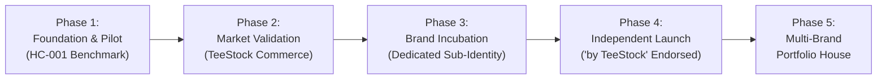

# TDL-06 — BRAND PORTFOLIO & INCUBATION ARCHITECTURE

> [!NOTE]
> **CANONICAL GLOBAL STANDARD — TDL-06**
> Otoritas: Standar kanonikal Brand Portfolio and Incubation Architecture studio.
## Strategic System: From Creative Identity to Independent Apparel Brands

**Document ID:** `TDL-06`
**Version:** 1.0 — Strategic Policy Baseline
**Status:** Approved Architectural Standard
**System:** TeeStock Design Lab (TDL) & MultiGraph Commerce Group
**Framework:** CRAFT (*Creative Reproducibility & Artwork Fidelity Technology*)
**Effective Date:** 2026-11-03

---

## 1. STRATEGIC THESIS: THE HYBRID BRAND INCUBATOR

TeeStock bukan sekadar merek kaos grafis tunggal dengan banyak kategori desain. **TeeStock adalah platform apparel, inkubator merek (brand incubator), dan mesin perdagangan (commerce engine).**

```
+-----------------------------------------------------------------------------------+
|                                    TEESTOCK                                       |
|                  Apparel Platform · Brand Incubator · Commerce                    |
+-----------------------------------------------------------------------------------+
                                         │
                                         ▼
+-----------------------------------------------------------------------------------+
|                               TEESTOCK ORIGINAL                                   |
|             Creative Division · Design Lab · Incubated Label Portfolio            |
+-----------------------------------------------------------------------------------+
                                         │
        ┌───────────────┬────────────────┼───────────────┬────────────────┐
        ▼               ▼                ▼               ▼                ▼
  [HUMAN COND.]  [MODERN DIS.]    [ODDLY ORD.]    [QUIET REB.]     [WILD ARCH.]  ...
  Creative Label  Creative Label   Creative Label  Creative Label   Creative Label
        │               │                │               │                │
        └───────────────┴────────────────┼───────────────┴────────────────┘
                                         ▼
                      [ 5-GATE GRADUATION CRITERIA ]
                                         │
                                         ▼
+-----------------------------------------------------------------------------------+
|                          TEESTOCK BRAND PORTFOLIO                                 |
|            Independent & Endorsed Brands ("by TeeStock" Heritage)                 |
+-----------------------------------------------------------------------------------+
                                         │
                     [ SHARED INFRASTRUCTURE SERVICES ]
  E-Commerce · Production & Blanks · Inventory & Fulfillment · Finance · QA Ops
```

### Model Hubungan Merek: Hybrid House of Brands
Daripada membangun 6 organisasi, 6 situs web, dan 6 sistem operasional yang terpisah sejak awal, TeeStock mengadopsi model **Hybrid Brand Portfolio** yang berkembang secara bertahap:
1. **Fase Embrio (Creative Identity):** Seluruh koleksi dilahirkan di bawah naungan **TeeStock Original** sebagai identitas kreatif terkurasi.
2. **Fase Validasi (Endorsed Brand):** Koleksi yang menunjukkan tarikan pasar (*organic traction*) dan pembelian berulang mulai diberi identitas mandiri dengan dukungan endorsement (misal: *HUMAN CONDITION by TeeStock*).
3. **Fase Mandiri (Independent Brand):** Merek yang lolos 5 Gerbang Kelulusan (*5-Gate Graduation*) beroperasi sebagai merek independen dengan arahan kreatif, komunitas, dan lini produk tersendiri, namun tetap menggunakan **infrastruktur bersama** (*shared operational backbone*).

---

## 2. TIGA WILAYAH BRAND TERKUNCI (THREE BRAND TERRITORIES)

Keenam koleksi dikelompokkan ke dalam 3 wilayah strategis untuk mencegah kanibalisasi dan memudahkan ekspansi di masa depan:

```
+-----------------------------------------------------------------------------------+
|                            THREE BRAND TERRITORIES                                |
+-----------------------------------------------------------------------------------+
| 01 — THINKING & CULTURE | Perspective, Intellect & Social Commentary              |
|                         | • HUMAN CONDITION (Wearable Social Commentary)          |
|                         | • MODERN DISORDER (Digital Culture & Modern Anxieties)  |
|                         | • QUIET REBELLION (Independent Expression & Defiance)   |
+-------------------------+---------------------------------------------------------+
| 02 — CHARACTER & NATURE | Emotional Connection, Creatures & The Living World      |
|                         | • ODDLY ORDINARY (Everyday Humor & Relatable Mascots)   |
|                         | • WILD ARCHIVE (Natural History & Botanical Plates)     |
+-------------------------+---------------------------------------------------------+
| 03 — PLACE & IDENTITY   | Local Narratives, Contemporary Indonesian Perspectives   |
|                         | • LOCAL FREQUENCIES (Urban Indonesian Cultural Stories) |
+-----------------------------------------------------------------------------------+
```

### Analisis Potensi Brand Tiap Koleksi

| Koleksi | Potensi Brand | Rekomendasi Status | Target Wilayah Produk |
| :--- | :---: | :--- | :--- |
| **HUMAN CONDITION** | **Sangat Kuat** | **Kandidat Brand Independen #1** | *Intellectual Graphic Apparel:* Kaos etsa editorial, sweatshirt kearsipan, limited art editions, publikasi berkonsep. |
| **MODERN DISORDER** | **Sangat Kuat** | **Kandidat Brand Independen #2** | *Contemporary Culture & Digital Streetwear:* Tech-inspired apparel, eksperimen tipografi digital, kapsul kolaborasi artis 3D/AI. |
| **ODDLY ORDINARY** | **Kuat** | **Kandidat Character Lifestyle Brand** | *Everyday Humor & Character Merchandise:* Kaos maskot, tote bags, stiker, merchandise gaya hidup sehari-hari. |
| **QUIET REBELLION** | **Menengah–Kuat** | **Sub-Brand Internal (Tahan Dulu)** | *Alternative Statement Apparel:* Kaos manifesto punk Swiss. *Wajib dibedakan dari HC: HC = apa yang diamati; QR = bagaimana kita bersikap.* |
| **WILD ARCHIVE** | **Kuat** | **Kandidat Niche Lifestyle Brand** | *Nature-Inspired Graphic Lifestyle:* Kaos botani/satwa pelat naturalis, perlengkapan outdoor kasual, jurnal ilustrasi alam. |
| **LOCAL FREQUENCIES** | **Kuat** | **Kandidat Cultural Lifestyle Brand** | *Contemporary Indonesian Cultural Apparel:* Kaos tipografi lokal urban, kapsul cerita kota/daerah, kolaborasi kreator regional. |

---

## 3. LIMA GERBANG KELULUSAN BRAND (5-GATE BRAND GRADUATION POLICY)

Sebuah koleksi **DILARANG** dinaikkan statusnya menjadi merek mandiri sebelum memenuhi seluruh persyaratan pada 5 gerbang berikut:

| Gerbang | Nama Gerbang | Standar Persyaratan Mutu | Bukti Verifikasi |
| :---: | :--- | :--- | :--- |
| **G1** | **Identity Distinctiveness** | Memiliki positioning yang tajam, target audiens yang jelas, dan bahasa visual yang khas (tidak bisa disubstitusi oleh koleksi lain). | Visual Style Bible & Brand Manifesto terkunci. |
| **G2** | **Product Cohesion** | Memiliki minimal **5–10 desain teruji** yang membentuk lini produk yang utuh, fungsional, dan memiliki daya pakai (*wearability*) tinggi. | Katalog aktif dengan skor QA $\ge 80/100$. |
| **G3** | **Market & Community Demand** | Terdapat bukti pembelian berulang (*repeat purchase*), bukan hanya lonjakan sesaat pada satu desain viral. Timbul komunitas pemakai organik. | Metrik penjualan: $\ge 20\%$ pembelian berulang / organik engagement. |
| **G4** | **Unit Economics** | Memiliki margin kontribusi (*contribution margin*) positif setelah memperhitungkan biaya bahan garmen, produksi DTF, komisi platform, dan akuisisi pelanggan. | Laporan laba kotor per SKU $\ge 50\%$. |
| **G5** | **Operational Scalability** | Dapat diproduksi dan dipenuhi secara massal melalui infrastruktur bersama TeeStock tanpa menimbulkan friksi inventori atau over-kompleksitas tim. | SOP produksi vendor & SLA fulfillment $\le 48\text{ jam}$. |

> [!NOTE]
> **Pertanyaan Uji Kritis Sebelum Kelulusan:**
> 1. Apakah konsumen membeli karena **nama labelnya**, atau hanya karena gambar tertentu yang kebetulan lucu/keren?
> 2. Apakah pembeli produk pertama tertarik membeli rilisan berikutnya dari label yang sama?
> 3. Apakah konsep label ini memiliki bahan cerita yang cukup untuk dikembangkan selama 3–5 tahun ke depan?

---

## 4. ANGKOR KONSUMEN: REALITAS WEARABILITY (JAKPAT DEC 2025)

Filosofi dan intelektualitas desain tidak boleh mengabaikan kenyamanan fisik garmen. Berdasarkan survei Jakpat (Desember 2025) terhadap 1.158 responden Gen Z Indonesia mengenai keputusan pembelian apparel:

```
[79%] Kenyamanan bahan saat dipakai (Comfort)
[65%] Harga terjangkau dan masuk akal (Affordability)
[61%] Kualitas jahitan dan daya tahan cuci (Durability)
[58%] Desain simpel namun menarik (Aesthetic Appeal)
[41%] Kesesuaian dengan kepribadian (Personality Fit)
```

### Hukum Ergonomi TeeStock:
- Desain berbobot intelektual tinggi (seperti *HUMAN CONDITION*) wajib menggunakan kain katun *heavyweight* 235 gsm yang lembut dan adem.
- Wajib menerapkan **Knockout Black 100%** agar sablon tidak kaku (*no sweat-patches*).
- Harga jual berada pada tier yang rasional bagi Gen Z/Millennials Indonesia (Rp 179.000 – Rp 199.000).

---

## 5. ROADMAP INKUBASI 5 FASE (PHASED INCUBATION ROADMAP)



### Tahapan Eksekusi:
1. **Fase 1 — TeeStock Original Foundation (Tahap Aktif Saat Ini):**
   Membangun 6 koleksi sebagai identitas kreatif terstruktur. Menjadikan `HC-001 — THE DANGEROUS SPECIES` sebagai benchmark perdana kontrol kualitas dan estetika.
2. **Fase 2 — Market Validation:**
   Meluncurkan desain-desain terbaik ke etalase online TeeStock. Menguji respons pasar, harga riil, dan tingkat konversi tanpa beban overhead merek mandiri.
3. **Fase 3 — Brand Incubation:**
   Koleksi yang menunjukkan tarikan pasar konsisten mendapatkan sub-identitas visual, akun media sosial terpisah, arahan editorial khusus, dan kemasan tematik.
4. **Fase 4 — Independent Brand Launch:**
   Label yang lolos 5 Gerbang Kelulusan didaftarkan perlindungan merek dagang resminya dan dirilis penuh dengan endorsement kecil: *“by TeeStock”*.
5. **Fase 5 — Multi-Brand Portfolio Expansion:**
   TeeStock beroperasi sebagai *holding platform* yang mengelola multi-brand apparel independen dengan audiens, harga, dan narasi yang saling melengkapi.

---

## 6. INFRASTRUKTUR BERSAMA (SHARED SERVICES BACKBONE)

Merek-merek independen di masa depan tidak membangun infrastruktur dari nol, melainkan memanfaatkan sistem bersama yang efisien:

```
+-----------------------------------------------------------------------------------+
|                        TEESTOCK SHARED INFRASTRUCTURE                             |
+-----------------------------------------------------------------------------------+
| • Commerce Engine      : Website multi-brand, payment gateway, checkout flow      |
| • Production & Blanks  : Vendor cetak DTF terstandarisasi, blank tee supply chain |
| • Fulfillment Ops      : Gudang terpadu, QC packing, integrasi ekspedisi logistik |
| • Financial & Legal    : Pembukuan terpusat, analitik margin, registrasi HKI      |
| • Creative Lab (TDL)   : SOP CRAFT, audit resolusi 300 PPI, riset visual AI-human |
+-----------------------------------------------------------------------------------+
```

---

## 7. KEPUTUSAN STRATEGIS TERKUNCI (GOVERNANCE LOCK)

1. **Prinsip Utama:** Enam koleksi bukan enam brand yang wajib dipaksakan berdiri; melainkan enam peluang merek yang akan diuji secara disiplin.
2. **Prioritas Inkubasi Koleksi:**
   - Prioritas 1: **`HUMAN CONDITION`** (Sedang dikembangkan).
   - Prioritas 2: **`MODERN DISORDER`** (Kandidat berikutnya).
   - Prioritas 3: **`ODDLY ORDINARY`** (Kandidat lifestyle berbasis karakter).
   - Prioritas 4: **`WILD ARCHIVE`** (Kandidat niche lifestyle alam).
   - Prioritas 5: **`LOCAL FREQUENCIES`** (Menunggu riset kultural mendalam).
   - Prioritas 6: **`QUIET REBELLION`** (Ditahan sebagai sub-brand internal sampai diferensiasi dari HC tervalidasi).
3. **Status Hukum Merek:** Seluruh nama koleksi berstatus nama kerja kreatif internal sampai dilakukan *trademark clearance* resmi saat masuk Fase 4.


---

## 8. THE 3-LAYER PORTFOLIO FUNNEL & EXPLORATORY SANDBOX

Untuk menjaga agar inkubator merek tetap menghasilkan peluang baru tanpa memicu hilangnya fokus eksekusi, portofolio dikelola melalui 3 lapisan disiplin:

```
┌──────────────────────────────────────────────────────────────────────────────────┐
│                           THE 3-LAYER BRAND FUNNEL                               │
├──────────────────────────────────────────────────────────────────────────────────┤
│ LAYER 1: CORE CONCEPTS (6 Locked Collections)                                    │
│ Enam koleksi awal yang telah memiliki konsep, charter, dan identitas dasar:       │
│ • TSO-01 HUMAN CONDITION (Priority 1 Pilot Benchmark)                            │
│ • TSO-02 MODERN DISORDER                                                         │
│ • TSO-03 ODDLY ORDINARY                                                          │
│ • TSO-04 QUIET REBELLION                                                         │
│ • TSO-05 WILD ARCHIVE                                                            │
│ • TSO-06 LOCAL FREQUENCIES                                                       │
├──────────────────────────────────────────────────────────────────────────────────┤
│ LAYER 2: EXPLORATORY CONCEPTS (8 Candidate Concepts — Open Sandbox)              │
│ Status: EXPLORATORY — NOT APPROVED FOR PORTFOLIO                                 │
│ 07. NOISE CULTURE (Music & subculture)                                            │
│ 08. MOTION STUDIES (Movement & outdoor)                                          │
│ 09. PLAYGROUND DEPT. (Play & imagination)                                        │
│ 10. FIELDWORK (Craft & maker culture)                                            │
│ 11. GOOD FORM (Wellbeing & lifestyle)                                            │
│ 12. FUTURE FOLK (Heritage & contemporary culture)                                │
│ 13. ELSEWHERE (Travel & exploration)                                             │
│ 14. FORM & FUNCTION (Design & objects)                                           │
├──────────────────────────────────────────────────────────────────────────────────┤
│ LAYER 3: FUTURE DISCOVERIES (Continuous Horizon Scanning)                        │
│ Ide-ide baru yang ditemukan secara berkelanjutan dari riset budaya, industri,     │
│ gaya hidup, seni, dan perilaku konsumen Gen Z.                                   │
└──────────────────────────────────────────────────────────────────────────────────┘
```

### Prinsip Operasional Layer 2 (Exploratory):
1. **Bebas dari Beban Produksi:** Seluruh ide di Layer 2 tidak memiliki komitmen produksi dan tidak dibuatkan folder koleksi fisik sebelum lolos evaluasi kurasi.
2. **Keterbukaan Iterasi:** Ide dapat digabungkan (*merger*), ditransformasikan menjadi seri/kapsul di dalam koleksi Layer 1, atau dieliminasi jika tidak memiliki pasar yang jelas.
3. **Kriteria Kenaikan ke Layer 1:** Suatu konsep eksploratif hanya dapat diangkat menjadi koleksi resmi jika memiliki diferensiasi tegas dari 6 koleksi inti, thesis statement orisinal, dan target audiens yang tervalidasi.
