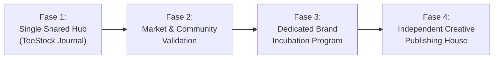

# TDL-08 — EDITORIAL UNIVERSE & CONTENT ENGINE ARCHITECTURE

> [!WARNING]
> **LEGACY — DO NOT USE AS AUTHORITY**
> Dokumen ini merupakan salinan historis sebelum integrasi EIS V2 dan rujukan pilot riset Human Condition terkini.
> Otoritas kanonikal dokumen TDL-08 berada di: [`06_GOVERNANCE/SOP/TDL-08_Editorial-Universe-and-Content-Engine-Architecture.md`](../../../../06_GOVERNANCE/SOP/TDL-08_Editorial-Universe-and-Content-Engine-Architecture.md).
## Strategic System: Apparel Meets Editorial Media in TeeStock Original

**Document ID:** `TDL-08`
**Version:** 1.0 — Strategic Standard Baseline
**Status:** Approved Architectural Standard
**System:** TeeStock Design Lab (TDL) & MultiGraph Media Commerce
**Framework:** CRAFT (*Creative Reproducibility & Artwork Fidelity Technology*)
**Effective Date:** 2026-11-04
**Parent Governance:** [`TDL-06 Brand Portfolio & Incubation Architecture`](TDL-06_Brand-Portfolio-and-Incubation-Architecture.md)

---

## 1. STRATEGIC THESIS: APPAREL MEETS EDITORIAL MEDIA

TeeStock Original memposisikan portofolio 6 merek terinkubasi bukan hanya sebagai SKU produk kaos, melainkan sebagai **6 Dunia Editorial (Editorial Universes)** dengan premis intelektual, pilar investigasi, dan cara pandang masing-masing.

```
┌────────────────────────────────────────────────────────────────────────┐
│                        THE APPAREL-MEDIA CYCLE                         │
├────────────────────────────────────────────────────────────────────────┤
│ CONTENT   : Riset mendalam, esai kearsipan, video essay, investigasi   │
│     ↓                                                                  │
│ COMMUNITY : Audiens loyal yang terhubung dengan cara pandang merek    │
│     ↓                                                                  │
│ APPAREL   : Kaos grafis sebagai artefak fisik dari gagasan yang diakui│
└────────────────────────────────────────────────────────────────────────┘
```

> [!IMPORTANT]
> **Prinsip Utama:** *"Setiap merek wajib memiliki sesuatu untuk dibicarakan, bukan hanya sesuatu untuk dijual."*
> Konsumen membeli produk bukan karena dipaksa promosi, melainkan karena produk tersebut merupakan representasi fisik dari pemikiran yang mereka sepakati.

---

## 2. ARSITEKTUR ENAM EDITORIAL UNIVERSE

```
+-----------------------------------------------------------------------------------+
|                                   TEESTOCK                                        |
|                          Apparel & Creative Ecosystem                             |
+-----------------------------------------------------------------------------------+
                                          │
                                          ▼
+-----------------------------------------------------------------------------------+
|                              TEESTOCK ORIGINAL                                    |
|                      Brand Incubation & Creative Lab                              |
+-----------------------------------------------------------------------------------+
                                          │
                                          ▼
+-----------------------------------------------------------------------------------+
|                           TEESTOCK JOURNAL (SHARED HUB)                           |
|                       Central Editorial & Publishing Hub                          |
+-----------------------------------------------------------------------------------+
         │               │                │               │                │
         ▼               ▼                ▼               ▼                ▼
   [HUMAN COND.]  [MODERN DIS.]    [ODDLY ORD.]    [QUIET REB.]     [WILD ARCH.]  ...
   Editorial Univ. Editorial Univ. Editorial Univ. Editorial Univ.  Editorial Univ.
   (The Human      (System Errors) (Daily Spec.)   (Beyond Script)  (Field Notes)
    Files)
```

### Matriks Editorial 6 Merek:

| No | Brand / Label | Territory Editorial | Nama Program Utama | Format Konten Unggulan |
| :---: | :--- | :--- | :--- | :--- |
| **01** | **HUMAN CONDITION** | Psikologi kognitif, bias, ego, moralitas, absurditas eksistensi | *THE HUMAN FILES* | Video essay, philosophical commentary, illustrated explainers |
| **02** | **MODERN DISORDER** | Algoritma digital, kultur kerja/burnout, konsumerisme, masa depan AI | *SYSTEM ERRORS* | Tech documentary, cultural critique, visual investigation |
| **03** | **ODDLY ORDINARY** | Keanehan hidup harian, momen canggung sosial, komedi situasi | *DAILY SPECIMENS* | Humorous observations, short docs, relatable visual notes |
| **04** | **QUIET REBELLION** | Kedaulatan berpikir, non-konformitas, perjalanan seniman mandiri | *BEYOND THE SCRIPT* | Creator documentary, deep interviews, personal manifestos |
| **05** | **WILD ARCHIVE** | Sejarah alam, taksonomi botani, satwa liar, ekologi evolusioner | *FIELD NOTES* | Nature documentary, naturalist field notes, scientific sketches |
| **06** | **LOCAL FREQUENCIES**| Antropologi kota, dialek lokal, kehidupan jalanan, ruang publik | *STORIES FROM HERE* | Street photography essay, cultural mini-docs, local stories |

---

## 3. THE LEAN CONTENT ENGINE: "SATU RISET, BANYAK FORMAT"

Menghindari fragmentasi kerja dan kelelahan operasional (*burnout*) bagi tim solo/ramping, seluruh produksi media mengikuti rantai nilai multi-format:

```
┌────────────────────────────────────────────────────────────────────────┐
│                        EDITORIAL CONTENT ENGINE                        │
├────────────────────────────────────────────────────────────────────────┤
│ 1. RESEARCH & INVESTIGATION                                            │
│    Studi literatur terpercaya, jurnal ilmiah, observasi lapangan       │
│                           ↓                                            │
│ 2. MASTER EDITORIAL SCRIPT                                             │
│    Naskah narasi lengkap yang telah melewati fact-checking             │
│                           ↓                                            │
│ 3. MULTI-FORMAT DERIVATION                                             │
│    ├── Long-Form Video Essay (YouTube 8–12 menit)                     │
│    ├── Published Journal Essay (Website / Blog)                       │
│    ├── Educational Carousel (Instagram 3–5 slides)                    │
│    ├── Reflective Shorts / Reels (60 detik)                           │
│    └── Community Discussion Question                                  │
│                           ↓                                            │
│ 4. APPAREL ARTWORK & PRODUCT STORYTELLING (Selektif & Organik)         │
│    Konsep visual inti diangkat menjadi desain kaos berlisensi          │
└────────────────────────────────────────────────────────────────────────┘
```

> [!NOTE]
> **Integritas Komersial:** Tidak semua riset editorial wajib diubah menjadi desain kaos. Konten editorial harus memiliki nilai mandiri tanpa terkesan sebagai iklan terselubung.

---

## 4. STANDAR AKURASI & ETIKA PENERBITAN (EDITORIAL INTEGRITY)

Setiap publikasi editorial di bawah naungan TeeStock Original terikat pada standar etika jurnalisme kreatif:
1. **Verifikasi Sumber Rujukan:** Wajib mencatat referensi ilmiah (jurnal psikologi, paper sains alam, data statistik resmi).
2. **Pemisahan Opini & Fakta:** Batasan yang jelas antara fakta empiris, tafsir filosofis, dan opini kurator.
3. **Legalitas Hak Cipta & Atribusi:** Penggunaan rekaman arsip domain publik atau lisensi resmi; mencantumkan kredit fotografer dan periset.
4. **Transparansi AI:** Wajib mengungkapkan secara transparan (*AI Disclosure*) apabila terdapat elemen visual/naskah yang dibantu pembuatannya oleh model AI.
5. **Anti-Eksploitasi Kultural:** Mengangkat realitas budaya lokal dengan empati dan riset mendalam, bukan komodifikasi stereotip.

---

## 5. STRATEGI IMPLEMENTASI BERTAHAP (4-PHASE ROLLOUT)



### Urutan Peluncuran Tiga Editorial Universe Pertama:
1. **`HUMAN CONDITION` (Priority 1):** Menguji format video essay filosofis (*Why We Think We Are More Rational Than We Really Are*).
2. **`MODERN DISORDER` (Priority 2):** Menguji investigasi budaya digital & ekonomi atensi (*The Business of Keeping You Scrolling*).
3. **`LOCAL FREQUENCIES` (Priority 3):** Menguji format antropologi visual dan cerita jalanan Indonesia (*The Unwritten Language of Indonesian Street Life*).

Ketiga universe ini dipilih sebagai *pilot wave* karena memiliki perbedaan format visual dan gaya penyampaian cerita yang paling tegas, memudahkan evaluasi respon audiens sebelum memperluas produksi ke tiga merek lainnya.
