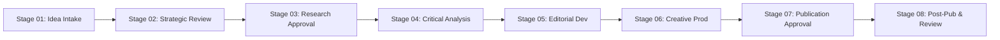

# HUMAN CONDITION — EDITORIAL DECISION & GOVERNANCE SYSTEM V1

> [!NOTE]
> **SUPPORTING GOVERNANCE STANDARD — ROLES & ACCOUNTABILITY**
> Dokumen ini adalah standar tata kelola pendukung yang mengatur 6 peran kognitif, hak pengambilan keputusan, klasifikasi risiko editorial (R0–R5), transparansi AI, dan kebijakan 3 tingkat koreksi (Minor Update, Clarification/Errata, Formal Retraction). Dokumen ini beroperasi di dalam dan mendukung siklus hidup kanonikal G0–G8 pada [HUMAN_CONDITION_EDITORIAL_INTELLIGENCE_SYSTEM_V2.md](HUMAN_CONDITION_EDITORIAL_INTELLIGENCE_SYSTEM_V2.md), bukan menetapkan siklus hidup proyek yang bersaing.

**System:** Editorial Intelligence System
**Governance scope:** Cross-system
**Status:** Canonical Working Standard — Locked
**Applies to:** All Human Condition editorial, research, publication, visual, and related apparel projects.
**Core philosophy:** We are the observers, the subjects, and sometimes the problem.
**Effective Date:** 2026-11-04

---

# 01. PURPOSE

The Editorial Decision & Governance System establishes how Human Condition makes, documents, reviews, approves, and revises editorial decisions.

Its purpose is to ensure that:
- Every editorial project has a clear owner.
- Decisions are made at the appropriate stage.
- Research and arguments meet defined standards.
- Publication risks are identified before release.
- Rights and source attribution are respected.
- AI-assisted work remains accountable.
- Editorial errors can be corrected transparently.
- The brand maintains intellectual consistency as it grows.

Governance is not intended to slow down creative work. It exists to protect the quality and integrity of the work.

> [!IMPORTANT]
> **Guiding Principle:**
> *Creative freedom requires clear boundaries, and editorial credibility requires accountable decisions.*

---

# 02. GOVERNANCE ARCHITECTURE

Governance operates across all seven Editorial Intelligence System layers:

| System layer | Primary responsibility |
| :--- | :--- |
| **01. Strategic Intelligence** | Identify and evaluate editorial opportunities |
| **02. Idea & Opportunity Management** | Maintain and prioritize the idea portfolio |
| **03. Research & Evidence Intelligence** | Establish and verify supporting evidence |
| **04. Critical Analysis & Argumentation** | Test arguments and conclusions |
| **05. Editorial Development** | Translate approved arguments into stories |
| **06. Content & Creative Production** | Produce and quality-check publication assets |
| **07. Performance & Learning** | Evaluate results and inform future decisions |

Governance controls are applied throughout the process. It is not an additional production department.

### Cross-System Governance Responsibilities:
1. Decision authority.
2. Project ownership.
3. Quality assurance.
4. Risk management.
5. Rights and permissions.
6. AI accountability.
7. Version control.
8. Corrections and appeals.
9. Performance review.

---

# 03. ROLES & RESPONSIBILITIES

Governance must distinguish responsibilities even when one person initially performs several roles.

## A. OWNER / BRAND STEWARD
Responsible for protecting the overall Human Condition identity.
- Approve brand philosophy and material changes.
- Set strategic priorities.
- Approve major editorial direction.
- Resolve strategic disagreements.
- Approve publication of flagship projects.
- Protect the long-term brand positioning.
- *The Owner is the final accountable decision-maker for the brand.*

## B. EDITORIAL LEAD
Responsible for maintaining editorial relevance and coherence.
- Review proposed topics.
- Ensure alignment with editorial pillars.
- Evaluate storytelling and editorial positioning.
- Review scripts and publications.
- Confirm editorial readiness.
- Coordinate publication decisions.

## C. RESEARCH LEAD
Responsible for evidence discovery and research documentation.
- Develop research scope.
- Identify and appraise sources.
- Maintain the claim evidence ledger.
- Document research limitations.
- Identify conflicting findings.
- Prepare research approval recommendations.

## D. CRITICAL REVIEWER
Responsible for challenging the reasoning and conclusions.
- Review argument maps.
- Identify hidden assumptions.
- Challenge weak inferences.
- Examine alternative explanations.
- Conduct contradiction tests.
- Record unresolved weaknesses.
- *This role should challenge the author rather than defend the author's preferred conclusion.*

## E. CREATIVE & PRODUCTION LEAD
Responsible for visual and technical execution.
- Develop visual direction.
- Review design and storytelling assets.
- Ensure consistency with brand identity.
- Review media quality.
- Coordinate publication materials.
- Check usage rights for creative assets.

## F. RIGHTS & COMPLIANCE REVIEWER
Responsible for identifying rights, privacy, attribution, and publication concerns.
- Verify image and video permissions.
- Review quotation and reproduction requirements.
- Check music, footage, and font licenses.
- Identify privacy and reputational risks.
- Escalate sensitive editorial issues for appropriate review.
- *At the initial stage, this can be a designated review function rather than a full-time position.*

---

# 04. LEAN GOVERNANCE MODEL

Human Condition is expected to begin with limited operational resources. Therefore, role separation must exist conceptually before it exists organizationally.

## Initial Operating Model

| Function | Initial arrangement |
| :--- | :--- |
| **Owner / Brand Steward** | Owner (Rizky) |
| **Editorial Lead** | Owner or designated editorial lead |
| **Research Lead** | Owner with AI research assistance |
| **Critical Reviewer** | Separate review pass, supported by AI critique |
| **Creative & Production Lead** | Owner or external creative collaborator |
| **Rights & Compliance Review** | Owner, with specialist assistance where required |

### Important Distinction on AI
- AI can support research, draft critiques, source organization, and quality-control checklists.
- AI is not an independent human expert reviewer.
- It cannot certify a scientific conclusion, replace a qualified professional opinion, or take legal responsibility for publication.
- For sensitive or high-consequence subjects, appropriate human specialist review may be necessary.

### Separation-of-Duties Principle
When the same person performs multiple roles, they should perform the reviews as distinct stages:
1. Develop the argument.
2. Set aside the author perspective.
3. Review the argument as a critical examiner.
4. Document identified weaknesses.
5. Revise and re-evaluate.
6. Record final approval.

*This is not equivalent to independent review, but it is better than approving work without a separate critical pass.*

---

# 05. EDITORIAL PROJECT LIFECYCLE

Every major editorial project follows this 8-stage lifecycle:



### STAGE 01 — IDEA INTAKE
- An idea enters the Master Editorial Idea Bank.
- **Required:** Unique Editorial ID, Working title, Editorial pillar, Initial phenomenon or question, Discovery source, Initial rationale.
- **Decision authority:** Editorial Lead.
- **Output:** Registered candidate.

### STAGE 02 — STRATEGIC REVIEW
- Apply the Strategic Intelligence Framework.
- **Evaluate:** Brand relevance, Audience relevance, Editorial differentiation, Intellectual depth, Storytelling potential, Long-term development potential.
- **Decision authority:** Editorial Lead, with Owner approval for flagship priorities.
- **Possible outcomes:** ADVANCE, RESEARCH FURTHER, HOLD, REFRAME, REJECT.
- **Output:** Approved opportunity brief or documented rejection.

### STAGE 03 — RESEARCH APPROVAL
- Apply the Research & Evidence Protocol.
- **Evaluate:** Scope clarity, Source availability, Evidence quality, Research limitations, Conflicting findings, Claim traceability.
- **Decision authority:** Research Lead.
- **Possible outcomes:** PASS, PASS WITH QUALIFICATIONS, MORE RESEARCH REQUIRED, REFRAME, STOP.
- **Output:** Research dossier.

### STAGE 04 — CRITICAL ANALYSIS
- Apply the Critical Analysis & Contradiction Protocol.
- **Evaluate:** Thesis defensibility, Argument structure, Hidden assumptions, Alternative explanations, Disconfirming evidence, Logical consistency, Scope discipline, Red-team findings.
- **Decision authority:** Editorial Lead following critical review.
- **Output:** Approved editorial argument map.

### STAGE 05 — EDITORIAL DEVELOPMENT
- **Develop:** Narrative direction, Story structure, Script or article, Opening and closing, Visual storytelling requirements, Citations and source integration, Audience comprehension.
- **Decision authority:** Editorial Lead.
- **Output:** Approved editorial manuscript.

### STAGE 06 — CREATIVE PRODUCTION
- **Produce:** Video and audio, Illustrations, Photography, Motion graphics, Thumbnails, Captions and subtitles, Social media adaptations, Supporting publication assets.
- **Review:** Content accuracy, Brand consistency, Production quality, Rights and licensing, Accessibility and readability.
- **Decision authority:** Creative & Production Lead within the approved editorial brief.
- **Output:** Publication candidate.

### STAGE 07 — PUBLICATION APPROVAL
- Conduct the final review.
- **Confirm:** Editorial content is approved, Factual claims have been verified, Critical weaknesses are resolved or qualified, Publication rights are cleared, Sensitive issues have been reviewed, Assets match the approved content, Citations and attribution are complete.
- **Final authority:** Owner / Brand Steward.
- **Output:** APPROVED FOR PUBLICATION.

### STAGE 08 — PUBLICATION & PERFORMANCE REVIEW
- **After publication:** Record publication details, Capture performance indicators, Review audience feedback, Identify corrections, Document creative lessons, Reassess strategic relevance, Record future opportunities.
- **Decision authority:** Editorial Lead.
- **Output:** Completed project record and learning notes.

---

# 06. DECISION RIGHTS MATRIX

Different decisions require different authorities:

| Decision | Responsible function | Final authority |
| :--- | :--- | :--- |
| Brand philosophy change | Editorial Lead | Owner |
| New editorial topic | Editorial Lead | Editorial Lead |
| Research completion | Research Lead | Editorial Lead |
| Critical argument review | Critical Reviewer | Editorial Lead |
| Script approval | Editorial Lead | Owner for flagship work |
| Visual production approval | Creative Lead | Editorial Lead |
| Rights clearance | Rights Reviewer | Owner |
| Flagship publication | Editorial Lead | Owner |
| Minor content correction | Editorial Lead | Editorial Lead |
| Major correction or retraction | Editorial Lead | Owner |
| Editorial strategy change | Editorial Lead | Owner |

> [!NOTE]
> - A person can be responsible for producing an asset without having authority to approve a material factual claim.
> - A publication can pass production review while still failing editorial approval.
> - These responsibilities must remain distinct.

---

# 07. APPROVAL GATES (G0 — G7)

Each project must pass the relevant gates before proceeding:

| Gate | Approval condition |
| :--- | :--- |
| **G0 — Registration** | Idea is documented in the Master Idea Bank |
| **G1 — Strategic fit** | Opportunity is justified via Strategic Intelligence Framework |
| **G2 — Research readiness** | Evidence is sufficient to proceed via Evidence Ledger |
| **G3 — Argument integrity** | Thesis survives critical examination & Contradiction Test |
| **G4 — Editorial readiness** | Narrative and manuscript are approved |
| **G5 — Production readiness** | Assets, accuracy, and rights are checked |
| **G6 — Publication approval** | Final release is authorized by Owner |
| **G7 — Post-publication review** | Performance and corrections are documented |

### Gate Rules:
1. A project cannot skip a mandatory gate merely to meet a publishing deadline.
2. However, review depth can be scaled according to the project's risk and complexity.
3. An editorial project rejected at one gate may be revised and resubmitted.
4. Every rejection or deferral should include a brief documented reason.

---

# 08. CONTENT RISK CLASSIFICATION

Use three risk tiers to determine procedural rigor:

## LEVEL A — LOW RISK
- **Examples:** General observations, Non-sensitive visual commentary, Clearly labeled opinions, Low-consequence cultural observations.
- **Requirements:** Brand and factual consistency, Appropriate attribution, Basic rights check.

## LEVEL B — MODERATE RISK
- **Examples:** Psychological explanations, Scientific interpretations, Social and cultural generalizations, Historical narratives, Discussions involving identifiable public events, Topics with meaningful reputational implications.
- **Requirements:** Verified sources, Claim-level evidence review, Scope and limitations, Critical analysis, Rights review, Editorial approval.

## LEVEL C — HIGH RISK
- **Examples:** Allegations about identifiable individuals, Sensitive political accusations, Health or mental-health claims that may influence decisions, Serious criminal or misconduct allegations, Highly sensitive historical or cultural disputes, Material involving private individuals or confidential information.
- **Requirements:** Enhanced evidence review, Independent human review where appropriate, Privacy and rights assessment, Specialist review when necessary, Explicit publication approval by Owner.

> [!CAUTION]
> If a project requires legal or professional expertise, obtain that expertise rather than treating an AI assessment as sufficient.
> **Risk Principle:** High-risk content may still be publishable, but its evidence, editorial justification, and review requirements must be stronger.

---

# 09. RIGHTS, PERMISSIONS & ATTRIBUTION GOVERNANCE

Every publication must respect the rights of source materials and contributors.

### Assets Requiring Review:
- Photographs, Video footage, Music and sound effects, Illustrations, Fonts, Archival materials, Third-party graphics, Quotations, Logos and trademarks, Interview recordings.

### Required Asset Record:
- Asset ID, Asset description, Original creator, Source location, License type, Permission record, Attribution requirement, Commercial-use permission, Modification permission, Usage limitations, Expiry or territory limitations.

### Mandatory Standards:
- Do not assume that publicly accessible content is free to reuse.
- Do not assume that attribution alone grants reproduction permission.
- Respect license restrictions.
- Obtain appropriate releases for interviews and identifiable private individuals when necessary.
- Check commercial-use permissions for artwork connected to apparel.
- Keep records of creator agreements and collaboration terms.
- *When rights are unclear, use alternative assets or obtain permission.*

---

# 10. AI ACCOUNTABILITY

AI tools may support the Human Condition editorial operation. However, the brand remains accountable for what it publishes.

### AI May Assist With:
- Research discovery, Literature mapping, Initial source summaries, Drafting, Translation, Argument mapping, Contradiction testing, Editing, Visual concept development, Production assistance, Performance analysis.

### AI Must Not Independently Approve:
- Scientific conclusions, Historical factual claims, Legal conclusions, High-risk allegations, Rights clearance, Final publication decisions.

### Human Accountability:
- A designated human owner must remain responsible for verifying important claims, reviewing final material, approving publication, resolving corrections, and ensuring rights and permissions are addressed.
- AI-generated images, audio, or other materials must also be reviewed for accuracy, rights implications, and potential misrepresentation.

### Internal AI Usage Record:
For material AI-assisted projects, record: Tool/system used, Purpose, Important generated material, Human verification, Material changes made, Final reviewer.

---

# 11. VERSION CONTROL & DECISION LOG

Every major editorial project must have a traceable history.

### Version Naming Syntax:
`[PROJECT-ID]_[DOCUMENT-TYPE]_[VERSION]_[STATUS]`

*Examples:*
```
HC-E01_RESEARCH-DOSSIER_V0.1_DRAFT
HC-E01_ARGUMENT-MAP_V1.0_APPROVED
HC-E01_SCRIPT_V0.3_REVIEW
HC-E01_SCRIPT_V1.0_APPROVED
HC-E01_PUBLICATION-PACKAGE_V1.0_RELEASED
```

### Version Principles:
1. Drafts are not approved documents.
2. Approved versions must not be silently overwritten.
3. Material changes require a new version.
4. Rejected versions should be preserved when necessary for traceability.
5. The publication must be linked to the exact approved source and script versions.

### Decision Log Fields:
- Decision ID, Project ID, Decision date, Decision made, Responsible reviewer, Supporting evidence or reasoning, Outstanding conditions, Next action.

---

# 12. EDITORIAL CORRECTIONS & RETRACTIONS

Human Condition must maintain a transparent public correction policy. The response depends on seriousness:

## LEVEL 1 — MINOR CORRECTION
- **Examples:** Typographical errors, Minor wording improvements, Non-material formatting corrections.
- **Action:** Correct the relevant asset; update the version record when appropriate.

## LEVEL 2 — MATERIAL CORRECTION
- **Examples:** Incorrect statistics, Misattributed quotations, Misrepresentation of a research finding, An important missing qualification, Incorrect historical details affecting interpretation.
- **Action:** Review the problem $\rightarrow$ Verify correct information $\rightarrow$ Correct content $\rightarrow$ Add visible correction notice $\rightarrow$ Preserve internal diff $\rightarrow$ Record learning.

## LEVEL 3 — RETRACTION OR WITHDRAWAL
- **Examples:** Central thesis materially unsupported, Serious factual distortion, Rights violations, Significant privacy violations, Substantial misleading representation.
- **Action:** Temporarily remove or restrict publication where necessary $\rightarrow$ Full investigation $\rightarrow$ Transparent explanation $\rightarrow$ Preserve internal audit record.

> [!IMPORTANT]
> **Correction Principle:**
> The brand should protect the accuracy of its work rather than protect its reputation through silence.

---

# 13. DISAGREEMENT & ESCALATION

Disagreements are expected in serious editorial work. They must be resolved based on evidence, reasoning, responsibilities, and risk.

### Escalation Order:
1. Direct clarification between responsible roles.
2. Review of sources and arguments.
3. Independent critical assessment.
4. Editorial Lead decision.
5. Owner decision for unresolved strategic or publication issues.
6. Specialist consultation where appropriate.

### Non-Negotiable Principle:
The Owner may decide brand direction and whether to publish. **However, a strategic preference cannot transform unsupported information into established fact.** If the evidence does not support a claim, the claim must be revised, qualified, or removed.

---

# 14. EDITORIAL STATUS SYSTEM

Standardized project statuses:

| Status | Meaning |
| :--- | :--- |
| `IDEA` | Initial candidate |
| `REGISTERED` | Added to the idea bank |
| `STRATEGIC REVIEW` | Opportunity being evaluated |
| `ADVANCED` | Approved for deeper research |
| `RESEARCH` | Research in progress |
| `RESEARCH REVIEW` | Evidence awaiting evaluation |
| `CRITICAL REVIEW` | Argument under examination |
| `REFRAMING` | Scope or thesis being revised |
| `EDITORIAL DEVELOPMENT` | Outline or script being developed |
| `EDITORIAL REVIEW` | Manuscript awaiting approval |
| `CREATIVE PRODUCTION` | Assets being produced |
| `PRODUCTION REVIEW` | Assets under review |
| `APPROVED` | Publication approved |
| `SCHEDULED` | Publication assigned a release date |
| `PUBLISHED` | Publicly released |
| `CORRECTION` | Material correction in progress |
| `RETRACTED` | Publication withdrawn |
| `ON HOLD` | Temporarily paused |
| `REJECTED` | Closed without publication |
| `ARCHIVED` | Retained for historical reference |

*A project must have one current primary status. Review notes are kept in the project record.*

---

# 15. EDITORIAL DECISION RECORD TEMPLATE

Every flagship project maintains a unified record covering:
1. **Project Identification:** Editorial ID, Title, Pillar, Program, Risk level, Status, Owner.
2. **Strategic Decision:** Opportunity score, Rationale, Audience hypothesis, Differentiation, G1 outcome.
3. **Research Decision:** Readiness score, Evidence assessment, Unresolved claims, Source approval, G2 outcome.
4. **Critical Decision:** Thesis, Argument map, Contradiction findings, Red-team review, Defensibility, G3 outcome.
5. **Editorial Decision:** Manuscript version, Editorial notes, Scope bounds, G4 outcome.
6. **Production Decision:** Asset version, QA results, Rights check, Risk check, G5 outcome.
7. **Publication Decision:** Final approver, Release version, Platforms, Date, G6 outcome.
8. **Post-Publication:** Performance review, Corrections, Audience feedback, Lessons, G7 outcome.

---

# 16. GOVERNANCE OPERATING MODEL BY SCALE

Governance grows only when operational complexity demands it:

## PHASE A — OWNER-OPERATED (Current Baseline)
- The Owner performs multiple roles with separated cognitive passes.
- Controls: Documented approvals, claim-level evidence records, clear publication gate, external expert check when necessary.

## PHASE B — SMALL CREATIVE TEAM
- Separate research, editorial, and production responsibilities.
- Controls: Explicit task handoffs, peer review, role-based approvals, shared documentation system.

## PHASE C — INDEPENDENT BRAND OPERATION
- Formal editorial leadership, research standards, production review, rights management, performance oversight.
- Controls: Delegated responsibilities, formal audit committees, independent critical review.

*Do not implement Phase C bureaucracy while operating at Phase A.*

---

# 17. GOVERNANCE AUDIT CHECKLIST

Periodically evaluate whether the governance system is working:
1. Were all mandatory gates completed?
2. Were source and claim records maintained?
3. Were significant counterarguments documented?
4. Were publication decisions traceable?
5. Were rights and permissions checked?
6. Were errors corrected appropriately?
7. Did the process create unnecessary delays?
8. Did any mandatory control fail?
9. Were responsibilities clear?
10. Did the system improve editorial quality?

---

# 18. LEAN IMPLEMENTATION RULES

To keep the system practical and avoid bureaucratic drag:
- Use one project record rather than duplicating information across multiple documents.
- Automate metadata and administrative tracking where appropriate.
- Reserve full research dossiers for meaningful investigations.
- Use risk-based review depth.
- Avoid requiring formal approval for every small creative adjustment.
- Keep decisions and their rationale concise.
- Separate mandatory controls from recommended practices.
- Review procedures periodically and remove steps that provide no meaningful value.

> [!TIP]
> *A control should exist because it reduces a real risk or improves a real decision.*

---

# 19. THE 10 GOVERNING PRINCIPLES

1. **No publication without accountable approval.**
2. **No important factual claim without appropriate verification.**
3. **No material thesis without critical examination.**
4. **No unlicensed asset without appropriate permission.**
5. **No AI output without responsible human review.**
6. **No material error left unaddressed.**
7. **No decision without a clear rationale when it materially affects the project.**
8. **No governance process without a practical purpose.**
9. **No strategic preference can override evidence integrity.**
10. **No system should be more complicated than its operational value justifies.**

---

# 20. FINAL GOVERNANCE PRINCIPLE

Human Condition must be able to create freely, investigate rigorously, disagree intelligently, and take responsibility for what it publishes.

The brand should never confuse authority with certainty.

**Creative independence requires intellectual responsibility.**

---

**Document status:** EDITORIAL DECISION & GOVERNANCE SYSTEM V1
**Governance scope:** Cross-system
**Next stage:** Editorial Intelligence System Integration & Operational Validation.
