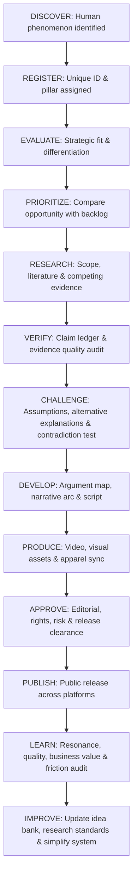

# HUMAN CONDITION — EDITORIAL INTELLIGENCE SYSTEM V2
## Integrated Operating Model & Operational Validation

**Brand:** HUMAN CONDITION  
**Parent:** TeeStock Original  
**Tagline:** An observation of the human species.  
**Core philosophy:** We are the observers, the subjects, and sometimes the problem.  
**System status:** Integrated Master Operating Standard  
**Document ID:** `TSO-HC-EIS-002`  
**Effective Date:** 2026-11-04  
**Purpose:** Establish a practical, evidence-conscious, strategically differentiated editorial operating system that unites editorial rigor with apparel brand equity.

---

# 01. SYSTEM OBJECTIVE

The Human Condition Editorial Intelligence System is designed to identify meaningful subjects, investigate them rigorously, develop defensible arguments, produce compelling editorial work, and learn from audience and business outcomes.

It integrates seven operational layers:
1. Strategic Intelligence.
2. Idea & Opportunity Management.
3. Research & Evidence Intelligence.
4. Critical Analysis & Argumentation.
5. Editorial Development.
6. Content & Creative Production.
7. Performance & Learning Intelligence.

Governance, quality assurance, rights management, and accountability operate across all seven layers.

> [!IMPORTANT]
> **Core Operating Principle:**  
> The system must improve editorial decisions without creating unnecessary operational complexity.

---

# 02. SYSTEM ARCHITECTURE

## Layer 01 — STRATEGIC INTELLIGENCE
**Purpose:** Identify meaningful editorial opportunities.
* **Functions:** Human phenomenon discovery, Knowledge landscape research, Audience intelligence, Competitive analysis, Editorial differentiation, Brand opportunity assessment.
* **Primary Output:** Editorial Opportunity Brief.

## Layer 02 — IDEA & OPPORTUNITY MANAGEMENT
**Purpose:** Manage the editorial idea portfolio.
* **Functions:** Master Idea Bank, Topic classification, Topic prioritization, Opportunity scoring, Idea lifecycle management, Editorial backlog.
* **Primary Output:** Prioritized Editorial Backlog.

## Layer 03 — RESEARCH & EVIDENCE INTELLIGENCE
**Purpose:** Establish what the available evidence supports.
* **Functions:** Research scope, Source discovery, Source appraisal, Claim-level evidence ledger, Research synthesis, Contradictory evidence tracking, Fact verification.
* **Primary Output:** Research Dossier & Evidence Ledger.

## Layer 04 — CRITICAL ANALYSIS & ARGUMENTATION
**Purpose:** Test whether our interpretation is defensible.
* **Functions:** Thesis construction, Argument mapping, Assumption analysis, Alternative explanation testing, Contradiction testing, Red-team review, Conclusion qualification.
* **Primary Output:** Approved Argument Map.

## Layer 05 — EDITORIAL DEVELOPMENT
**Purpose:** Transform an approved argument into an engaging editorial experience.
* **Functions:** Narrative architecture, Editorial angle, Script and article development, Storytelling, Audience comprehension, Editorial voice, Source integration.
* **Primary Output:** Approved Editorial Manuscript.

## Layer 06 — CONTENT & CREATIVE PRODUCTION
**Purpose:** Produce the final publication.
* **Functions:** Video production, Documentary development, Audio and narration, Illustration, Photography, Motion graphics, Social content, Visual identity application, Publication packaging, Apparel creative opportunity assessment.
* **Primary Output:** Approved Publication Package.

## Layer 07 — PERFORMANCE & LEARNING INTELLIGENCE
**Purpose:** Measure outcomes and improve the system.
* **Functions:** Content analytics, Audience response analysis, Returning audience measurement, Editorial quality review, Brand development analysis, Product discovery and attribution, Operational efficiency review, Strategic learning.
* **Primary Output:** Publication Review & Learning Record.

---

# 03. INTEGRATED OPERATING WORKFLOW

The canonical workflow connects raw curiosity to verified release and continuous learning:



*Rule:* No stage exists merely to create paperwork. Each stage must make or support a meaningful decision.

---

# 04. GATE SYSTEM (G0 — G8)

The integrated system operates through nine distinct control gates:

| Gate | Purpose | Exit requirement |
| :--- | :--- | :--- |
| **G0** | Idea registration | Candidate documented with unique identifier |
| **G1** | Strategic opportunity | Meaningful opportunity & competitive differentiation established |
| **G2** | Research readiness | Question, scope, methodology, and source potential established |
| **G3** | Evidence approval | Important factual claims adequately supported in Claim Ledger |
| **G4** | Argument approval | Thesis survives critical analysis & Contradiction Test |
| **G5** | Editorial approval | Manuscript is coherent, clinically empathetic, and accurate |
| **G6** | Production approval | Assets meet quality, tone, and copyright/licensing requirements |
| **G7** | Publication approval | Final publication authorized by Founder / Owner |
| **G8** | Performance review | Results, corrections, and operational lessons documented |

### Gate Rules:
1. Mandatory gates cannot be skipped for flagship publications.
2. A failed gate must generate an explicit decision: `REVISE`, `HOLD`, `REFRAME`, or `REJECT`.
3. A high numerical score cannot override critical integrity or copyright failures.
4. Review depth is determined by complexity and risk.
5. Short-form content uses a lighter workflow; flagship publications receive full review.

---

# 05. IDEA & OPPORTUNITY MANAGEMENT

This layer connects Strategic Intelligence with the Master Idea Bank.

### Idea Lifecycle:
$$\text{DISCOVERED} \rightarrow \text{REGISTERED} \rightarrow \text{PRELIMINARY REVIEW} \rightarrow \text{STRATEGICALLY EVALUATED} \rightarrow \text{PRIORITIZED} \rightarrow \text{RESEARCH CANDIDATE} \rightarrow \text{ACTIVE PROJECT}$$

*Alternative Outcomes:* `HOLD`, `REFRAME`, `REJECT`, `ARCHIVE`.  
An idea may remain in the backlog indefinitely without becoming an active project.

## Two-Score Decision Model

### A. Strategic Opportunity Score (Score A: 0–100)
*Measures whether a topic is worth pursuing.*
* **Brand relevance (20%):** Alignment with brand philosophy and the 6 core pillars.
* **Audience relevance (20%):** Resonance with existential, psychological, and social tensions.
* **Editorial differentiation (20%):** Distinctive perspective compared to mainstream/popular creators.
* **Intellectual depth (15%):** Potential for rigorous investigation and meaningful insight.
* **Storytelling and visual potential (15%):** Pacing, narrative tension, and engraving/visual metaphors.
* **Long-term development potential (10%):** Reusability across essay series and apparel collections.

### B. Research Readiness Assessment (Score B: 0–100)
*Measures whether the topic is ready for full investigation.*
* **Research scope clarity (20%):** Sharp boundary between included and excluded questions.
* **Source availability and verifiability (25%):** Access to Tier 1/Tier 2 peer-reviewed literature.
* **Suitability of research methods (20%):** Soundness of empirical, historical, or conceptual approaches.
* **Availability of independent and contradictory evidence (15%):** Evidence available to challenge the thesis.
* **Production feasibility (10%):** Realistic for execution within current operational resources.
* **Rights and ethical feasibility (10%):** Freedom from commercial IP risk or privacy concerns.

> [!NOTE]
> *Decision Rule:* Score B is a readiness indicator, not evidence that the eventual thesis is true. A topic with high Score A but low Score B remains a research candidate on hold, rather than entering production.

---

# 06. RESEARCH & CRITICAL ANALYSIS INTEGRATION

Research and critical analysis must remain connected but distinct:
* **Research answers:** What does the source actually establish? How reliable is the evidence? What are its limitations? What conflicting findings exist?
* **Critical analysis answers:** Does the argument follow from the evidence? What assumptions are being made? What alternative explanation exists? What evidence could change the conclusion? Is the conclusion appropriately limited?

### Required Flagship Research Package:
1. Research scope.
2. Source register.
3. Source appraisal.
4. Claim-level evidence ledger.
5. Research synthesis.
6. Conflict log.
7. Argument map.
8. Assumption register.
9. Contradiction test.
10. Red-team review.
11. Final conclusion classification.

*Rule:* These records may exist as modular sections within the unified project record, but must remain linked to one single project ID.

---

# 07. EDITORIAL DEVELOPMENT SYSTEM

Editorial development begins only after the argument is sufficiently defensible.

### Flagship Project Specifications:
* **Editorial Identity:** Editorial ID, Pillar, Program, Target audience hypothesis, Investigation type.
* **Story Architecture (5-Act Structure):**
  1. Central question & opening hook.
  2. Context & popular distortion.
  3. Main investigation & empirical reality.
  4. Critical turning point & counterarguments.
  5. Closing reflection & epistemic humility.
* **Manuscript Requirements:**
  - Factual claims linked to source IDs.
  - Important qualifications and limitations retained.
  - Counterarguments represented fairly (no strawmen).
  - Technical terminology made accessible.
  - Visual storytelling requirements documented.

> [!IMPORTANT]
> **Editorial Approval Test:**  
> The work must be accurate, coherent, interesting, understandable, distinctive, and consistent with Human Condition philosophy. A strong script must not conceal uncertainty merely to create a dramatic narrative.

---

# 08. CONTENT & CREATIVE PRODUCTION SYSTEM

Production transforms an approved editorial manuscript into publication assets across five streams:
* **LONG-FORM:** Video essays (The Human Files: 8–15 mins), documentaries, extended explainers.
* **WRITTEN:** Long-form web essays, research articles, editorial monographs.
* **SHORT-FORM:** Reels, Shorts, short observations, carousel commentary.
* **VISUAL:** Copperplate engravings, conceptual illustrations, visual essays, editorial graphics.
* **APPAREL OPPORTUNITY:** Concept extraction, visual metaphor development, artwork specification, and garment/hangtag integration.

### Production Rules:
1. Production must strictly follow the approved editorial argument.
2. Creative styling must not materially distort factual meaning.
3. Revisions that alter factual claims must return to the evidence and critical review stages.
4. Usage rights (public domain, commercial licenses) must be cleared prior to final rendering.
5. Each publication must reference its exact approved manuscript version.
6. Not every editorial topic requires an apparel product.

---

# 09. PERFORMANCE & LEARNING INTELLIGENCE

Performance is evaluated across four distinct dimensions:

### A. Editorial Quality
* *Questions:* Was the work accurate? Was the argument coherent? Were limitations communicated? Did it deliver meaningful insight? Were corrections needed?
* *Indicators:* Fact-check audits, critical review outcomes, errata logs.

### B. Audience Resonance
* *Questions:* Did people continue watching/reading? Did it generate substantive discussion? Did audiences find it worth saving/sharing? Did viewers return?
* *Indicators:* Click-through rate, average viewing duration, retention curves, saves, shares, substantive comments, returning viewer ratio.

### C. Brand Development
* *Questions:* Is Human Condition becoming recognizable? Do audiences identify with its perspective? Are people discovering the brand through editorial work?
* *Indicators:* Brand mentions, branded discovery searches, recurring program recognition, appetite for related apparel releases.

### D. Business Contribution
* *Questions:* Does editorial discovery lead to product interest? Does it support product storytelling? Does it contribute to sales? Is it economically viable?
* *Indicators:* Attributed visits to product pages, add-to-cart conversions, merchandise purchases, contribution margin.

> [!CAUTION]
> **Performance Invariant:**  
> Views and follower metrics must never become the sole definition of editorial success. Low reach does not mean low intellectual value; high reach does not mean high brand value.

---

# 10. THE LEARNING LOOP

Every published flagship project produces a post-mortem learning record across four categories:
1. **Editorial Learning:** Which arguments were strongest? Which explanations were difficult to convey?
2. **Audience Learning:** What sparked discussion? What was misunderstood? What questions emerged?
3. **Strategic Learning:** Does the topic deserve a sequel? Does another pillar need attention?
4. **Operational Learning:** What took the most effort? Which review stage added real value? What created useless friction?

*Rule:* Do not modify the entire editorial strategy based on the performance of a single publication. Establish an initial baseline across several comparable publications before setting rigid KPIs.

---

# 11. PROJECT DATA & DOCUMENTATION MODEL

### Canonical Identifiers:
* **Editorial project:** `HC-ED-###` (e.g., `HC-ED-001`)
* **Idea candidate:** `HC-ID-###` (e.g., `HC-ID-001`)
* **Claim:** `HC-ED-001-C###`
* **Source:** `HC-SRC-###`
* **Decision:** `HC-DEC-###`
* **Creative asset:** `HC-ASSET-###`

### Canonical Directory Layout:
```
HUMAN_CONDITION/
├── 00_BRAND_SYSTEM/
│   ├── BRAND_PHILOSOPHY/
│   ├── EDITORIAL_ARCHITECTURE/
│   ├── SYSTEM_PROTOCOLS/
│   └── GOVERNANCE/
├── 01_EDITORIAL_INTELLIGENCE/
│   ├── MASTER_IDEA_BANK/
│   ├── OPPORTUNITY_BRIEFS/
│   └── STRATEGIC_REVIEWS/
├── 02_ACTIVE_PROJECTS/
│   └── HC-ED-001/
│       ├── PROJECT_RECORD/
│       ├── RESEARCH/
│       ├── EVIDENCE/
│       ├── CRITICAL_ANALYSIS/
│       ├── EDITORIAL/
│       ├── PRODUCTION/
│       ├── APPROVALS/
│       └── PERFORMANCE/
├── 03_PUBLICATION_ARCHIVE/
├── 04_BRAND_CREATIVE/
│   ├── VISUAL_IDENTITY/
│   ├── VISUAL_SPECIMENS/
│   └── APPAREL_CONNECTIONS/
└── 05_LEARNING_AND_IMPROVEMENT/
```

*Rule:* Avoid copying identical information across multiple files. The central project record points to authoritative supporting artifacts.

---

# 12. OPERATIONAL COMPLEXITY LEVELS

Review depth is proportioned according to risk and scope:
* **LEVEL 1 — LIGHT CONTENT (Notes on Humanity / Carousels):** Minimum controls: Brand relevance, basic factual verification, attribution/rights check, editorial review.
* **LEVEL 2 — STANDARD CONTENT (Species Report / Web Essays):** Minimum controls: Strategic brief, research dossier, claim verification, argument/counterargument review, manuscript approval, production review.
* **LEVEL 3 — FLAGSHIP CONTENT (The Human Files / Documentary / Apparel Drops):** Full 9-gate review: Full strategic assessment, evidence ledger, critical contradiction test, red-team audit, formal publication sign-off, post-release evaluation.

---

# 13. LEAN OPERATING MODEL & HUMAN ACCOUNTABILITY

* **Phase A Baseline:** Owner-operated with strictly separated sequential cognitive passes.
* **Human Responsibility:** The Owner remains accountable for brand identity, editorial priorities, final flagship publication approval, sensitive content decisions, and major retractions.
* **AI Tool Boundary:** AI assists with research discovery, literature mapping, drafting, contradiction testing, and asset support. **AI is never the final authority for factual verification, legal conclusions, rights clearance, or publication accountability.**

---

# 14. OPERATIONAL VALIDATION PLAN (THREE-TOPIC COMPARATIVE TEST)

Before declaring the system permanently operational, test it across three candidate topics:

| Candidate ID | Candidate Title | Primary Testing Objective | Test Priority |
| :--- | :--- | :--- | :---: |
| **`HC-ID-001` (`MORAL-001`)** | **The Architecture of Hypocrisy** | Moral psychology, in-group favoritism, reputation vs virtue | **Priority Test #1** |
| **`HC-ID-002` (`SOCIAL-001`)** | **The Power of the Crowd** | Social psychology, digital conformity vs anti-conformity | **Comparison Test #2** |
| **`HC-ID-003` (`MIND-002`)** | **The Confidence Gap** | Metacognition, limits of certainty, Dunning-Kruger boundary | **Comparison Test #3** |

### Validation Measurements:
* Time and cognitive effort required at each stage.
* Number of significant weaknesses or misleading premises identified.
* Number of conceptual revisions required.
* Source verification completion rate.
* Quality and defensibility of the final argument.
* Clarity and decisiveness of gate outcomes.
* Friction and operational bottlenecks.

### Component Verdict Classification:
* `KEEP`: The procedure provides indispensable value.
* `SIMPLIFY`: The procedure is useful but unnecessarily heavy.
* `REVISE`: The procedure exhibits conceptual or workflow design flaws.
* `REMOVE`: The procedure adds bureaucracy without improving decisions.

---

# 15. SYSTEM ACCEPTANCE CRITERIA

The integrated system is ready for controlled operational release when:
1. All seven layers have defined responsibilities and interfaces.
2. Every major project maintains one authoritative record.
3. Mandatory progression gates (G0–G8) are enforceable.
4. Factual claims are traceable to specific sources.
5. Critical adversarial reviews are formally documented.
6. Publication and veto authority is clearly assigned.
7. Copyright, licenses, and privacy risks are audited.
8. Corrections can be managed transparently.
9. Post-publication reviews generate actionable operational learning.
10. The entire workflow can be executed by a solopreneur without burnout.

---

# 16. FINAL OPERATING PHILOSOPHY

Human Condition must operate as a creative brand with the intellectual discipline of an investigative publication.

It should be curious enough to discover new ideas, critical enough to question its own beliefs, disciplined enough to examine evidence, creative enough to communicate complex subjects, and responsible enough to correct its mistakes.

The system exists to protect these qualities, not replace human curiosity.

> [!TIP]
> **The Epistemic Code:**  
> *Explore widely. Investigate deeply. Think critically. Create thoughtfully. Publish responsibly. Learn continuously.*

---

**Document status:** EDITORIAL INTELLIGENCE SYSTEM V2 — INTEGRATED MASTER STANDARD  
**Next operational step:** Operational Validation — Three-Topic Comparative Test (Stage 01 & Stage 02).
