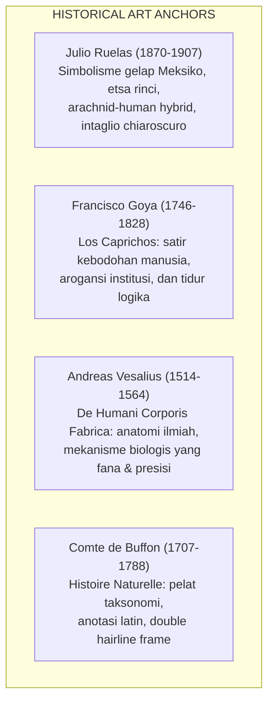

# HUMAN CONDITION
## Visual Style Bible V1.0

> [!IMPORTANT]
> Dokumen ini adalah spesifikasi artistik dan teknis resmi untuk seluruh ilustrator, desainer grafis, dan AI prompt engineer yang mengerjakan aset **TSO-01 HUMAN CONDITION**.
> Setiap artwork yang dihasilkan harus tampak seperti berasal dari satu rumah arsip kurasi yang sama.

---

## 1. INSPIRASI SENI & CIRI KHAS VISUAL

Visual HUMAN CONDITION berakar pada tradisi seni cetak cukil tembaga (*copperplate intaglio*) dan litografi abad ke-18 hingga awal abad ke-20.



### Karakteristik Tinta & Garis:
- **Copperplate Linework:** Garis tegas, memiliki variasi tebal-tipis organik (*pressure-sensitive tapering*), dengan teknik bayangan silang (*cross-hatching*) dan titik-titik padat (*stippling*).
- **Chiaroscuro Kontras:** Kontras dramatis antara bidang terang (*highlights*) dan bidang gelap pekat (*deep shadows*), menciptakan ilusi volume patung klasik yang berwibawa.
- **Bukan Flat Vector:** Garis harus memiliki mikrotekstur organik tinta cetak kuno, bukan vektor mulus tanpa jiwa ala icon aplikasi modern.

---

## 2. SISTEM TIPOGRAFI LENGKAP

Tipografi pada kaos HUMAN CONDITION berfungsi sebagai narator intelektual. Tata letak mengikuti aturan hierarki editorial 3 level:

```
┌────────────────────────────────────────────────────────────────────────────────────────┐
│                              TYPOGRAPHIC HIERARCHY SYSTEM                              │
├─────────┬──────────────────────┬────────────────────────────┬──────────────────────────┤
│ Level   │ Elemen Tipografis    │ Karakter & Rekomendasi Font│ Penggunaan & Parameter   │
├─────────┼──────────────────────┼────────────────────────────┼──────────────────────────┤
│ Level 1 │ Primary Headline     │ High-Contrast Editorial    │ Judul Utama Karya        │
│         │                      │ Serif: Bodoni 72, Century  │ (All Caps, Tracking 50,  │
│         │                      │ Schoolbook, EB Garamond    │ Skala Visual Dominan)    │
├─────────┼──────────────────────┼────────────────────────────┼──────────────────────────┤
│ Level 2 │ Philosophical Thesis │ Hard Editorial Sans /      │ Pernyataan Tesis / Copy  │
│         │ / Observation        │ Space Mono, Courier Prime, │ (Small Caps / Italic,    │
│         │                      │ Druk Condensed Grotesque   │ Tracking 100-150)        │
├─────────┼──────────────────────┼────────────────────────────┼──────────────────────────┤
│ Level 3 │ Archival Annotation  │ Monospaced Metadata:       │ Nomor Registri & Katalog │
│         │ & Plate Microtext    │ Space Mono, IBM Plex Mono  │ (Ukuran 8-10pt, steril,  │
│         │                      │                            │ anotasi ilmiah FIG. 01)  │
└─────────┴──────────────────────┴────────────────────────────┴──────────────────────────┘
```

---

## 3. LIMA KELUARGA KOMPOSISI (COMPOSITION FAMILIES)

Seluruh desain HUMAN CONDITION wajib dibangun menggunakan salah satu dari 5 pola komposisi berikut:

### 1. The Archive Specimen (Contoh: `HC-001`)
- **Struktur:** Bingkai ganda kotak (*double rectangular hairline frame*) khas pelat ensiklopedia abad ke-18.
- **Pusat:** Bust patung klasik atau spesimen anatomis di tengah, dikelilingi garis ukur antropometri.
- **Teks:** Judul di atas bingkai (*Header Plate*), subjudul dan anotasi metadata latin di bagian bawah (*Footer Annotation*).

### 2. The Central Symbolic Emblem (Contoh: `HC-002`, `HC-007`)
- **Struktur:** Komposisi memusat (*radial or bilateral symmetry*) berbentuk lambang stempel atau medali klasik.
- **Pusat:** Objek metafor dekonstruksi (timbangan cermin, jantung kran mekanik, kompas moral).
- **Teks:** Tipografi melingkar (*curved path*) atau baris horizontal berjarak di atas dan bawah simbol.

### 3. The Editorial Statement (Contoh: `HC-005`)
- **Struktur:** Tipografi headline mendominasi 40-50% area grafis, dipadukan dengan figur ilustrasi berukuran sedang.
- **Pusat:** Karakter orator atau figur manusia berinteraksi langsung dengan blok huruf besar.
- **Teks:** Kalimat tesis ditampilkan besar dan tegas menggunakan kombinasi Serif dan Condensed Sans.

### 4. The Philosophical Minimalism
- **Struktur:** Bidang negatif (*negative space*) yang sangat luas dan bersih, memfokuskan pandangan pada satu metafor surealis kecil namun tajam.
- **Penempatan:** Sangat ideal untuk penempatan saku dada depan (*front chest pocket*) atau punggung minimalis.

### 5. The Experimental Editorial Collage
- **Struktur:** Tumpang tindih berlapis (*multi-layered montage*) antara potongan denah arsitektur kuno, sketsa anatomi, tipografi mesin tik, dan cap stempel merah.

---

## 4. SISTEM WARNA & INTEGRASI SABLON DTF

| Warna | Hex Code | Peran Estetis | Perilaku Sablon DTF di Kain |
|:---|:---|:---|:---|
| **Ink Black** | `#171717` | Garis etsa utama, bayangan kontras | **Wajib Knockout (Alpha 0)** pada kaos hitam/charcoal |
| **Aged Ivory** | `#E8DFC9` | Tubuh marmer patung, kertas dokumen | Tinta krem solid di atas underbase putih tipis |
| **Archive Grey** | `#77736C` | Arsiran sekunder cross-hatching | Tinta abu-abu netral |
| **Oxide Red** | `#873E36` | Aksen cap stempel kurator & segel lilin | Tinta spot color merah tua (maksimal 5% total area) |
| **Muted Olive** | `#66664D` | Ornamen ranting atau aksen border | Aksen sekunder opsional |
| **Warm Brown** | `#765C45` | Elemen kayu atau instrumen laboratorium | Warna pendukung opsional |

### Ketentuan Mutu DTF Sablon Kaos:
1. **Knockout Black:** Sablon DTF di atas garmen hitam (`#000000`, Washed Black, Charcoal) **tidak boleh mencetak tinta hitam**. Warna hitam garmen harus dimanfaatkan sebagai bayangan alami agar cetakan lentur dan tidak panas di badan.
2. **Line Thickness Minimum:** Garis terisolasi terkecil adalah $\ge 0.5	ext{ mm}$ (6 piksel pada kanvas native 300 PPI) agar serbuk lem DTF melekat sempurna dan tahan pencucian 50x.
3. **Halftoning Halus:** Area gradasi opasitas di bawah 20% wajib diubah menjadi *dithered halftones* atau arsiran garis agar tidak menimbulkan bercak putih lem pudar.
