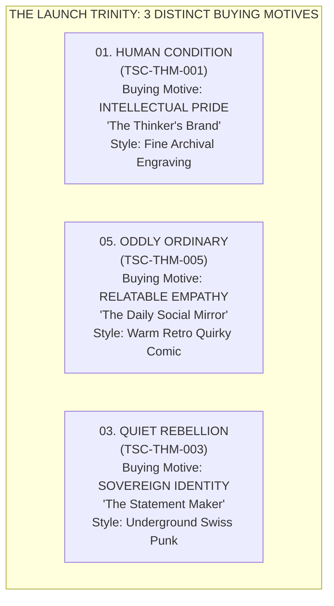

# TEEStock ORIGINAL
# PORTFOLIO AUDIT & IDEA REFINEMENT REPORT (PHASE 1)

> [!IMPORTANT]
> **Keputusan Strategis Tahap 1:** Studio telah mengaudit seluruh **80 ide kandidat** dari *Master Design Idea Bank V1.0 (`TSO-MDIB-001`)* menggunakan 5 dimensi evaluasi tertimbang.
> Tidak ada satupun kuota render gambar AI yang dihabiskan sebelum narasi, orisinalitas copy, eliminasi klise Pinterest, dan batas wilayah kreatif terkunci rapat.

---

## 1. EXECUTIVE SUMMARY & AUDIT METHODOLOGY

Audit portofolio ini bertujuan menyaring inventaris ide awal menjadi katalog terarah yang memiliki diferensiasi tajam, nilai komersial nyata, dan kesiapan cetak DTF.

### Dimensi Evaluasi & Formula Pembobotan:
Formula pembobotan skor (skala 1.00 – 5.00):
$$\text{Total Score} = (\text{Orig} \times 0.25) + (\text{Wear} \times 0.25) + (\text{Vis} \times 0.20) + (\text{Ident} \times 0.15) + (\text{Prod} \times 0.15)$$

1. **Originality & Conceptual Strength (25%):** Orisinalitas premis ide, ketajaman satir, dan penghindaran dari kiasan visual/quote pasaran.
2. **Wearability & Audience Appeal (25%):** Kenyamanan visual dipakai di ruang publik (tidak memalukan, tidak terkesan murahan/cringe, punya kebanggaan kultural).
3. **Visual Potential (20%):** Kemampuan konsep diterjemahkan menjadi komposisi grafis yang berdiri kokoh, memiliki hierarki tipografi yang berwibawa, dan siluet kuat.
4. **Collection Identity (15%):** Kesesuaian tema dengan batas wilayah kreatif (*Creative Territory*) dan ketajaman *tone of voice*.
5. **Production Feasibility (15%):** Realitas produksi DTF (garis minimum >= 0.5 mm, tidak mengandalkan gradasi transparan pudar tanpa halftoning, efisiensi transfer film, knockout black).

### Hasil Klasifikasi 80 Ide:
- **🌟 Shortlisted Master (Top 24):** 24 konsep terkuat (Skor 4.54 – 4.83). Terbagi menjadi **15 Launch Trinity** (5 desain per koleksi Prioritas A) + **9 Supporting Expansion** (Priority B & C).
- **📁 Reserve Candidate (16 Ide):** Konsep bernilai tinggi (Skor 4.35 – 4.53) yang disimpan sebagai cadangan peluncuran *Wave 2*.
- **⚙️ Idea Pool / Rework (40 Ide):** Konsep yang terdeteksi tumpang tindih (*overlapping*), memiliki risiko klise tinggi, atau membutuhkan perombakan narasi mendalam sebelum dieksekusi.

---

## 2. OVERLAP DETECTION & TERRITORIAL BOUNDARY MATRIX

Salah satu tantangan terbesar dalam inventaris 80 ide adalah **risiko kanibalisasi internal** antar-koleksi. Jika dua koleksi menghasilkan pesan serupa, konsumen akan bingung dan identitas brand melemah.

Berikut 5 kluster tumpang tindih utama yang berhasil dideteksi dan aturan batas wilayah (*boundary resolution*) yang ditetapkan:

```
┌──────────────────────────────────────────────────────────────────────────────────────────────────┐
│                             TERRITORIAL BOUNDARY RESOLUTION MATRIX                               │
├─────────────────────┬──────────────────────────┬─────────────────────────────────────────────────┤
│ Kluster Isu         │ Ide yang Bersinggungan   │ Keputusan Alokasi & Batas Wilayah Kreatif       │
├─────────────────────┼──────────────────────────┼─────────────────────────────────────────────────┤
│ **Kluster A:**      │ - `OO-001` (Soc Battery) │ **1. ODDLY ORDINARY (`OO-001`):**                │
│ Kelelahan Sosial &  │ - `MD-008` (Always On)   │    Humor personal, self-deprecating, empati     │
│ Kebutuhan Hening    │ - `QR-006` (No Audience) │    sehari-hari (kucing berjas retro dandy).     │
│                     │ - `IA-005` (Quiet Mind)  │ **2. MODERN DISORDER (`MD-008`):**              │
│                     │                          │    Kritik struktural korporat / 24/7 slack feed │
│                     │                          │ **3. QUIET REBELLION (`QR-006`):**              │
│                     │                          │    Prinsip martabat diri: hidup bukan tontonan  │
│                     │                          │ **4. INNER ATLAS (`IA-005`):**                  │
│                     │                          │    Refleksi batin, meditatif, ketenangan jiwa   │
├─────────────────────┼──────────────────────────┼─────────────────────────────────────────────────┤
│ **Kluster B:**      │ - `QR-001` (Think Free)  │ **1. QUIET REBELLION (`QR-001`):**              │
│ Kedaulatan Berpikir │ - `HC-006` (Blind Crowd) │    Sovereign individual: menolak opini pinjaman │
│ vs Arus Kerumunan   │ - `MD-004` (Algorithm)   │ **2. HUMAN CONDITION (`HC-006`):**              │
│                     │                          │    Kritik antropologis spesies manusia komunal  │
│                     │                          │ **3. MODERN DISORDER (`MD-004`):**              │
│                     │                          │    Manipulasi sistemik algoritma AI & cookie    │
├─────────────────────┼──────────────────────────┼─────────────────────────────────────────────────┤
│ **Kluster C:**      │ - `OO-002` (Vacation)    │ **1. ODDLY ORDINARY (`OO-002`):**                │
│ Pelarian dari Rutin │ - `MD-009` (Escape)      │    Komedi melamun di meja kantor (absurd).      │
│ & Kerinduan Alam    │ - `WA-002` (No Algo)     │ **2. MODERN DISORDER (`MD-009`):**              │
│                     │ - `WA-005` (Quiet Place) │    Jebakan treadmill beton dan pintu darurat.   │
│                     │                          │ **3. WILD ARCHIVE (`WA-002`):**                 │
│                     │                          │    Alam murni tanpa algoritma (botanikal etsa). │
├─────────────────────┼──────────────────────────┼─────────────────────────────────────────────────┤
│ **Kluster D:**      │ - `OO-003` (Overthinker) │ **1. ODDLY ORDINARY (`OO-003`):**                │
│ Overthinking &      │ - `IA-008` (Thought Wgt) │    Parodi ruang kendali panik karena chat sepele│
│ Beban Pikiran       │ - `HC-007` (Anxiety Arch)│ **2. INNER ATLAS (`IA-008`):**                  │
│                     │                          │    Gravitasi puitis eksistensial / astrofisika  │
├─────────────────────┼──────────────────────────┼─────────────────────────────────────────────────┤
│ **Kluster E:**      │ - `AT-001` (RetroFuture) │ **1. ARCHIVE OF TOMORROW (`AT-001`):**          │
│ Nostalgia & Memori  │ - `AT-004` (Analog Soul) │    Nostalgia sains 60an & tabung audio analog.  │
│ Masa Lalu           │ - `LF-007` (Nostalgia ID)│ **2. LOCAL FREQUENCIES (`LF-007`):**            │
│                     │ - `IA-003` (Memory Keep) │    Memori domestik lokal (kipas besi & kaset).  │
│                     │                          │ **3. INNER ATLAS (`IA-003`):**                  │
│                     │                          │    Ontologi memori jiwa manusia (arsip batin).  │
└─────────────────────┴──────────────────────────┴─────────────────────────────────────────────────┘
```

---

## 3. ANTI-CLICHÉ COPY REFINEMENT SYSTEM

Sebagian ide awal memiliki risiko jatuh ke dalam **Pinterest Quote Trap** (kata mutiara motivasi generik, slogan kaos distro murahan, atau meme receh yang cepat usang). 

Studio melakukan perombakan bahasa (*copy refinement*) dengan prinsip:
1. **Editorial Authority:** Menulis layaknya judul esai majalah sastra/koleksi arsip, bukan caption Instagram.
2. **Bilingual Versatility:** Menyediakan opsi Bahasa Inggris berbobot internasional dan Bahasa Indonesia yang mengakar kultural tanpa terdengar kaku.
3. **Subversive Irony:** Menyelipkan pembalikan logika (*subversion*) di akhir kalimat.

### 10 Contoh Upgrade Copy Anti-Klise:

| ID | Judul Kerja | Draft Awal (Klise) | Refined Copy EN (Editorial Apparel) | Refined Copy ID (Resonansi Lokal) |
|---|---|---|---|---|
| `HC-001` | The Dangerous Species | *Intelligence Is Not Immunity Against Stupidity.* | **THE DANGEROUS SPECIES** // *INTELLECT IS NO IMMUNITY TO FOLLY.* | **SPESIES BERBAHAYA** // *KECERDASAN BUKAN PENAWAR KEBODOHAN.* |
| `HC-002` | The Art of Hypocrisy | *Principles Are Convenient Until They Cost Something.* | **MORAL CONVENIENCE** // *PRINCIPLES THAT ONLY APPLY WHEN ADVANTAGEOUS.* | **MORAL KONDISIONAL** // *BERLAKU HANYA KETIKA MENGUNTUNGKAN.* |
| `QR-001` | Think for Yourself | *Borrowed Opinions Are Still Borrowed.* | **SOVEREIGN MIND** // *SECOND-HAND OPINIONS FIT NOBODY.* | **PIKIRAN MERDEKA** // *PENDAPAT PINJAMAN TAK PERNAH PAS DI KEPALA.* |
| `QR-006` | No Audience Required | *Not Everything Needs an Audience.* | **PRIVATE ODYSSEY** // *NOT EVERYTHING IS BUILT TO BE APPLAUDED.* | **TANPA PENONTON** // *HIDUP INI BUKAN PANGGUNG SANDIWARA UNTUKMU.* |
| `OO-001` | Social Battery: 1% | *Low Battery. High Standards.* | **SOCIAL CAPACITY: 1%** // *PLEASE DO NOT ENGAGE. SHUTTING DOWN.* | **DAYA SOSIAL: 1%** // *MOHON JANGAN DISAPA. SEDANG PROSES PADAM.* |
| `OO-003` | Professional Overthinker | *Making Simple Things Complicated Since Forever.* | **OVERTHINKING DEPT.** // *TURNING SIMPLE SCENARIOS INTO CATASTROPHES.* | **BIRO PIKIRAN RUMIT** // *MEMPERKAYA MASALAH SEPELE SEJAK DULU KALA.* |
| `OO-005` | Replying in My Head | *Sent in My Imagination.* | **TELEPATHIC CHAT** // *I RESPONDED IN MY HEAD THREE WEEKS AGO.* | **BALASAN GAIB** // *SUDAH KUBALAS PANJANG LEBAR DI DALAM HATI.* |
| `MD-001` | Productivity Prison | *Busy Is Not the Same as Alive.* | **PERPETUAL HUSTLE** // *BUSY IS NOT THE SAME AS ALIVE.* | **PENJARA PRODUKTIVITAS** // *SIBUK BUKAN BERARTI HIDUP.* |
| `WA-002` | Nature Has No Algorithm | *No Feed. Just Life.* | **WILD AUTONOMY** // *NO FEED. NO REFRESH. JUST LIFE HAPPENING.* | **TANPA ALGORITMA** // *ALAM TAK BUTUH REKOMENDASI TREN.* |
| `LF-003` | Warung Philosophy | *Big Thoughts. Small Tables.* | **ROADSIDE ACADEMY** // *HEAVY DIALOGUE AT UNPRETENTIOUS TABLES.* | **FILSAFAT MEJA WARUNG** // *GAGASAN BESAR DI ATAS TAPLAK PLASTIK.* |

---

## 4. MASTER SHORTLIST OF 24 DESIGNS

Berikut adalah **24 Konsep Terbaik Portofolio TeeStock Original**, diseleksi secara ketat dari 80 kandidat.
Daftar ini mengunci **15 Desain Peluncuran (Launch Trinity: 5 desain × 3 koleksi prioritas)** dan **9 Desain Ekspansi Terpilih** dari 5 wilayah pendukung.

### 01. `HC-001` — THE DANGEROUS SPECIES 🌟
- **Koleksi & Wilayah:** `TSC-THM-001` — **HUMAN CONDITION** (Priority A (Launch))
- **Skor Evaluasi:** **`4.72` / 5.00** *(Orig: 4.8 | Wear: 4.6 | Vis: 4.8 | Ident: 4.9 | Prod: 4.5)*
- **Pesan Inti:** Manusia menganggap dirinya paling rasional, tetapi rentan terhadap kebodohan sendiri.
- **Refined Copy EN:** `THE DANGEROUS SPECIES // INTELLECT IS NO IMMUNITY TO FOLLY.`
- **Refined Copy ID:** `SPESIES BERBAHAYA // KECERDASAN BUKAN PENAWAR KEBODOHAN.`
- **Metafor Visual:** Pelat taksonomi tembaga abad ke-18: bust marmer filsuf dengan jangka antropometri dahi dan ekspresi angkuh.
- **Art Direction:** `Editorial Archive / 18th-century copperplate engraving`
- **Alasan Keunggulan:** Konsep sangat kuat dan orisinal. Membalik persepsi kecerdasan manusia sebagai senjata paling destruktif saat dibungkus keangkuhan.
- **Catatan Batas Wilayah & Produksi DTF:** Unik. Memegang jangkar filosofis seluruh koleksi HUMAN CONDITION. | *DTF: Garis minimum >= 0.5 mm, knockout black natural pada kain gelap.*

### 02. `HC-002` — THE ART OF HYPOCRISY 🌟
- **Koleksi & Wilayah:** `TSC-THM-001` — **HUMAN CONDITION** (Priority A (Launch))
- **Skor Evaluasi:** **`4.63` / 5.00** *(Orig: 4.5 | Wear: 4.7 | Vis: 4.6 | Ident: 4.8 | Prod: 4.6)*
- **Pesan Inti:** Manusia memiliki standar berbeda untuk dirinya dan orang lain.
- **Refined Copy EN:** `MORAL CONVENIENCE // PRINCIPLES THAT ONLY APPLY WHEN ADVANTAGEOUS.`
- **Refined Copy ID:** `MORAL KONDISIONAL // BERLAKU HANYA KETIKA MENGUNTUNGKAN.`
- **Metafor Visual:** Timbangan keadilan kuno etsa tembaga; piringan beban dipasangi cermin kecil yang memantulkan wajah suci si pembawa timbangan.
- **Art Direction:** `Dark Satirical Engraving / Chiaroscuro etching`
- **Alasan Keunggulan:** Resonansi sosial sangat tinggi. Standar moral ganda adalah kenyataan universal.
- **Catatan Batas Wilayah & Produksi DTF:** Batas jelas: kritik kemunafikan etika personal, bukan kritik sistemik MD. | *DTF: Garis minimum >= 0.5 mm, knockout black natural pada kain gelap.*

### 03. `HC-003` — EGO IS A BLIND SPOT 🌟
- **Koleksi & Wilayah:** `TSC-THM-001` — **HUMAN CONDITION** (Priority A (Launch))
- **Skor Evaluasi:** **`4.58` / 5.00** *(Orig: 4.6 | Wear: 4.5 | Vis: 4.7 | Ident: 4.7 | Prod: 4.4)*
- **Pesan Inti:** Ego membuat seseorang tidak mampu melihat kekurangan sendiri.
- **Refined Copy EN:** `THE EGO APPARATUS // THE BIGGER THE STATUE, THE SMALLER THE VIEW.`
- **Refined Copy ID:** `MONUMEN EGO // SEMAKIN TINGGI PATUNG DIRI, SEMAKIN BUTA PANDANGAN.`
- **Metafor Visual:** Figur pematung klasik memahat monumen patung kepalanya sendiri 5x lebih besar, sementara tubuh aslinya kerdil dan rapuh di bawah bayangannya.
- **Art Direction:** `Philosophical Surrealism / Vintage architectural linework`
- **Alasan Keunggulan:** Kritik narsisme yang elegan. Semakin besar citra diri, semakin sempit perspektif realitas.
- **Catatan Batas Wilayah & Produksi DTF:** Ego individual (HC), berbeda dengan citra media sosial (MD-006). | *DTF: Garis minimum >= 0.5 mm, knockout black natural pada kain gelap.*

### 04. `HC-005` — THE CONFIDENCE PARADOX 🌟
- **Koleksi & Wilayah:** `TSC-THM-001` — **HUMAN CONDITION** (Priority A (Launch))
- **Skor Evaluasi:** **`4.61` / 5.00** *(Orig: 4.6 | Wear: 4.6 | Vis: 4.5 | Ident: 4.7 | Prod: 4.7)*
- **Pesan Inti:** Orang yang paling yakin belum tentu paling memahami.
- **Refined Copy EN:** `THE CONFIDENCE PARADOX // CERTAINTY IS NOT PROOF OF INTELLIGENCE.`
- **Refined Copy ID:** `PARADOKS KEYAKINAN // MERASA PALING TAHU, PALING SEDIKIT MEMAHAMI.`
- **Metafor Visual:** Figur orator berjubah kuno berteriak di atas mimbar podium podium tinggi yang kakinya ternyata terbuat dari tumpukan ranting kering patah.
- **Art Direction:** `Dark Satirical Engraving / Editorial intaglio`
- **Alasan Keunggulan:** Dunning-Kruger effect yang diangkat menjadi apparel intelektual. Sangat tajam.
- **Catatan Batas Wilayah & Produksi DTF:** Unik untuk HC. Kritik terhadap kepongahan intelektual. | *DTF: Garis minimum >= 0.5 mm, knockout black natural pada kain gelap.*

### 05. `HC-007` — THE SELECTIVE CONSCIENCE 🌟
- **Koleksi & Wilayah:** `TSC-THM-001` — **HUMAN CONDITION** (Priority A (Launch))
- **Skor Evaluasi:** **`4.56` / 5.00** *(Orig: 4.5 | Wear: 4.5 | Vis: 4.6 | Ident: 4.7 | Prod: 4.6)*
- **Pesan Inti:** Moralitas sering berubah ketika kepentingan pribadi terancam.
- **Refined Copy EN:** `SELECTIVE CONSCIENCE // MORALITY HAS A CONVENIENT SWITCH.`
- **Refined Copy ID:** `HURANI SELEKTIF // PEDULI SAAT POPULER, HILANG SAAT BERESIKO.`
- **Metafor Visual:** Jantung anatomis kuno etsa tembaga dengan katup kran kuningan yang diberi label 'ON' dan 'OFF' tergantung situasi.
- **Art Direction:** `Dark Satirical Engraving / Anatomical plate`
- **Alasan Keunggulan:** Kritik tajam atas empati dan kemarahan publik yang diatur seperti keran air.
- **Catatan Batas Wilayah & Produksi DTF:** Kuat untuk HC. Komplementer dengan HC-002. | *DTF: Garis minimum >= 0.5 mm, knockout black natural pada kain gelap.*

### 06. `OO-001` — SOCIAL BATTERY: 1% 🌟
- **Koleksi & Wilayah:** `TSC-THM-005` — **ODDLY ORDINARY** (Priority A (Launch))
- **Skor Evaluasi:** **`4.83` / 5.00** *(Orig: 4.7 | Wear: 4.9 | Vis: 4.8 | Ident: 4.9 | Prod: 4.9)*
- **Pesan Inti:** Energi sosial yang cepat habis.
- **Refined Copy EN:** `SOCIAL CAPACITY: 1% // PLEASE DO NOT ENGAGE. SHUTTING DOWN.`
- **Refined Copy ID:** `DAYA SOSIAL: 1% // MOHON JANGAN DISAPA. SEDANG PROSES PADAM.`
- **Metafor Visual:** Ilustrasi komik retro linocut: seekor kucing berjas rapi berdiri di pesta koktail dengan baterai jam antik berkarat di punggungnya yang sudah hampir mati.
- **Art Direction:** `Retro Comic Strip / Quirky Hand-drawn Linework`
- **Alasan Keunggulan:** Kandidat best-seller mutlak di pasar Indonesia dan global. Humor sosial akut yang dialami semua orang.
- **Catatan Batas Wilayah & Produksi DTF:** Bintang utama ODDLY ORDINARY. Humor, empati, dan mass wearability. | *DTF: Garis minimum >= 0.5 mm, knockout black natural pada kain gelap.*

### 07. `OO-002` — MENTALLY ON VACATION 🌟
- **Koleksi & Wilayah:** `TSC-THM-005` — **ODDLY ORDINARY** (Priority A (Launch))
- **Skor Evaluasi:** **`4.67` / 5.00** *(Orig: 4.5 | Wear: 4.8 | Vis: 4.6 | Ident: 4.7 | Prod: 4.8)*
- **Pesan Inti:** Tubuh hadir, pikiran sedang liburan.
- **Refined Copy EN:** `PHYSICALLY PRESENT // MENTALLY SIPPING COCONUTS AT AN UNDISCLOSED BEACH.`
- **Refined Copy ID:** `RAGA DI KANTOR // PIKIRAN SUDAH NYELAM DI LABUAN BAJO.`
- **Metafor Visual:** Karakter figur kantoran duduk tegak di depan laptop, namun kepalanya diganti balon udara tropis yang melayang ke luar jendela kantor.
- **Art Direction:** `Quirky Retro Cartoon / 1950s Advertisement style`
- **Alasan Keunggulan:** Humor pekerja kantoran dan mahasiswa. Raga hadir di rapat/kelas, pikiran melayang di pantai.
- **Catatan Batas Wilayah & Produksi DTF:** Sangat relate dengan kelas pekerja urban Indonesia. | *DTF: Garis minimum >= 0.5 mm, knockout black natural pada kain gelap.*

### 08. `OO-003` — PROFESSIONAL OVERTHINKER 🌟
- **Koleksi & Wilayah:** `TSC-THM-005` — **ODDLY ORDINARY** (Priority A (Launch))
- **Skor Evaluasi:** **`4.71` / 5.00** *(Orig: 4.6 | Wear: 4.8 | Vis: 4.7 | Ident: 4.8 | Prod: 4.7)*
- **Pesan Inti:** Terlalu banyak memikirkan hal kecil.
- **Refined Copy EN:** `OVERTHINKING DEPARTMENT // TURNING SIMPLE SCENARIOS INTO COMPLICATED DISASTERS.`
- **Refined Copy ID:** `BIRO PIKIRAN RUMIT // MEMPERKAYA MASALAH SEPELE SEJAK DULU KALA.`
- **Metafor Visual:** Ruang kendali reaktor nuklir retro di dalam kepala dengan tiga operator kartun panik menekan semua tombol peringatan hanya karena sebuah pesan belum dibalas.
- **Art Direction:** `Retro Comic / Nuclear Control Room parody`
- **Alasan Keunggulan:** Kekuatan humor observasional yang self-deprecating. Overthinking hal-hal sepele.
- **Catatan Batas Wilayah & Produksi DTF:** Pilar komedi kedua yang sangat kuat di katalog. | *DTF: Garis minimum >= 0.5 mm, knockout black natural pada kain gelap.*

### 09. `OO-005` — REPLYING IN MY HEAD 🌟
- **Koleksi & Wilayah:** `TSC-THM-005` — **ODDLY ORDINARY** (Priority A (Launch))
- **Skor Evaluasi:** **`4.67` / 5.00** *(Orig: 4.6 | Wear: 4.8 | Vis: 4.5 | Ident: 4.7 | Prod: 4.8)*
- **Pesan Inti:** Percakapan sudah selesai di pikiran, belum di chat.
- **Refined Copy EN:** `TELEPATHIC CHAT // I RESPONDED TO YOUR MESSAGE IN MY HEAD THREE WEEKS AGO.`
- **Refined Copy ID:** `BALASAN GAIB // SUDAH KUBALAS PANJANG LEBAR DI DALAM HATI.`
- **Metafor Visual:** Kantor pos vintage mini di mana burung merpati pos tertidur pulas di sarangnya sambil memeluk amplop bertuliskan 'RE: YESTERDAY'.
- **Art Direction:** `Quirky Hand-drawn / Storybook illustration`
- **Alasan Keunggulan:** Kebiasaan modern yang sangat khas: merasa sudah membalas chat secara mental, padahal draft belum dikirim berminggu-minggu.
- **Catatan Batas Wilayah & Produksi DTF:** Sangat charming dan memancing senyum siapa pun yang membaca. | *DTF: Garis minimum >= 0.5 mm, knockout black natural pada kain gelap.*

### 10. `OO-006` — ADULTING IS A SCAM 🌟
- **Koleksi & Wilayah:** `TSC-THM-005` — **ODDLY ORDINARY** (Priority A (Launch))
- **Skor Evaluasi:** **`4.59` / 5.00** *(Orig: 4.4 | Wear: 4.7 | Vis: 4.6 | Ident: 4.6 | Prod: 4.7)*
- **Pesan Inti:** Realitas kedewasaan tidak selalu sesuai harapan.
- **Refined Copy EN:** `ADULTHOOD SUBSCRIPTION // WHO SIGNED ME UP FOR THESE RESPONSIBILITIES?`
- **Refined Copy ID:** `JEBAKAN KEDEWASAAN // SIAPA YANG MENYETUJUI TANGGUNG JAWAB SEBANYAK INI?`
- **Metafor Visual:** Karakter anak kecil berkacamata mengenakan jas korporat kedodoran 5 ukuran lebih besar sambil menyeret koper penuh tagihan listrik.
- **Art Direction:** `Mid-century Editorial Cartoon`
- **Alasan Keunggulan:** Realitas menjadi dewasa yang dipenuhi tagihan, keputusan berat, dan rindu masa kecil.
- **Catatan Batas Wilayah & Produksi DTF:** Kuat untuk audiens 20-35 tahun. | *DTF: Garis minimum >= 0.5 mm, knockout black natural pada kain gelap.*

### 11. `QR-001` — THINK FOR YOURSELF 🌟
- **Koleksi & Wilayah:** `TSC-THM-003` — **QUIET REBELLION** (Priority A (Launch))
- **Skor Evaluasi:** **`4.72` / 5.00** *(Orig: 4.6 | Wear: 4.8 | Vis: 4.6 | Ident: 4.9 | Prod: 4.8)*
- **Pesan Inti:** Jangan menyerahkan pemikiran kepada kelompok.
- **Refined Copy EN:** `SOVEREIGN MIND // SECOND-HAND OPINIONS FIT NOBODY.`
- **Refined Copy ID:** `PIKIRAN MERDEKA // PENDAPAT PINJAMAN TAK PERNAH PAS DI KEPALA.`
- **Metafor Visual:** Stempel tipografi manifesto underground; siluet profil kepala bersih yang memutus kabel-kabel pengumpan berita.
- **Art Direction:** `Underground Swiss Punk / Bold Stark Monochromatic`
- **Alasan Keunggulan:** Pernyataan kedaulatan berpikir paling fundamental. Menolak pemikiran hasil pinjaman.
- **Catatan Batas Wilayah & Produksi DTF:** Jangkar utama QUIET REBELLION. Menolak konformitas. | *DTF: Garis minimum >= 0.5 mm, knockout black natural pada kain gelap.*

### 12. `QR-002` — NO PERMISSION REQUIRED 🌟
- **Koleksi & Wilayah:** `TSC-THM-003` — **QUIET REBELLION** (Priority A (Launch))
- **Skor Evaluasi:** **`4.67` / 5.00** *(Orig: 4.5 | Wear: 4.8 | Vis: 4.5 | Ident: 4.8 | Prod: 4.8)*
- **Pesan Inti:** Tidak semua keputusan membutuhkan persetujuan orang lain.
- **Refined Copy EN:** `UNAUTHORIZED // NO PERMISSION SOUGHT. NONE REQUIRED.`
- **Refined Copy ID:** `TANPA IZIN // TIDAK MEMINTA RESTU SIAPA PUN.`
- **Metafor Visual:** Garis pagar kawat berduri yang dipotong rapi dengan gunting minimalis, membentuk jalan setapak bebas.
- **Art Direction:** `Underground Editorial / Monochromatic distress`
- **Alasan Keunggulan:** Sangat kuat sebagai statement apparel. Tidak butuh validasi publik untuk hidup sesuai prinsip.
- **Catatan Batas Wilayah & Produksi DTF:** Unik. Sangat disukai audiens urban streetwear mandiri. | *DTF: Garis minimum >= 0.5 mm, knockout black natural pada kain gelap.*

### 13. `QR-004` — UNFOLLOW THE NOISE 🌟
- **Koleksi & Wilayah:** `TSC-THM-003` — **QUIET REBELLION** (Priority A (Launch))
- **Skor Evaluasi:** **`4.62` / 5.00** *(Orig: 4.4 | Wear: 4.7 | Vis: 4.6 | Ident: 4.7 | Prod: 4.8)*
- **Pesan Inti:** Memilih apa yang pantas mendapat perhatian.
- **Refined Copy EN:** `FREQUENCY SELECTOR // LESS VOLUME, SHARPER REASON.`
- **Refined Copy ID:** `PILIH FREKUENSI // KURANGI RIUH, TAJAMKAN PIKIRAN.`
- **Metafor Visual:** Diagram tuner pemancar gelombang radio era 60an yang sengaja di-tune ke frekuensi sunyi berlabel 'CLARITY'.
- **Art Direction:** `Underground Editorial / Technical schematic linework`
- **Alasan Keunggulan:** Menyaring kebisingan opini publik. Relevan bagi orang yang lelah drama sosial.
- **Catatan Batas Wilayah & Produksi DTF:** Sangat elegan. Membedakan diri dari quote motivasi biasa. | *DTF: Garis minimum >= 0.5 mm, knockout black natural pada kain gelap.*

### 14. `QR-006` — NO AUDIENCE REQUIRED 🌟
- **Koleksi & Wilayah:** `TSC-THM-003` — **QUIET REBELLION** (Priority A (Launch))
- **Skor Evaluasi:** **`4.70` / 5.00** *(Orig: 4.7 | Wear: 4.7 | Vis: 4.6 | Ident: 4.8 | Prod: 4.7)*
- **Pesan Inti:** Hidup tidak harus dipertunjukkan kepada orang lain.
- **Refined Copy EN:** `PRIVATE ODYSSEY // NOT EVERYTHING IS BUILT TO BE APPLAUDED.`
- **Refined Copy ID:** `TANPA PENONTON // HIDUP INI BUKAN PANGGUNG SANDIWARA UNTUKMU.`
- **Metafor Visual:** Kursi teater kuno kosong yang teratur rapi menghadap ke bentang cakrawala gunung berkabut di malam hari.
- **Art Direction:** `Stoic Surrealism / High-contrast monochrome print`
- **Alasan Keunggulan:** Gagasan luar biasa kuat: hidup bukan panggung pertunjukan untuk orang asing. Anti-performatif.
- **Catatan Batas Wilayah & Produksi DTF:** Pilar ketiga QUIET REBELLION yang paling puitis namun tegas. | *DTF: Garis minimum >= 0.5 mm, knockout black natural pada kain gelap.*

### 15. `QR-008` — UNAPPROVED THOUGHTS 🌟
- **Koleksi & Wilayah:** `TSC-THM-003` — **QUIET REBELLION** (Priority A (Launch))
- **Skor Evaluasi:** **`4.58` / 5.00** *(Orig: 4.5 | Wear: 4.6 | Vis: 4.5 | Ident: 4.7 | Prod: 4.7)*
- **Pesan Inti:** Pemikiran independen yang tidak selalu populer.
- **Refined Copy EN:** `REDACTED // THINK BEYOND THE SANCTIONED CURRICULUM.`
- **Refined Copy ID:** `DI LUAR SENSOR // PIKIRAN YANG TIDAK MEMINTA PENGESAHAN.`
- **Metafor Visual:** Dokumen kearsipan dengan stempel 'DECLASSIFIED - FOR FREE MINDS ONLY' dan tipografi typewriter tegas.
- **Art Direction:** `Archival Brutalism / Stamp & Typewriter graphic`
- **Alasan Keunggulan:** Pikiran yang tidak lolos sensor sosial atau tren masa kini. Sikap independen murni.
- **Catatan Batas Wilayah & Produksi DTF:** Sangat marketable untuk apparel streetwear. | *DTF: Garis minimum >= 0.5 mm, knockout black natural pada kain gelap.*

### 16. `MD-001` — PRODUCTIVITY PRISON 🌟
- **Koleksi & Wilayah:** `TSC-THM-002` — **MODERN DISORDER** (Priority B (Expansion))
- **Skor Evaluasi:** **`4.73` / 5.00** *(Orig: 4.7 | Wear: 4.7 | Vis: 4.7 | Ident: 4.8 | Prod: 4.8)*
- **Pesan Inti:** Manusia terjebak dalam obsesi untuk selalu produktif.
- **Refined Copy EN:** `PERPETUAL HUSTLE // BUSY IS NOT THE SAME AS ALIVE.`
- **Refined Copy ID:** `PENJARA PRODUKTIVITAS // SIBUK BUKAN BERARTI HIDUP.`
- **Metafor Visual:** Stempel jam absensi kuno era pabrik dengan jarum jam membentuk jeruji sel, di dalamnya ada cangkir kopi dingin.
- **Art Direction:** `Editorial Collage / Industrial Swiss typography`
- **Alasan Keunggulan:** Salah satu konsep paling kuat di katalog. Sindiran mematikan bagi budaya hustle & corporate grind.
- **Catatan Batas Wilayah & Produksi DTF:** Jangkar utama MODERN DISORDER. Beda dengan OO-004 yang humoris; ini kritik struktural. | *DTF: Garis minimum >= 0.5 mm, knockout black natural pada kain gelap.*

### 17. `MD-003` — OFFLINE IS A LUXURY 🌟
- **Koleksi & Wilayah:** `TSC-THM-002` — **MODERN DISORDER** (Priority B (Expansion))
- **Skor Evaluasi:** **`4.63` / 5.00** *(Orig: 4.5 | Wear: 4.8 | Vis: 4.4 | Ident: 4.6 | Prod: 4.9)*
- **Pesan Inti:** Ketidakmampuan melepaskan diri dari dunia digital.
- **Refined Copy EN:** `OFFLINE STATUS // THE ULTIMATE MODERN LUXURY.`
- **Refined Copy ID:** `OFFLINE // KEMEWAHAN HAKIKI ZAMAN INI.`
- **Metafor Visual:** Plakat pameran museum minimalis: smartphone era 2020-an dalam etalase kaca kedap sinyal berlabel 'DO NOT DISTURB - ARTIFACT OF PEACE'.
- **Art Direction:** `Minimalist Swiss Editorial / Monochrome layout`
- **Alasan Keunggulan:** Wearability luar biasa tinggi. Menjadi offline adalah simbol kemewahan baru bagi kelas pekerja modern.
- **Catatan Batas Wilayah & Produksi DTF:** Sangat marketable. Menjadi statement piece. | *DTF: Garis minimum >= 0.5 mm, knockout black natural pada kain gelap.*

### 18. `IA-003` — THE MEMORY KEEPER 🌟
- **Koleksi & Wilayah:** `TSC-THM-004` — **INNER ATLAS** (Priority B (Expansion))
- **Skor Evaluasi:** **`4.54` / 5.00** *(Orig: 4.5 | Wear: 4.5 | Vis: 4.5 | Ident: 4.7 | Prod: 4.6)*
- **Pesan Inti:** Memori membentuk identitas manusia.
- **Refined Copy EN:** `THE MEMORY ARCHIVE // WE ARE SHAPED BY WHAT REFUSES TO FADE.`
- **Refined Copy ID:** `PENYIMPAN MEMORI // KITA ADALAH APA YANG MENOLAK PADAM.`
- **Metafor Visual:** Kabinet arsip herbaria botani antik; setiap laci kaca berisi spesimen daun kering, tiket kereta tua, dan surat tak bertanggal.
- **Art Direction:** `Botanical Archival Graphic / Restrained monochrome`
- **Alasan Keunggulan:** Memori sebagai materi penyusun identitas manusia. Puitis dan berbobot.
- **Catatan Batas Wilayah & Produksi DTF:** Unik. Menghubungkan emosi personal dengan keindahan kearsipan. | *DTF: Garis minimum >= 0.5 mm, knockout black natural pada kain gelap.*

### 19. `IA-004` — BECOMING 🌟
- **Koleksi & Wilayah:** `TSC-THM-004` — **INNER ATLAS** (Priority B (Expansion))
- **Skor Evaluasi:** **`4.51` / 5.00** *(Orig: 4.4 | Wear: 4.5 | Vis: 4.6 | Ident: 4.6 | Prod: 4.5)*
- **Pesan Inti:** Identitas sebagai proses yang terus berubah.
- **Refined Copy EN:** `WORK IN PROGRESS // NOT FINISHED BECOMING WHO I AM.`
- **Refined Copy ID:** `DALAM PROSES // BELUM SELESAI MENJADI DIRI SENDIRI.`
- **Metafor Visual:** Patung marmer klasik setengah jadi: separuh tubuh telah terukir sempurna dengan proporsi dewa Yunani, separuh lagi masih berupa batu mentah bertuliskan coretan kuas.
- **Art Direction:** `Classical Sculpture Deconstructed / Fine-art typography`
- **Alasan Keunggulan:** Identitas sebagai karya yang terus dibentuk, bukan cetakan final yang beku.
- **Catatan Batas Wilayah & Produksi DTF:** Sangat disukai audiens muda yang sedang berproses mencari arah hidup. | *DTF: Garis minimum >= 0.5 mm, knockout black natural pada kain gelap.*

### 20. `WA-001` — BORN TO WANDER 🌟
- **Koleksi & Wilayah:** `TSC-THM-006` — **WILD ARCHIVE** (Priority C (Expansion))
- **Skor Evaluasi:** **`4.38` / 5.00** *(Orig: 4.0 | Wear: 4.6 | Vis: 4.5 | Ident: 4.3 | Prod: 4.6)*
- **Pesan Inti:** Dorongan menjelajah dan menemukan tempat baru.
- **Refined Copy EN:** `ANCIENT MIGRATION // THE WORLD REMAINS WIDER THAN YOUR SCHEDULE.`
- **Refined Copy ID:** `JALUR MIGRASI PURBA // BUMI INI LEBIH LUAS DARI RUTINITASMU.`
- **Metafor Visual:** Pelat ornitologi abad ke-18: burung layang-layang laut terbang melintasi peta navigasi samudra kuno lengkap dengan garis angin mawar kompas.
- **Art Direction:** `18th-century Natural History Engraving`
- **Alasan Keunggulan:** Kebutuhan manusia untuk kembali ke alam dan menjelajah.
- **Catatan Batas Wilayah & Produksi DTF:** Harus dipastikan bergaya arsip ilmiah, bukan logo distro gunung. | *DTF: Garis minimum >= 0.5 mm, knockout black natural pada kain gelap.*

### 21. `WA-002` — NATURE HAS NO ALGORITHM 🌟
- **Koleksi & Wilayah:** `TSC-THM-006` — **WILD ARCHIVE** (Priority C (Expansion))
- **Skor Evaluasi:** **`4.62` / 5.00** *(Orig: 4.6 | Wear: 4.7 | Vis: 4.5 | Ident: 4.7 | Prod: 4.6)*
- **Pesan Inti:** Alam tidak mengikuti sistem rekomendasi manusia.
- **Refined Copy EN:** `WILD AUTONOMY // NO FEED. NO REFRESH. JUST LIFE HAPPENING.`
- **Refined Copy ID:** `TANPA ALGORITMA // ALAM TAK BUTUH REKOMENDASI TREN.`
- **Metafor Visual:** Potongan melintang hutan hujan primer etsa detail di mana lumut dan pakis tumbuh menembus keyboard mekanik tua yang sudah lapuk.
- **Art Direction:** `Botanical Field Guide / Vintage intaglio`
- **Alasan Keunggulan:** Konsep brilian: alam tidak mengenal feed, rekomendasi, atau like. Hidup apa adanya.
- **Catatan Batas Wilayah & Produksi DTF:** Konsep terkuat di WILD ARCHIVE. Menghubungkan alam dengan kritik modern. | *DTF: Garis minimum >= 0.5 mm, knockout black natural pada kain gelap.*

### 22. `AT-001` — TOMORROW WAS YESTERDAY 🌟
- **Koleksi & Wilayah:** `TSC-THM-007` — **ARCHIVE OF TOMORROW** (Priority C (Expansion))
- **Skor Evaluasi:** **`4.69` / 5.00** *(Orig: 4.6 | Wear: 4.7 | Vis: 4.7 | Ident: 4.8 | Prod: 4.7)*
- **Pesan Inti:** Masa depan yang dulu dibayangkan manusia.
- **Refined Copy EN:** `RETRO-FUTURE // THE TOMORROW WE ENVISIONED YESTERDAY.`
- **Refined Copy ID:** `MASA DEPAN MASA LALU // BAYANGAN ESOK DARI ZAMAN KEMARIN.`
- **Metafor Visual:** Poster promosi perjalanan antariksa fiktif era Soviet-Americana 1968: roket streamlined meluncur ke cincin Saturnus dengan palet duotone pudar.
- **Art Direction:** `Space-Age Retro-Futurism / Mid-century Soviet-Americana Sci-Fi`
- **Alasan Keunggulan:** Intisari retro-futurisme: nostalgia manusia era 60-an terhadap tahun 2000-an yang dipenuhi mobil terbang dan koloni Mars.
- **Catatan Batas Wilayah & Produksi DTF:** Jangkar utama ARCHIVE OF TOMORROW. | *DTF: Garis minimum >= 0.5 mm, knockout black natural pada kain gelap.*

### 23. `AT-004` — ANALOG SOUL 🌟
- **Koleksi & Wilayah:** `TSC-THM-007` — **ARCHIVE OF TOMORROW** (Priority C (Expansion))
- **Skor Evaluasi:** **`4.67` / 5.00** *(Orig: 4.5 | Wear: 4.8 | Vis: 4.6 | Ident: 4.7 | Prod: 4.8)*
- **Pesan Inti:** Kerinduan terhadap benda dan pengalaman analog.
- **Refined Copy EN:** `ANALOG SOUL // ENGINEERED FOR A SLOWER, WARMER FREQUENCY.`
- **Refined Copy ID:** `JIWA ANALOG // DIRANCANG UNTUK GELOMBANG YANG LEBIH HANGAT.`
- **Metafor Visual:** Diagram skematik tabung vakum audio (vacuum tube) dengan filamen menyala hangat di tengah gelombang sinus yang berderau.
- **Art Direction:** `Vintage Audio Schematic / Blueprint linework`
- **Alasan Keunggulan:** Kerinduan terhadap kehangatan mekanikal dan suara kresek kaset/vinyl di era digital serba flat.
- **Catatan Batas Wilayah & Produksi DTF:** Sangat tinggi wearability di kalangan musisi, audiofil, dan desainer. | *DTF: Garis minimum >= 0.5 mm, knockout black natural pada kain gelap.*

### 24. `LF-003` — WARUNG PHILOSOPHY 🌟
- **Koleksi & Wilayah:** `TSC-THM-008` — **LOCAL FREQUENCIES** (Priority C (Expansion))
- **Skor Evaluasi:** **`4.72` / 5.00** *(Orig: 4.6 | Wear: 4.8 | Vis: 4.6 | Ident: 4.9 | Prod: 4.8)*
- **Pesan Inti:** Percakapan sederhana yang sering berisi pengamatan hidup.
- **Refined Copy EN:** `ROADSIDE ACADEMY // HEAVY DIALOGUE AT UNPRETENTIOUS TABLES.`
- **Refined Copy ID:** `FILSAFAT MEJA WARUNG // GAGASAN BESAR DI ATAS TAPLAK PLASTIK.`
- **Metafor Visual:** Gelas kaca belimbing berisi teh panas beruap dengan sendok aluminium miring, berdiri tegak di tengah tumpukan buku tebal filosofi.
- **Art Direction:** `Editorial Cultural Illustration / Clean Woodcut Linework`
- **Alasan Keunggulan:** Filsafat warung kopi: obrolan geopolitik, ekonomi, dan nasib hidup yang dibahas tuntas di atas meja plastik sederhana.
- **Catatan Batas Wilayah & Produksi DTF:** Konsep lokal terkuat di portofolio. Menolak romantisasi murahan, merayakan kecerdasan rakyat. | *DTF: Garis minimum >= 0.5 mm, knockout black natural pada kain gelap.*

---

## 5. STRATEGIC DEEP-DIVE: THE 3 LAUNCH COLLECTIONS

Pemilihan **HUMAN CONDITION**, **ODDLY ORDINARY**, dan **QUIET REBELLION** sebagai katalog perdana didasarkan pada strategi bisnis dan psikologi konsumen apparel:



### Mengapa Formasi 3 Pilar Ini Ideal:

1. **Diferensiasi Motif Pembelian (Buying Triggers):**
   - **`HUMAN CONDITION` (15 Desain Pilot = 5 Terpilih):** Dibeli konsumen karena **gagasan intelektual**, ironi manusia, dan prestise estetik etsa tembaga (*fine art engraving*). Menarik audiens *readers, designers, academics, thoughtful urbanites*.
   - **`ODDLY ORDINARY` (5 Terpilih):** Dibeli karena **faktor relatable, humor observasional, dan validasi emosi harian**. Menjadi *ice-breaker* sosial di tongkrongan atau kantor. Menarik audiens massal pekerja muda dan mahasiswa.
   - **`QUIET REBELLION` (5 Terpilih):** Dibeli sebagai **pernyataan identitas dan sikap berprinsip** (*sovereign mind*). Menarik segmen *independent thinkers, creators, and street culture enthusiasts* yang menolak konformitas.

2. **Kontras Estetika Rupa yang Saling Melengkapi:**
   - Katalog TeeStock tidak akan terlihat membosankan karena menampilkan 3 gaya yang sangat berlawanan:
     - Etsa gelap abad ke-18 (*copperplate intaglio*) untuk HC.
     - Komik retro linocut hangat (*warm vintage cartoon*) untuk OO.
     - Tipografi brutalist minimalis monokrom (*underground Swiss punk*) untuk QR.

3. **Kesesuaian dengan Model Bisnis On-Demand DTF:**
   - Karena MultiGraph menerapkan sistem cetak setelah pesanan (*on-demand DTF heat press*):
     - Tidak ada modal tertimbun pada stok kaos jadi.
     - 15 desain awal ini dapat dirilis dalam katalog digital (Shopee, TikTok Shop, Direct Web) secara serentak.
     - Data penjualan dan konversi dari 15 desain ini akan menjadi bukti objektif (*empirical proof*) sebelum mencetak stok fisik dalam jumlah besar.

---

## 6. NEXT ACTION STEPS (ENTERING PHASE 3)

Dengan selesainya audit portofolio dan penetapan 24 desain shortlist, langkah operasional selanjutnya adalah:

1. **Phase 3 — Creative Brief Production:**
   - Memproduksi **15 Dokumen Creative Brief Formal** untuk 15 desain terpilih pada Top 3 Koleksi (HC-001 s/d HC-007, OO-001 s/d OO-006, QR-001 s/d QR-008) menggunakan template standar `creative_brief_template.md`.
   - Mengunci 2–3 rute eksplorasi visual (*art direction alternatives*) per konsep brief.
2. **Phase 4 — Controlled Visual Exploration:**
   - Memasukkan prompt ke Midjourney/AI generator hanya untuk brief yang telah disetujui.
   - Rekonstruksi master artwork menjadi vector / PSD berlapis siap produksi cetak DTF.
