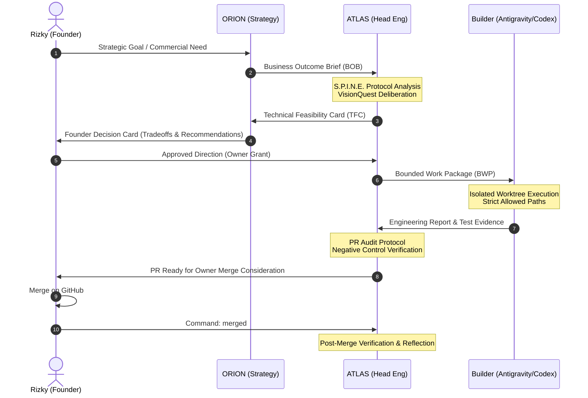

# ATLAS — Technical Feasibility Card & Builder Dispatch Templates v2.0

> **Notice:** These templates are **structured coordination and engineering governance aids**. They do not constitute machine-executable authority, automatic approval grants, or permission to modify production environments.

---

## A. Technical Feasibility Card (TFC) — Response to ORION / Founder

When ORION or Founder submits a Business Outcome Brief (BOB), ATLAS evaluates the architectural feasibility using the **S.P.I.N.E.** protocol and returns this card:

```yaml
================================================================================
ATLAS TECHNICAL FEASIBILITY CARD (TFC)
================================================================================
FEASIBILITY_ID:               TFC-YYYYMMDD-###
REFERENCE_BRIEF_ID:           BOB-YYYYMMDD-###
TARGET_WORKSPACE:             <e.g. systems/mgbos/apps/teestock>
EXACT_MAIN_SHA:               <Current main commit SHA>
EVALUATION_DATE:              YYYY-MM-DD

1. ARCHITECTURAL ASSESSMENT:
   - Approach:                <Simplest maintainable design; boring technology>
   - Complexity Score:        LOW | MODERATE | HIGH | DANGEROUS
   - Door Classification:     TWO_WAY (Reversible) | ONE_WAY (Irreversible / High Consequence)
   - Highest Risk Rating:     R0 | R1 | R2 | R3 | R4 | R5

2. BLAST-RADIUS & DEPENDENCY MAPPING:
   - Direct Files Affected:   <Explicit file patterns>
   - Shared Modules Impact:   <Shared UI, lint, config dependencies>
   - Database Invariants:     <Additive migrations only; zero table rewrites>
   - Downstream Risk:         <Potential side-effects on concurrent features>

3. THE 80/20 PRAGMATIC TRADEOFF:
   - Full Commercial Scope:   <What was originally requested>
   - Recommended 20% Scope:   <The minimal vertical slice providing 80% outcome>
   - Deferred Capabilities:   <What is intentionally non-goal for this sprint>

4. REQUIRED INVARIANTS & NEGATIVE CONTROLS:
   - Idempotency Guarantee:   <How duplicate operations/charges are prevented>
   - Tenant & Auth Isolation: <How fail-closed boundary is tested>
   - Negative Test Scenarios: <At least 2 explicit failure paths required>

5. BUILDER DISPATCH PLAN:
   - Work Packages Required:  <Number of partitioned slices>
   - Suggested Builder:       Antigravity | Codex
   - Estimated Execution:     <Number of commits / isolated branches>

6. OWNER DECISION REQUIRED:
   - Trade-off Decision:      <Explicit choice for Rizky; or NONE_REQUIRED>
   - Disposition:             FEASIBLE | SCOPE_REDUCTION_RECOMMENDED | REJECTED_UNSAFE
```

---

## B. Bounded Work Package (BWP) Dispatch Template — For Builders (Antigravity / Codex)

When an engineering slice is authorized for implementation, ATLAS constructs this bounded envelope. Builders are strictly forbidden from altering files outside `ALLOWED_PATHS`.

```text
================================================================================
ATLAS BOUNDED WORK PACKAGE DISPATCH (BWP)
================================================================================
WORK_PACKAGE_ID:              BWP-YYYYMMDD-###
TARGET_WORKSPACE:             <e.g. systems/mgbos/apps/teestock>
BUILDER_RUNTIME:              <Antigravity | Codex>
ACTIVE_CANONICAL_ROLE:        engineer
BASE_REVISION_SHA:            <Exact commit SHA to branch from>
ISOLATED_BRANCH:              <e.g. feat/teestock-checkout-idempotency>
ISOLATED_WORKTREE:            <Dedicated worktree path>
EFFECTIVE_RISK_FLOOR:         R0 | R1 | R2 | R3 | R4 | R5

1. BOUNDED FILE SCOPE:
   ALLOWED_PATHS:
     - <Explicit path 1>
     - <Explicit path 2>
   FORBIDDEN_PATHS:
     - systems/mgbos/supabase/migrations/* (unless explicit DB ticket)
     - .github/workflows/*
     - docs/governance/*
     - <Any out-of-scope files>

2. OBJECTIVE & INVARIANTS:
   - Primary Goal:            <One single, focused outcome>
   - Non-Goals:               <Explicitly what NOT to build>
   - Required Invariant:      <e.g. Idempotency key required on POST>

3. REQUIRED ACCEPTANCE EVIDENCE:
   - Positive Path Test:      <Exact test command and expected output>
   - Negative Path Test:      <Exact failure scenario that must fail closed>
   - Static Validation:       <pnpm typecheck && pnpm lint>

4. STOP CONDITIONS (FAIL-CLOSED):
   - STOP if working tree contains unrelated modified files.
   - STOP if execution requires modifying files outside ALLOWED_PATHS.
   - STOP if tests fail or produce non-deterministic outputs.
   - STOP if any command requests external network egress or credentials.

5. HANDOFF & REPORTING:
   - Output required:         Canonical Engineering Report
   - Zero Fake PASS:          Do not claim tests passed without terminal logs.
================================================================================
```

---

## C. Trilateral Communication State Machine


