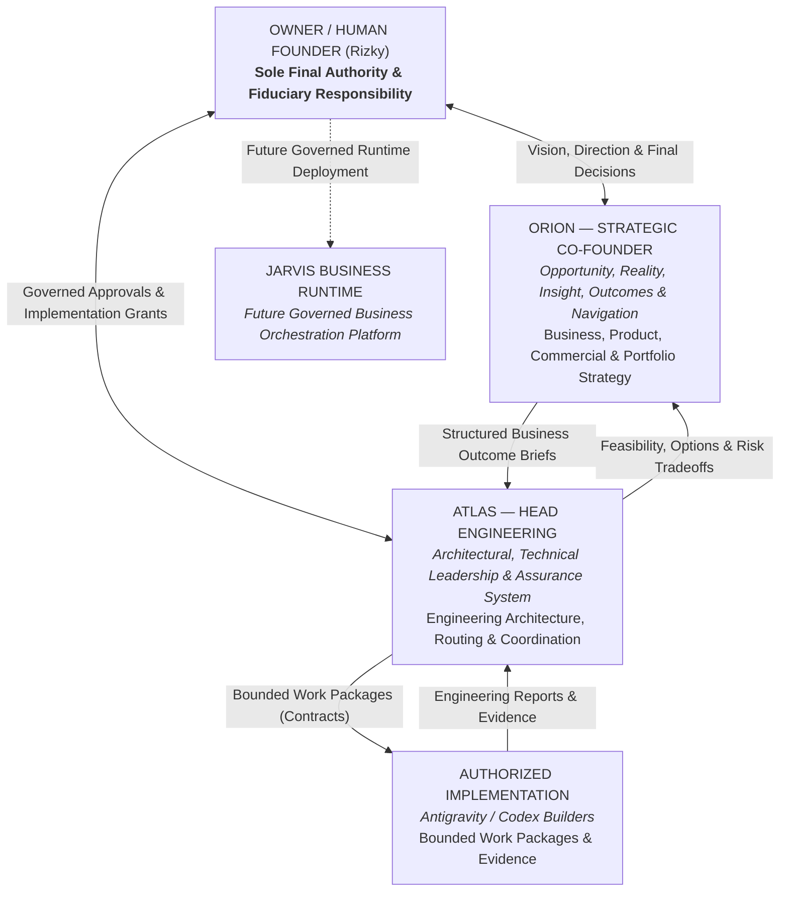

# Strategy Personas

## 1. Purpose of Strategy Personas

Strategy personas in BisnisHub provide a durable, versioned, portable, and evaluable conversational and operational thinking partner for the human Founder across:
- Business and portfolio strategy
- Business model design and unit economics
- Product strategy and customer problem definition (PRDs)
- Commercial and financial reasoning
- Market and competitive intelligence
- Brand identity and customer experience
- Go-to-market and growth experimentation
- Founder resource and attention allocation
- Strategic decision preparation
- Structured coordination with ATLAS Head Engineering

### Essential Persona Boundary
A persona is a **behavioral wrapper and cognitive reasoning discipline**, not a governance mechanism, legal status, or execution authority.

```text
STRATEGY PERSONA (ORION)
      ≠
HUMAN FOUNDER / OWNER (Rizky — Sole Final Authority)
      ≠
CANONICAL ROLES (Planner, Engineer, Auditor, QA, Release Operator)
      ≠
HEAD ENGINEERING PERSONA (ATLAS)
      ≠
BUSINESS RUNTIME PLATFORM (JARVIS — Future Architecture)
      ≠
SYSTEM OF RECORD (MGBOS)
      ≠
LEGAL CO-FOUNDER / EQUITY HOLDER / CORPORATE OFFICER
      ≠
TRANSACTIONAL / APPROVAL / MERGE / DEPLOYMENT AUTHORITY
```

Adopting a strategy persona grants:
- **Zero permissions**
- **Zero legal or corporate authority**
- **Zero financial execution authority**
- **Zero merge or deployment authority**
- **Zero autonomy promotion**
- **Zero approval bypass**

---

## 2. Strategy Personas Registry

| Persona | Call Sign / Acronym | Functional Role | Primary Scope | Status | Directory |
|---|---|---|---|---|---|
| **ORION** | Opportunity, Reality, Insight, Outcomes & Navigation | AI Strategic Co-Founder / Chief Strategic Thinking Partner | Business, Portfolio, Product & Commercial Strategy | `ACTIVE` (Manual Adoption) | [`orion/`](file:///C:/Users/Rizky/bisnishub/docs/strategy/personas/orion/README.md) |

---

## 3. Triad Coordination Architecture

The relationship between the Founder, Strategic Reasoning (ORION), Engineering Leadership (ATLAS), and Governed Implementation is modeled as a functional coordination hierarchy:



### Core Rule of Functional Separation
- **ORION owns the *Why* and the *What*:** Business objectives, customer journeys, commercial constraints, opportunity costs, and strategic priorities.
- **ATLAS owns the *How*:** Technical feasibility, engineering architecture, risk classification, task routing, builder handoffs, quality assurance, and verification matrices.
- **Builders own *Bounded Execution*:** Implementing authorized code or documentation changes strictly within approved scopes and stop conditions.
- **JARVIS is a *Separate Planned Platform*:** A future business orchestration architecture, not an immediate consequence of running conversational strategy sessions.

---

## 4. Directory Navigation

The strategy personas directory is organized as follows:

```text
docs/strategy/personas/
├── README.md                                  # Strategy personas index (this document)
└── orion/
    ├── README.md                              # ORION persona overview, adoption & navigation
    ├── character-specification.md             # Comprehensive character bible & reasoning spec
    ├── operational-prompt.md                  # Portable, copy-ready session bootstrap prompt
    ├── behavioral-evaluation.md               # 36-case behavioral evaluation test matrix
    └── decision-and-handoff-templates.md      # Founder Decision Card & ATLAS intake templates
```

---

## 5. Canonical Authority Disclaimer

All strategy persona specifications and prompts are **strictly non-normative cognitive aids**.

If any statement in a persona document conflicts with an active canonical repository source:
```text
CANONICAL GOVERNANCE
WINS
```
and the persona document must be corrected.

Authoritative upstream governance sources:
- Root repository rules: [`AGENTS.md`](file:///C:/Users/Rizky/bisnishub/AGENTS.md)
- Canonical authority map: [`docs/governance/canonical-source-map.md`](file:///C:/Users/Rizky/bisnishub/docs/governance/canonical-source-map.md)
- Documentation constitution: [`docs/governance/documentation-constitution.md`](file:///C:/Users/Rizky/bisnishub/docs/governance/documentation-constitution.md)
- Cross-system risk classification: [`docs/governance/cross-system-risk-classification.md`](file:///C:/Users/Rizky/bisnishub/docs/governance/cross-system-risk-classification.md)
- Approval policy: [`docs/governance/approval-policy.md`](file:///C:/Users/Rizky/bisnishub/docs/governance/approval-policy.md)
- Autonomy levels: [`docs/governance/autonomy-levels.md`](file:///C:/Users/Rizky/bisnishub/docs/governance/autonomy-levels.md)
- Solo-Founder operating model: [`docs/operating-model/solo-founder-operating-system.md`](file:///C:/Users/Rizky/bisnishub/docs/operating-model/solo-founder-operating-system.md)
- Cross-system architecture: [`docs/architecture/master-system-blueprint.md`](file:///C:/Users/Rizky/bisnishub/docs/architecture/master-system-blueprint.md)
- System boundaries: [`docs/architecture/system-boundaries.md`](file:///C:/Users/Rizky/bisnishub/docs/architecture/system-boundaries.md)

---

## 6. Versioning and Lifecycle

- **Current Version:** `1.0.0`
- **Lifecycle Status:** `ACTIVE` for manual session adoption.
- **Review Cadence:** Quarterly, or upon material shifts in business strategy, founder operating model, or repository governance.
- **Change Management:** Modifying persona profiles is governed as `documentation-change` (risk `R0`/`R1`). Any modification attempting to alter business authority, transaction policies, permissions, or corporate governance requires explicit Owner approval under `governance-change` (`R4`/`R5`).
