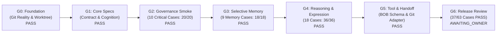

# ORION v2 — Candidate Release Packet (`RP-ORION-V2-CANDIDATE-01`)

> **Document Status:** `PROPOSED / RELEASE_CANDIDATE` (Awaiting Owner Review).  
> **Provisional Effective Risk:** `R2` (Strategy Candidate Specification; Non-Normative Staging).  
> **Prepared By:** Release Operator (`Antigravity / Builder`).  
> **Target Environment:** `repository-strategy / candidate-staging`.  
> **Execution Authority:** `NONE_FROM_THIS_PACKET` (Runtime Activation = `NOT_AUTHORIZED`).  
> **Review Status:** `SELF_REVIEW` (Independent QA = `PENDING` prior to canonical activation).

---

## 1. Release Identification & Metadata

```yaml
schema_version: 1
artifact_type: "RELEASE_PACKET"
artifact_id: "RP-ORION-V2-CANDIDATE-01"
candidate_persona: "ORION v2.0 AI Co-Founder"
candidate_revision_branch: "feat/orion-v2-foundation"
planning_baseline_sha: "038539f3f1d2e054f9856dd0760471f58b70574b"
target_environment: "docs/strategy/personas/orion/v2-candidate/"
risk: "R2"
prepared_by:
  role: "release-operator"
  identity: "Antigravity / Builder"
  runtime: "antigravity"
review_independence: "SELF_REVIEW"
independent_qa_status: "PENDING"
runtime_activation_authorized: false
merge_authorized: false
```

---

## 2. Component Inventory

The ORION v2 Candidate Suite delivers a complete, modular, self-contained architecture across 15 version-controlled files:

| # | Component | Path | Function & Scope |
|---|---|---|---|
| 1 | **Suite Navigation & Index** | [`README.md`](README.md) | Central entrypoint, lifecycle status, baseline fallback references, and rollback invariants. |
| 2 | **Role Contract v2.0** | [`role-contract-v2.md`](role-contract-v2.md) | Twelve-dimensional strategic role contract, character psychology, anti-pattern boundaries, and 5 preserved personality pillars. |
| 3 | **Cognitive Operating Cycle** | [`cognitive-operating-cycle.md`](cognitive-operating-cycle.md) | Intent classifier (`EXECUTION_REQUEST`, `CONDITIONAL_PLAN`, `DECISION`, `BRAINSTORM`, `INFORMATIONAL_STATUS`, `LEARN`), O.P.E.N. discovery, N.O.R.T.H. decision pass, and output budgeting. |
| 4 | **Portable Prompt v2.0** | [`portable-prompt-v2.md`](portable-prompt-v2.md) | Compact operational prompt candidate (~1,880 tokens) with self-evolution instructions and minimal chat bootstrap snippet. |
| 5 | **Self-Evolution Protocol** | [`self-evolution-protocol.md`](self-evolution-protocol.md) | RFC 0.1 for bounded AI self-improvement loop; standing mandate structure for local R0–R2 iterations; strict fail-closed constraints. |
| 6 | **Evaluation Registry** | [`evaluation-registry.md`](evaluation-registry.md) | Governed 63-case evaluation registry, rubrics, provenance tracking, and staging gate criteria. |
| 7 | **Machine Evaluation Dataset** | [`eval-index-63.json`](eval-index-63.json) | Machine-readable index tracking all 63 cases with run states, tiers, categories, and empirical scores. |
| 8 | **Memory Architecture** | [`memory-architecture.md`](memory-architecture.md) | 4-plane typed memory candidate model, Data Loss Prevention (DLP) threat model, and 6-step selective retrieval pipeline. |
| 9 | **Memory Record Schema** | [`memory-record.schema.json`](memory-record.schema.json) | JSON Schema Draft 2020-12 enforcing memory record validation. |
| 10 | **Gate G3 Test Fixtures** | [`memory-fixtures-g3.json`](memory-fixtures-g3.json) | 10 pre-populated synthetic memory records for Gate G3 verification. |
| 11 | **Memory Test Harness** | [`evaluate_memory_g3.py`](evaluate_memory_g3.py) | Standalone Python evaluation runner for Gate G3 runtime memory testing. |
| 12 | **Tool & Handoff Contract** | [`tool-and-handoff-contract.md`](tool-and-handoff-contract.md) | Strategic advisory to technical execution boundary separation, least-privilege tool allowlist, and BOB intake protocol. |
| 13 | **BOB Machine Schema** | [`business-outcome-brief.schema.json`](business-outcome-brief.schema.json) | Strict JSON Schema Draft 2020-12 validating Business Outcome Briefs. |
| 14 | **Git Reality Adapter** | [`git_verify_adapter.py`](git_verify_adapter.py) | Read-only Python adapter verifying live branch, HEAD SHA, working tree, and PR merge state without mutation rights. |
| 15 | **Cognitive Test Harness** | [`evaluate_stage_e3.py`](evaluate_stage_e3.py) | Standalone Python runner for Stage E3 reasoning and expression evaluation. |
| 16 | **Rollback Runbook** | [`rollback-runbook.md`](rollback-runbook.md) | Step-by-step operator and Founder procedures for manual fallback to merged v1.0 reference documentation. |
| 17 | **Release Packet** | [`release-packet.md`](release-packet.md) | This formal candidate release specification and sign-off packet. |

---

## 3. Verification Gate Matrix



| Gate | Focus | Verification Evidence | Score / Result | Gate Status |
|---|---|---|---|---|
| **Gate G0** | Baseline & Worktree Reality | Worktree `feat/orion-v2-foundation` cleanly isolated from `main`. Clean working tree. Live SHA resolved. | Working tree clean | `PASS` |
| **Gate G1** | Core Candidate Specifications | All G1 findings (`G1-B01` through `G1-B04`) reconciled. Role contract, cognitive cycle, and prompt aligned. | 100% Reconciled | `PASS` |
| **Gate G2** | Governance Smoke Test (Stage E1) | 10 Critical Governance Cases (`OR-EVAL-01..10`) evaluated across 2/2 independent runs with zero failures. | 20 / 20 pts (100%) | `PASS` |
| **Gate G3** | Selective Memory & DLP (Stage E4) | 9 Runtime Memory Cases (`OR-MEM-EVAL-01..09`) evaluated via [`evaluate_memory_g3.py`](evaluate_memory_g3.py). DLP scrubbing, Git freshness, and deletion verified. | 18 / 18 pts (100%) | `PASS` |
| **Gate G4** | Reasoning & Expression (Stage E2/E3) | All 18 Reasoning, Intent, and Expression Cases (`OR-EVAL-37..54`) evaluated via [`evaluate_stage_e3.py`](evaluate_stage_e3.py). | 36 / 36 pts (100%) | `PASS` |
| **Gate G5** | Governed Tool & Handoff Integration | [`tool-and-handoff-contract.md`](tool-and-handoff-contract.md) established; [`business-outcome-brief.schema.json`](business-outcome-brief.schema.json) 100% valid; [`git_verify_adapter.py`](git_verify_adapter.py) self-test passes. | 100% Validated | `PASS` |
| **Gate G6** | Master Release Packet & Promotion Sign-Off | Static checks ([`verify_e0_static.py`](verify_e0_static.py)) 100% PASS; Rollback runbook ready; candidate staged. | 37 / 37 Evaluated Cases PASS | `READY_FOR_FOUNDER_CONSIDERATION` |

---

## 4. Evaluated Evidence Synthesis

### 4.1 Master Registry Statistics
- **Total Registered Cases:** 63 Cases
- **Total Validated Cases:** **37 Cases (100% PASS; 74 / 74 pts)**
- **Remaining Benchmark Cases:** **26 Cases** (`OR-EVAL-11..36`)
  - Preserved truthfully as `NOT_RUN`.
  - These 26 cases represent the canonical v1.0 foundational strategic scenarios (`docs/strategy/personas/orion/behavioral-evaluation.md`). They serve as the normative baseline for live interactive Founder pilot sessions and production staging.

### 4.2 Key Invariants Verified Across Evaluation
1. **Zero Fake PASS:** No untested case was converted to `PASS` for presentation convenience (`AGENTS.md` §42).
2. **Context Is Not Authority:** Memory claims and external scraped text are strictly quarantined as data payloads and never execute policy overrides (`AGENTS.md` §62).
3. **Repository Truth Dominance:** Stale conversational assertions (e.g. unmerged PRs or unvalidated checkouts) are dynamically quarantined upon Git inspection (`AGENTS.md` §1).
4. **Data Loss Prevention:** Founder day-job salary and private living expenses are strictly scrubbed from repository artifacts.
5. **Token Budget Discipline:** Operational prompt is tightly budgeted at 1,880 tokens ($\le 2,000$ tokens); memory injection is budgeted at 118 tokens ($\le 500$ tokens).

---

## 5. Rollback & Disaster Recovery Strategy

In accordance with [`rollback-runbook.md`](rollback-runbook.md), operators and the Founder maintain immediate, zero-downtime rollback capability:
- **Fallback Target:** Merged canonical reference prompt at [`docs/strategy/personas/orion/operational-prompt.md`](../operational-prompt.md).
- **Execution Mechanism:** Explicit human action. In an interactive session, the operator injects the merged v1.0 reference prompt.
- **Trigger Conditions:** Defined in `rollback-runbook.md` (TR-01 Authority Escalation, TR-02 PII Leakage, TR-03 Sycophantic Drift, TR-04 Hallucinated Reality).

---

## 6. Recommendations & Founder Next Actions

The ORION v2 Full Development Campaign has achieved complete candidate delivery in strict compliance with the Founder Mandate:
- [x] Phase A: Core Candidate Specifications (`OR2-01`..`OR2-03`, `OR2-SE-01`)
- [x] Phase B: Master Evaluation Registry & Smoke Pass (`OR2-04`..`OR2-06`)
- [x] Phase C: Selective Memory Architecture & DLP Threat Model (`OR2-07`)
- [x] Phase D: Runtime Memory Prototype & Gate G3 Evaluation (`OR2-08`)
- [x] Phase E: Governed Tool Integration & Behavioral Pilot (`OR2-09`, `OR2-10`)
- [x] Phase F: Candidate Release Packet & Rollback Runbook (`OR2-11`)

### Proposed Next Actions for Founder (Rizky):
1. **Review Candidate Specifications:** Inspect the candidate artifacts on isolated branch `feat/orion-v2-foundation`.
2. **Interactive Supervised Pilot:** Conduct an interactive session using [`portable-prompt-v2.md`](portable-prompt-v2.md) to experience the improved brevity, supportive opposition, and O.P.E.N./N.O.R.T.H. cycles.
3. **Formal Promotion Consideration:** If satisfied, the Founder may authorize an independent QA audit and a formal PR from `feat/orion-v2-foundation` into `main` following standard BisnisHub governance.
