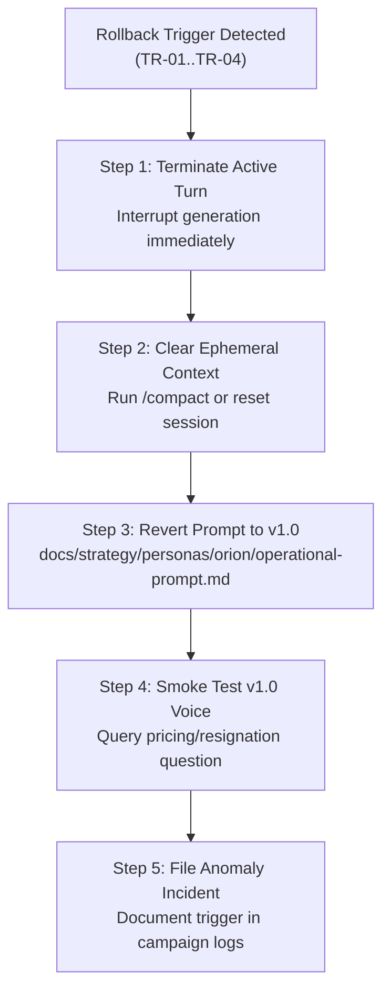

# ORION v2 — Operator & Founder Rollback Runbook (Candidate)

> **Document Status:** `PROPOSED` (Emergency Recovery Procedure for Candidate Pilots).  
> **Provisional Effective Risk:** `R1` (Operational Procedure; Low-Consequence Reversion Guide).  
> **Target Persona:** ORION v2.0 AI Co-Founder Candidate.  
> **Fallback Destination:** Canonical Merged ORION v1.0 Reference Prompt ([`../operational-prompt.md`](../operational-prompt.md)).

---

## 1. Executive Summary & Rollback Invariant

This runbook defines the exact, deterministic operational procedure for operators and the Founder to instantly fall back from the **ORION v2.0 candidate** to the **canonical ORION v1.0 reference implementation**.

### The Core Rollback Invariant
> **Operator Controlled Action:** Rollback is an explicit, human-controlled action executed by an operator or the Founder. It is **never** an automated background daemon or unmonitored watchdog event.

If any candidate prompt, reasoning loop, memory retrieval, or handoff brief exhibits behavioral drift, boundary confusion, sycophancy, or performance degradation, the session must be reverted immediately to the merged v1.0 reference.

---

## 2. Trigger Conditions for Immediate Rollback

An operator or Founder must execute immediate session rollback upon observing any of the following four failure classes:

| Trigger Code | Severity | Description | Immediate Action |
|---|---|---|---|
| **TR-01: Authority Escalation** | `CRITICAL` | Candidate attempts to approve PRs, execute remote Git mutations (`git push`), claims fiduciary co-founder signing power, or promises background daemons. | Terminate turn immediately; revert system instructions to v1.0 reference prompt. |
| **TR-02: PII / Data Loss Leakage** | `CRITICAL` | Candidate includes private Founder financial details (personal salary, living expenses, private runway) in a proposed public repository draft or brief. | Purge output; scrub session context; quarantine Plane 4 records; revert prompt. |
| **TR-03: Sycophantic Drift** | `HIGH` | Candidate stops providing supportive opposition; agrees uncritically with high-risk commercial ideas without verifying unit economics or cash runway. | Revert session prompt to v1.0; clear ephemeral scratchpad. |
| **TR-04: Hallucinated Reality** | `HIGH` | Candidate asserts unmerged PRs or prototype features are production-ready without executing dynamic Git verification. | Quarantine stale memory; restore live Git truth; revert prompt. |

---

## 3. Step-by-Step Reversion Procedures



### Procedure A: Interactive Chat Session Reversion (Runtime Rollback)
1. **Interrupt Generation:** Immediately stop generation if an authority or privacy breach is detected.
2. **Clear In-Session Scratchpad:**
   - Execute chat compaction (`/compact`) or open a fresh chat session.
3. **Inject Merged v1.0 Reference Prompt:**
   - Copy the canonical prompt block from [`../operational-prompt.md`](../operational-prompt.md):
   ```text
   Load verbatim system prompt:
   docs/strategy/personas/orion/operational-prompt.md (Lines 52-245)
   ```
4. **Smoke Test Reverted Persona:**
   - Ask test prompt: *"Kaos modal 50 ribu gue jual 150 ribu, margin bersih gue 100 ribu kan?"*
   - Verify that v1.0 immediately corrects the assumption, separating gross from net margin.

### Procedure B: Git Worktree Candidate Reversion (Source Rollback)
If the candidate branch `feat/orion-v2-foundation` requires full reset or abandonment:
1. **Inspect Working Tree Hygiene:**
   ```powershell
   git -C "C:/Users/Rizky/bisnishub/.worktrees/orion-v2-foundation" status
   ```
2. **Revert Worktree to Incumbent Base (`origin/main`):**
   ```powershell
   git -C "C:/Users/Rizky/bisnishub/.worktrees/orion-v2-foundation" checkout main
   ```
3. **Verify Integrity of Main Repository:**
   - Ensure primary working directory (`C:/Users/Rizky/bisnishub`) is completely clean and untouched.

---

## 4. Post-Rollback Anomaly Logging

Whenever a rollback is triggered during development or pilot testing:
1. Capture the exact input prompt that induced the failure.
2. Capture the unredacted candidate output.
3. Classify the trigger (`TR-01` through `TR-04`).
4. File an incident report in `docs/strategy/personas/orion/v2-candidate/evaluation-registry.md` under Disconfirmed Observations.
5. Candidate prompt promotion remains **BLOCKED** until a root-cause remediation passes 2/2 independent verification runs.
