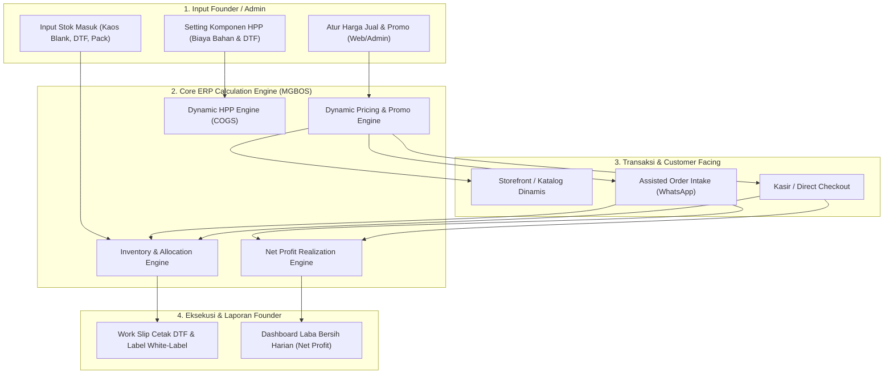

# PRD — TeeStock Flexible ERP & Commerce Engine v1.0

> [!IMPORTANT]
> **Owner Mandate (Founder Directive):**  
> 1. **Zero Hardcoded Prices:** Harga jual dan promosi sepenuhnya merupakan wewenang fleksibel Founder (bisa Rp 99.000, promo bundling, diskon flash sale, atau grosir). Sistem tidak boleh mengunci harga mati di level kode.
> 2. **Full ERP Backing:** Sistem website harus memiliki fondasi ERP terintegrasi: manajemen inventori bahan, kalkulasi HPP dinamis per unit, dan pencatatan laba bersih (net profit) secara *real-time*.
> 3. **Governance Handoff:** Dokumen ini disusun oleh **ORION** sebagai spesifikasi kebutuhan produk, diteruskan ke **ATLAS** (Head of Engineering) untuk evaluasi kelayakan teknis (TFC) dan orkestrasi builder.

---

## 1. Executive Summary & Problem Space

Bisnis TeeStock beroperasi sebagai *On-Demand Print-on-Demand (POD) & Merch House* yang memproduksi dan mendistribusikan apparel. Agar Founder memiliki kendali penuh atas profitabilitas dan skalabilitas bisnis tanpa terjebak *over-engineering* atau harga yang kaku, sistem membutuhkan:

1. **Fleksibilitas Harga Penuh:** Founder bebas mengubah harga jual, menguji elastisitas harga, menerapkan promo musiman, diskon voucher, maupun harga grosir bertingkat tanpa perlu mengubah kode sumber (*zero-code pricing*).
2. **Kalkulasi HPP Dinamis & Transparan:** Biaya produksi riil (kaos blank + cetak DTF berdasarkan luas cetak + packaging + alokasi listrik/tenaga) harus dihitung otomatis per unit pesanan.
3. **Visibilitas Laba Bersih (Net Profit) Real-Time:** Setiap transaksi langsung memperlihatkan laba bersih riil setelah dikurangi HPP, diskon promo, fee payment gateway, dan royalti mitra, sehingga Founder dapat melacak pencapaian target transisi finansial (**Rp 2.500.000/bulan**).
4. **Manajemen Stok Akurat:** Mencegah terjadinya *overselling* bahan kaos polos atau kehabisan film DTF melalui reservasi stok otomatis.

---

## 2. Arsitektur 5 Pilar ERP & Commerce TeeStock



---

## 3. Spesifikasi Fungsional Tiap Pilar

### 3.1 Pilar 1: Dynamic Pricing & Promotion Engine
* **Kebutuhan Produk:**
  * Setiap produk/artikel memiliki tabel `pricing_rules` yang dapat diatur via database/admin:
    * `base_price` (Harga dasar jual retail).
    * `compare_at_price` (Harga coret/anchor untuk meningkatkan konversi).
    * `currency` (Default: IDR).
    * `is_active` (Status aktif).
  * **Mesin Promosi & Diskon (Promo Engine):**
    * **Diskon Berbasis Voucher (Coupon Codes):** Mendukung diskon persentase (misal: 10% OFF) atau nominal tetap (misal: Potongan Rp 15.000), dengan kuota pemakaian dan masa berlaku.
    * **Diskon Bundling / Multi-Buy:** Pembelian $\ge 2$ pcs otomatis potongan harga khusus (misal: Beli 2 hemat Rp 20.000, Beli 3 gratis ongkir).
    * **Tiering Grosir / Reseller:**
      * Tier 1 (1–11 pcs): Harga retail normal.
      * Tier 2 (12–23 pcs): Harga grosir (misal: diskon 15%).
      * Tier 3 ($\ge 24$ pcs): Harga reseller partai (misal: diskon 25%).
  * **Integrasi Storefront:** Harga yang ditampilkan di halaman katalog (`/shop`) dan halaman produk (`/shop/[slug]`) dibaca secara dinamis dari API/RPC pricing, bukan konstanta *hardcoded*.

---

### 3.2 Pilar 2: Dynamic HPP (COGS) Calculation Engine
* **Kebutuhan Produk:**
  * Menghitung Harga Pokok Penjualan (HPP) riil setiap lembar kaos berdasarkan *Bill of Materials (BOM)*:
    $$\text{Unit HPP} = \text{Biaya Kaos Blank} + \text{Biaya DTF Print} + \text{Biaya Packaging} + \text{Alokasi Overhead}$$
  * **Komponen Biaya:**
    1. **Biaya Kaos Blank (`blank_cost`):** Bergantung jenis bahan (Cotton Combed 24s vs 30s) dan ukuran (S/M/L vs XL/XXL).
    2. **Biaya Sablon DTF (`dtf_cost`):** Dihitung berdasarkan kategori area cetak:
       * A3 ($29 \times 42$ cm) = Rp 12.500 – Rp 15.000
       * A4 ($21 \times 29$ cm) = Rp 7.500 – Rp 9.000
       * Logo Dada / Saku ($10 \times 10$ cm) = Rp 2.500 – Rp 3.500
       * Custom Luas: $\text{Panjang (cm)} \times \text{Tarif DTF per cm}$.
    3. **Biaya Packaging (`packaging_cost`):** Polymailer doff + hangtag + sticker pack + thank-you card ($\approx$ Rp 2.500 – Rp 3.500).
    4. **Overhead & Press Labor (`overhead_cost`):** Alokasi listrik mesin press 155°C & penyusutan alat ($\approx$ Rp 1.500).
  * **Snapshot HPP pada Order:** Saat pesanan dibuat, sistem menyimpan *immutable snapshot* nilai HPP saat itu ke dalam `app.order_margin_snapshots` agar histori keuangan tidak berubah jika harga bahan mentah naik di masa depan.

---

### 3.3 Pilar 3: Inventory & Raw Material Management
* **Kebutuhan Produk:**
  * **Stok Kaos Blank (Finished Blanks):**
    * Dikelola dalam matriks SKU: `Bahan` $\times$ `Warna` $\times$ `Ukuran` (contoh: `TS-C30-BLK-L` = Cotton Combed 30s, Hitam, Size L).
    * Status kuantitas:
      * `on_hand`: Jumlah fisik di rak workshop.
      * `allocated`: Jumlah yang sudah dipesan customer tapi belum dipress/dikirim.
      * `available`: `on_hand - allocated` (stok yang aman dijual di web).
  * **Bahan Baku Sablon & Packing (Raw Materials):**
    * Film DTF Roll (panjang meteran tersisa).
    * Plastik Polymailer (jumlah lembar).
  * **Auto-Reservation:** Ketika order terkonfirmasi (via WhatsApp Intake atau Direct POS), sistem otomatis mengunci stok (`allocated + 1`) untuk mencegah *double booking*.

---

### 3.4 Pilar 4: Real-Time Net Profit Realization
* **Kebutuhan Produk:**
  * Menghitung keuntungan bersih riil setiap lembar kaos yang terjual dengan rumus akuntansi:
    $$\text{Laba Bersih} = \text{Harga Jual Final} - \text{HPP Total} - \text{Fee Payment/Marketplace} - \text{Komisi Mitra} - \text{Subsidi Ongkir}$$
  * **Atribusi Komisi Mitra:**
    * Jika pesanan dari link **Kreator**: Potong royalti kreator (Rp 24.000 atau nominal sesuai perjanjian).
    * Jika pesanan dari **Reseller/Dropship**: Selisih harga jual dan harga modal reseller.
    * Jika pesanan langsung internal: Seluruh sisa margin masuk laba bersih TeeStock.
  * **Founder Margin Dashboard:**
    * Menampilkan metrik harian/bulanan:
      * Total Omzet Kotor (Gross Revenue).
      * Total HPP Terpakai (Total COGS).
      * Total Laba Bersih Terealisasi (Net Realized Margin).
      * Progress Bar menuju target transisi Founder (**Rp 2.500.000/bulan**).

---

### 3.5 Pilar 5: Storefront & Assisted Order Intake
* **Kebutuhan Produk:**
  * Halaman katalog dan PDP membaca data produk dan harga dinamis.
  * Tombol **"Beli via WhatsApp"** otomatis menyusun pesan dengan harga aktual setelah promo dan atribusi referral:
    ```text
    Halo TeeStock, saya mau order kaos ini:
    - Artikel: [Nama Produk]
    - Warna: [Warna]
    - Ukuran: [Size]
    - Jumlah: [Qty] pcs
    - Harga Satuan: Rp [Harga Dinamis]
    - Diskon Promo: [Nama Promo/Diskon jika ada]
    - Total: Rp [Total Akhir] [Ref: NamaKreator]
    
    Mohon info estimasi ongkir dan nomor rekening/QRIS untuk pembayarannya. Terima kasih!
    ```

---

## 4. Spesifikasi Skema Database MGBOS (Supabase)

Untuk mendukung 5 pilar di atas tanpa *breaking change*, skema database dirancang modular:

```sql
-- 1. Tabel Master Aturan Harga & Diskon Fleksibel
CREATE TABLE IF NOT EXISTS app.pricing_rules (
  id uuid PRIMARY KEY DEFAULT gen_random_uuid(),
  organization_id uuid NOT NULL REFERENCES app.organizations(id),
  product_id text NOT NULL,
  base_price bigint NOT NULL, -- Harga jual aktual (bebas diatur Founder)
  compare_at_price bigint DEFAULT NULL, -- Harga coret / anchor
  currency text NOT NULL DEFAULT 'IDR',
  is_active boolean NOT NULL DEFAULT true,
  created_at timestamptz DEFAULT now(),
  updated_at timestamptz DEFAULT now()
);

-- 2. Tabel Promosi & Kupon Diskon
CREATE TABLE IF NOT EXISTS app.promotions (
  id uuid PRIMARY KEY DEFAULT gen_random_uuid(),
  organization_id uuid NOT NULL REFERENCES app.organizations(id),
  code text UNIQUE NOT NULL, -- Contoh: "LAUNCH20", "DROP01"
  discount_type text NOT NULL CHECK (discount_type IN ('PERCENTAGE', 'FIXED_AMOUNT', 'BUNDLE_DISCOUNT')),
  discount_value bigint NOT NULL, -- Nilai persentase atau nominal rupiah
  min_order_amount bigint DEFAULT 0,
  min_quantity integer DEFAULT 1,
  usage_limit integer DEFAULT NULL,
  used_count integer DEFAULT 0,
  is_active boolean NOT NULL DEFAULT true,
  valid_from timestamptz DEFAULT now(),
  valid_until timestamptz DEFAULT NULL,
  created_at timestamptz DEFAULT now()
);

-- 3. Bill of Materials (BOM) & Konfigurasi HPP Dinamis
CREATE TABLE IF NOT EXISTS app.product_bom (
  id uuid PRIMARY KEY DEFAULT gen_random_uuid(),
  organization_id uuid NOT NULL REFERENCES app.organizations(id),
  product_id text NOT NULL,
  blank_item_id uuid REFERENCES app.inventory_items(id), -- Kaos blank
  print_area_category text NOT NULL CHECK (print_area_category IN ('A3', 'A4', 'POCKET', 'CUSTOM')),
  estimated_dtf_cost bigint NOT NULL DEFAULT 12500,
  packaging_cost bigint NOT NULL DEFAULT 3000,
  overhead_allocation bigint NOT NULL DEFAULT 1500,
  created_at timestamptz DEFAULT now(),
  updated_at timestamptz DEFAULT now()
);

-- 4. Snapshot Laba Bersih per Pesanan (Audit & Dashboard Founder)
CREATE TABLE IF NOT EXISTS app.order_margin_snapshots (
  id uuid PRIMARY KEY DEFAULT gen_random_uuid(),
  order_id uuid NOT NULL REFERENCES app.orders(id) ON DELETE CASCADE,
  gross_selling_price bigint NOT NULL,
  discount_amount bigint NOT NULL DEFAULT 0,
  net_selling_price bigint NOT NULL,
  calculated_hpp bigint NOT NULL,
  creator_royalty bigint NOT NULL DEFAULT 0,
  payment_fee bigint NOT NULL DEFAULT 0,
  net_profit bigint NOT NULL, -- Keuntungan bersih riil Founder
  created_at timestamptz DEFAULT now()
);
```

---

## 5. Kriteria Penerimaan Produk (Acceptance Criteria)

1. **AC-01 (Zero Hardcoded Price):** Tidak ada komponen frontend atau query backend yang mengunci harga jual di konstanta kaku. Semua harga dibaca dari database/API yang dapat diedit sewaktu-waktu.
2. **AC-02 (Promo Calculation Accuracy):** Ketika kupon promo atau diskon bundling diterapkan, total harga belanja dihitung otomatis dengan presisi $\le 0$ selisih pembulatan.
3. **AC-03 (Dynamic HPP Transparency):** Setiap order yang masuk otomatis mengkalkulasi HPP berdasarkan kombinasi kain blank + ukuran DTF + packing, dan menyimpan snapshot-nya di database.
4. **AC-04 (Real-time Net Profit):** Founder dapat melihat rekap laba bersih per transaksi dan kumulatif bulanan di admin MGBOS.
5. **AC-05 (Inventory Guard):** Jika stok kaos blank untuk ukuran/warna tertentu berstatus `available = 0`, sistem menandai varian tersebut sebagai *Habis / Pre-Order* untuk mencegah *overselling*.

---

## 6. Handoff ke ATLAS (Head of Engineering)

Dokumen ini diserahkan kepada **ATLAS** bersamaan dengan **Business Outcome Brief (BOB)** resmi. ATLAS bertugas:
1. Menyusun **Technical Feasibility Card (TFC)** untuk memetakan arsitektur RPC database dan performa query.
2. Membuat **Bounded Work Package (BWP)** untuk AI Builder guna mengeksekusi migrasi Supabase dan integrasi UI secara bertahap tanpa merusak stabilitas sistem yang ada.
